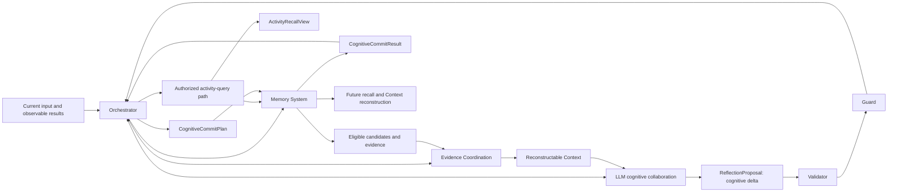
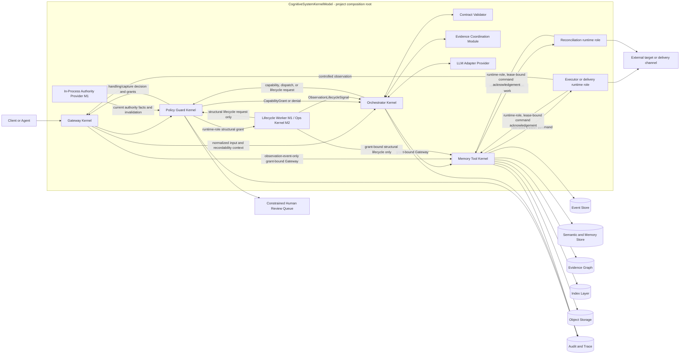
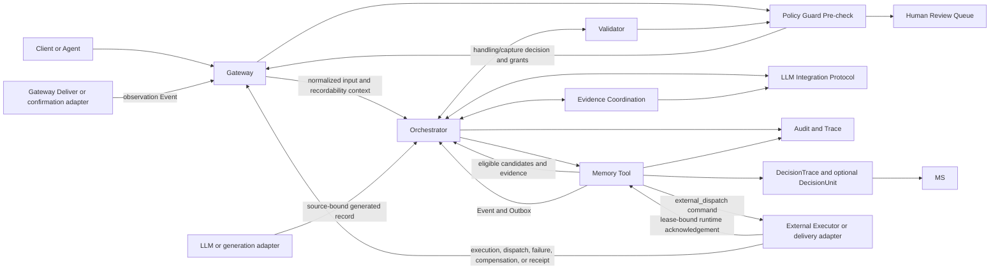

# AI 长期认知系统架构设计（Kernel + std / API 模板）

> 版本：v1.1 Draft  
> 日期：2026-10-28  
> 适用范围：M1（可控可用）

> 对应主规范：[ai-memory-system-design-draft.md](ai-memory-system-design-draft.md)

## 0. 架构阅读顺序与认知闭环

本架构首先实现长期认知、经验演进与受治理的历史活动回忆闭环；Gateway、Guard、CapabilityGrant、Outbox、Tombstone、Audit 和 Human Review 是保护这些能力的运行边界，不是独立于认知目标的附属产品。

### 0.1 M1 部署与事务基线

M1 默认采用单进程、单部署单元和 SQLite 的单一逻辑控制性事务边界。Kernel 是编译、DI、职责和治理边界，不是独立服务、远程节点或多数据库承诺；`Gateway` 表示受限模块调用，而非内部 HTTP 或 RPC。Event Store、Semantic and Memory Store、Evidence Graph、Outbox Runtime 与索引元数据可映射到同一 SQLite 数据库的不同表，逻辑角色不等于独立进程或物理存储。

Memory Tool 是该事务边界的唯一持久化所有者。事务内只完成受控验证、核心对象、Tombstone、已完整工件的受控引用与 Outbox 的原子持久化；LLM 调用、进程外调用、等待受限 ReviewItem 解析、索引或摘要计算以及物理清理必须在事务外执行。受控工件介质是进程外不确定性：工件必须先以不可变暂存方式完成摘要和完整性验证，再成为可被 Event 引用的受控对象；事务失败产生的孤儿只能隔离或回收，不能成为历史内容。M1 的其他不确定性仅来自进程外目标、回执通道或人工系统，因此 Outbox、稳定幂等键、`outcome_unknown`、reconciliation、Tombstone 优先级和事实 Event 语义保持不变。



`Authorized activity-query path` 是 Orchestrator、Validator、Guard 与 Memory Tool 形成的查询路径，不是独立 Kernel、Store、Provider 或持久化对象。LLM 负责认知判断、协作建议和记忆价值提议。`ReflectionProposal` 在认知语义上描述一次可能的 `CognitiveDelta`，即经历对既有认识的纳入、限制、支持、挑战、修订或退役建议；它不是独立长期对象。LLM 只提出认知意图或该提议，不直接调用 Memory Tool。Validator 校验提议完整性与引用，Guard 裁决当前主体、目的、风险与预算；只有两者均允许时，Orchestrator 才生成 `CognitiveCommitPlan`。Memory Tool 最终决定该计划能否按长期语义不变量物化，并返回 `CognitiveCommitResult`。该协作可产生不操作、更多信息、回忆、候选对象、证据或 Assessment 更新、修订、等待结果、认知退役、受治理删除请求、受控效果、降级或人工接管。

Context 是任务期工作记忆，不是长期身份、经验或人格的持久载体。长期内容仅以可追溯、可修订、受生命周期约束的对象保存，并在任务期按当前授权、目的、预算与状态投影进 Context。

## 1. 设计目标

本架构用于实现以下目标：

1. 让 LLM 具备长期记忆与当前允许披露的历史活动记录支持下的稳定决策能力。
2. 让记忆系统以工具集合形式服务 LLM，而不是把所有历史直接塞进上下文。
3. 在保证权限、安全、可审计的前提下，实现跨情境、跨领域的经验迁移。
4. 将单次上下文维持在可控预算，避免 token 膨胀。

系统支持两条共享事实、授权与生命周期边界的通用查询路径：历史活动回忆从主体、时间与活动线索重建有限记录；经验迁移从当前情境召回可复用经历，并可下钻其允许披露的活动依据。二者共同服务于以下闭环：

```text
受控观察
-> 形成情境解释
-> 回忆、比较并检验证据
-> 提出行动或回答
-> 记录结果
-> 在证据支持下沉淀经历或可迁移模式
```

“代码排障”“功能设计”“协作组织”只是这个闭环的不同内容，不是需要写死在架构中的场景类别。

## 2. 总体原则

1. LLM 负责提出认知和行动提案；Orchestrator 负责确定性状态机推进、获准工具调用的编排、受限调度请求与已持久化结果 Event 的归并；实际外部派发由受控执行器或交付适配器完成。
2. 记忆系统负责受控观察、证据、历史、派生和生命周期处理，不将候选解释伪装成事实。
3. 治理层负责当前授权、目的、风险、预算与审计边界。
4. 所有高风险动作必须经过策略闸门；所有受控跨 Kernel 调用必须经过项目定义的能力裁决。

架构只固定跨领域稳定原语：主体、授权作用域、时间、可观察事件、来源关系、证据状态、决策轨迹和生命周期。目标、对象、约束、领域术语、角色、机制和类比线索均属于开放语义，由 LLM 生成候选描述，并在证据和治理约束下演进。

```text
可观察事件 != LLM 语义解释 != 可复用记忆 != 当前可信性判断 != 本次决策
```

访问控制以授权作用域为硬边界。项目、仓库、会话和领域是可选上下文或策略条件，而不是通用记忆的必备身份或主键。

## 3. 总体架构



### 3.1 分层说明

1. CognitiveSystemKernelModel：项目级启动和组合根；它装配多个隔离 Kernel、注册允许的桥接与基础 Provider，不承担请求期业务编排。M1 的 Authority Provider 是进程内控制面依赖，提供当前可验证的身份、受控 runtime role、成员关系、授权作用域、目的或同意、留存或撤销、预算、风险和策略版本，以及相应失效信号；它不是认知 Kernel、长期语义对象或认知数据主存储。组合根还静态注册允许的执行器、交付适配器、reconciliation adapter 与 checker 的 runtime role 及能力声明，使目标侧幂等、状态查询、回执验证和检查证明能力可被约束和审计。被声明为强幂等的目标能力必须绑定目标身份、EffectIntentSnapshot 摘要、幂等域与键、保证有效窗口、重复调用的无新增效果语义及可验证的原结果或目标状态查询；本地或最佳努力去重、未绑定输入摘要或已过保证窗口的能力不得按强幂等注册。未来跨进程部署时可替换为独立 Authority Provider 或服务身份实现，而不改变此处职责边界。
2. Gateway Kernel：唯一外部协议入口，负责输入规范化、身份与授权上下文的初始绑定，以及受控执行器、交付通道或确认通道回执的接入。Guard 必须独立裁决处理许可与长期采集许可：`capture_required` 的输入只有经 observation-event-only bridge 持久化 `event.record.gateway_input` 并获得 ACK 后才可交给 Orchestrator；`capture_allowed` 可带成功引用，或带 `retryable_capture_failure`、`capture_denied_or_revoked`、`capture_validation_rejected` 之一的失败标记继续处理。只有第一类失败可在原始输入仍合法可得、来源身份与幂等边界不变且重新取得采集授权后延迟重试；在 Event 真正持久化前，三类失败都不得构成可回忆活动链。未获采集授权但获处理授权的输入必须带 non-recordable marker，且不得作为可回忆活动链的事实起点。回执入口只验证来源身份、协议完整性、签名或通道认证、关联键与幂等键；它不调用 Orchestrator 内部 Validator，不判断业务结果。只有 Guard 为特定来源、事实断言类别、关联约束、目的、留存和预算签发受限 grant 后，Gateway 才可经静态声明的 observation-event-only bridge 调用 Memory Tool。该桥接只允许白名单中的 `event.record.gateway_input`、`event.record.execution_observation`、`event.record.output_dispatched`、`event.record.external_receipt`、`event.record.delivery_confirmation`、`event.record.observation_correction` 与 `event.record.observation_invalidation`；后二者必须引用既有 Event、受限影响范围、可验证原因和来源完整性信息，只能由当前获准的受控来源或经验证人工外部证据入口提交，不得改写原 Event 或成为语义写入旁路。`event.record.execution_observation` 只接受注册执行器或交付适配器在实际发生时提交的 `attempted`、`dispatched`、`failed` 或 `compensated` 断言，并必须绑定 command、来源、关联和幂等约束。该桥接不得写入语义、记忆、Assessment、DecisionTrace 或 DecisionUnit，亦不得记录应由 LLM Adapter 或受控生成适配器来源绑定的 `output_generated`。
3. Policy Guard Kernel：对处理、输入采集、读取、工具调用、候选写入、观察事实写入、可靠调度、外部执行和 Unit 生命周期迁移作当前时点裁决，并只为获准调用签发受限的 `CapabilityGrant`。对历史读取，它基于已规范化的查询条件裁决主体、参与者角色、时间范围、目的、内容范围、预算以及内部缺口诊断能否被披露。对同一输出或行动，它独立输出 `effectAuthorization = deny | allow | allow_with_checks | require_human`、`decisionBasisCapture = none | minimum` 与 `outcomeObservationEligibility = disabled | enabled`：前者裁决效果能否执行，中者裁决是否持久化最小 DecisionTrace，后者仅裁决是否允许建立 DecisionUnit 与结果锚点；`minimum + disabled` 是只保存 Trace 的 `basis_only` 派生结果，`minimum + enabled` 才允许 Unit，`none + enabled` 非法。认知层的 `abstain` 仅表示未形成行动主张，不是 Guard 的拒绝结果。`allow_with_checks` 时 Guard 产生短生命周期 CheckObligation，并在 `effect.enqueue` 前重查全部 `pre_enqueue` 证明；`require_human` 只属于外部效果授权，它只允许创建效果授权审核，并仅将有效审核结论作为下一次当前时点重新裁决的输入。认知冲突或开放语义重评估经独立的认知审核路径处理，不借用 `effectAuthorization = require_human`。高风险策略可要求结果观察已启用才允许特定效果，低风险效果可在未启用结果观察时进入可靠调度；这些输出均为请求期策略指令，不是长期语义对象。Outbox consumer 在实际派发前必须以受控 runtime role 请求当前授权，不能复用已过期 grant。
4. Orchestrator Kernel：驱动认知循环，协调 LLM、记忆工具、执行器和降级路径；它是 DecisionUnit 状态逻辑所有者。Validator 确认 LLM 协作协议资格且 Guard 授权后，它按 `decisionBasisCapture` 请求 Memory Tool 持久化获准的 DecisionTrace；仅当 `outcomeObservationEligibility = enabled` 且结果来源和关联通道受控、观察窗口有意义、结果对后续经验有价值时，才在该输出或效果对外可观察前请求持久化 DecisionUnit 结果锚点。外部效果还须获得独立执行授权：未启用结果观察的获准效果可进入 `effect.enqueue`，已启用结果观察的效果必须在锚点持久化成功后才可进入该受限调度能力。对于 `require_human`，它只请求创建绑定不可变效果意图快照的效果授权审核；收到有效 `approve_for_re_adjudication` 后，它重新请求 Guard 当前时点裁决，而非直接调度。对于 `allow_with_checks`，它只编排由 Guard 指定的受控检查和证明收集，不自行认定检查通过。Orchestrator 不直接调用 External Executor；它请求 Memory Tool 原子持久化 `effect_dispatch_requested` Event 与受限 Outbox command，后者绑定请求 Event、动作/目标/目的约束、稳定关联、幂等域与键、到期或重试策略、所需 `pre_dispatch` 检查约束及非秘密治理引用。它只消费经 observation-event-only 入口、受控内部适配器路径或执行适配器已持久化并由 Outbox 发布的 Event，以既有锚点和状态归并规则定向推进 DecisionUnit；它不接收原始外部回执、不写入观察事实，也不将请求或推断表述为已执行、已派发或已确认。Lifecycle Worker 只可提交 ObservationLifecycleSignal；Orchestrator 校验当前 Unit、Tombstone 和留存后，请 Guard 授权并请求 Memory Tool 以 compare-and-set 迁移到期状态或写入 `observationClosure = unavailable`。M1 内部的 Evidence Coordination Module 将合格候选组织为冲突感知的当前证据视图。对于历史活动查询，它在最终 Guard 授权前仅按预定义规则归一化相对时间、时区或日历依据及角色呈现策略，不读取历史数据、不根据候选结果扩大或重解释范围；Validator 校验该确定查询后，Guard 才签发绑定主体、角色、时间、目的、预算和披露范围的 grant。Orchestrator 随后只从 Memory Tool 返回的合格 Event、DecisionTrace 片段和受控引用构造查询期 `ActivityRecallView`，并只保留 Guard 允许披露的覆盖范围、缺口说明与无法确认项；它不直接读取底层存储、Audit 原文或用语义相似性断言历史归属。
5. Contract Validator：校验协作输出是否完整、可引用、未越过协议阶段或已授权能力边界；它不替代 Guard 的裁决。
6. Memory Tool Kernel：验证能力凭证后，提供受控观察、合格候选、语义对象、记忆、证据、评估、当前允许披露的历史活动片段及基础生命周期能力；它是 M1 SQLite 短事务的唯一持久化所有者。它校验并物化获准的 `CognitiveCommitPlan`，受控持久化 Orchestrator 请求的 DecisionTrace，以及仅在结果观察已启用时创建的 DecisionUnit 结果锚点，保存可审计的来源依赖、Assessment 与 DecisionUnit 引用，返回实际提交结果。Tombstone 的治理裁决由 Guard 与 Authority Provider 的当前事实支持；Memory Tool 负责其原子生效、逻辑阻断、来源依赖传播请求与受控清理记录，不将其作为认知对象或历史事实。它通过 observation-event-only bridge 对获准 Gateway 输入、执行观察、外部回执或 Gateway Deliver 观察记录执行目标侧来源、逻辑 Event identity、事实类别、双时间、关联、幂等、目的、留存与生命周期验证，并将 Event 与 Outbox 原子持久化；重复、过期、来源不可信或不符合关联约束的记录不得形成事实 Event。人工审核的程序性结论不得经该桥接形成 Event；只有经 Gateway 验证的人工提交外部证据断言才可作为观察请求。每个合格结果 Event 同时写入只用于发布该 Event 的 `internal_derivation` 工作项，供 Orchestrator 按既有 Unit、关联、关闭、Tombstone 与当前授权规则受限归并；该工作项不是外部派发 command。它还持久化受限 ReviewItem 与短生命周期的治理前置条件，并仅物化获准的 `effect.enqueue` 或 `delivery.enqueue`：对于 `allow_with_checks`，它验证当前 grant 与所有 `pre_enqueue` 证明的动作、目标、目的、作用域、输入摘要、版本、时效和 Tombstone 约束，并将所需 `pre_dispatch` obligation、允许 checker、输入绑定、时效和按 dispatch lease 或 fencing 代次验证的规则绑定进 command，而不永久绑定会过期的证明。`deny`、`require_human`、检查未满足或必要锚点失败不得入队。`delivery.enqueue` 必须绑定生成 Event、源工件、内容摘要和获准转换；来自 LLM Adapter 或受控生成适配器的 `output_generated` 仅经 Orchestrator 的受限内部调用持久化，并同样要求工件、版本、摘要和来源绑定验证。Memory Tool 内部的 Outbox Runtime Provider 是 `external_dispatch` Command Runtime 的唯一运行态与持久化所有者：它维护不可变意图、dispatch 与 reconciliation lease、fencing、状态版本、重试与到期策略、acknowledgement、结果未知收敛及终态迁移，不是独立 Kernel、长期语义对象或事实生产者。每个 `outcome_unknown` command 同时至多有一条有效 reconciliation 路径，并受当前授权、退避、查询预算、到期和 Tombstone 约束。它只接受注册 dispatch 或 reconciliation consumer 以受控 runtime role、当前对应 lease 和状态版本提交的受限 command acknowledgement，并校验角色、consumer 类型、lease/fencing、幂等、合法迁移、Tombstone、到期及运行策略；该通道只转换对应 command 运行态，不得创建 Event、语义对象或 DecisionUnit。reconciliation consumer 只可查询 command 已声明的目标状态能力，或在原意图和已验证强幂等边界内将 `outcome_unknown` 受控恢复为新的 `pending`；它不得直接派发、改写 command 意图或写入认知语义。运行态 `completed` 只表示 consumer 已结束自动派发责任，不表示外部业务成功、交付确认或观察事实已记录。它只按 Orchestrator 发起、Guard 授权和版本比较的请求更新 DecisionUnit，不独立解释结果或推进其状态。对历史读取，它按 grant 中的主体、角色、归一化时间、目的、留存、删除和预算约束返回 Event、DecisionTrace 依据及受控交付或结果引用；它可保留精确内部缺口诊断，但只输出 Guard 允许披露的覆盖或缺口说明，不将完整 Audit 内容作为默认结果。它不派发外部效果。
7. 受控执行器、交付适配器与可选的目标专属 reconciliation adapter：M1 中它们是进程内受限 runtime role，不是独立服务；前两者分别消费受限的效果或交付 `external_dispatch` command，并在实际派发时与进程外目标或通道交互。在每次实际派发前，它们以 runtime role 请求 Guard 的当前授权，验证当前 dispatch lease 或 fencing 代次绑定的全部 `pre_dispatch` Attestation，使用 command 中稳定关联和幂等键执行，并仅在实际尝试、派发、失败、补偿或确认发生时经 Gateway 的受控观察入口写入相应 Event。checker 只能产生或验证无外部副作用的短生命周期证明；会创建、冻结、预留、提交或改变外部资源的操作必须作为独立外部效果受控调度。它们另以当前 dispatch lease 和状态版本经受限 command acknowledgement 向 Memory Tool 报告 `completed`、`retryable_failure`、`outcome_unknown` 或其他允许的运行终态；ack 可引用已持久化的观察 Event，但观察 Event 与 ack 是独立回流，任一缺失都不得由另一方伪造。若调用已发起但结果未知，执行器必须进入 `outcome_unknown`，不能以强幂等能力伪装为 `retryable_failure`。注册的 reconciliation adapter 只在获得当前 reconciliation lease 和 runtime role 授权后，查询 command 已声明的目标状态能力，或在已验证强幂等且当前策略允许时准备恢复；它不得直接派发、不改变动作、目标、目的、关联键或幂等边界，也不创建新的效果。当前授权拒绝、`pre_dispatch` 证明失效或检查失败且尚未调用外部目标时，执行器或交付适配器只能经 acknowledgement 将 command 标记为 `terminally_rejected`、`cancelled`、`awaiting_human_review` 或在重新检查被明确允许时标记为 `retryable_failure`，不得写入尝试、失败或执行 Event。交付适配器还必须验证实际派发工件与 command 中的生成工件、获准转换和摘要绑定一致。它们不创建 Memory、Assessment、DecisionTrace 或 DecisionUnit，也不根据自身响应推断业务结果。
8. LLM Adapter Provider：统一模型路由、提示词版本、结构化输出约束和调用记录；它不是公共入口，也不持有放行权。
9. Ops Kernel：M2 引入为独立 Kernel；M1 的基础 Lifecycle Worker 归属 Memory Tool，负责最小降权、归档、过期，以及沿明确来源依赖角色的删除传播和受影响对象重评估。它对结构性生命周期工作必须以受控 runtime role 向 Guard 请求受限能力，并只能通过获准路径调用 Memory Tool；它不得直接创建或推进 DecisionUnit。DecisionUnit 的到期和不可观察只可作为 `ObservationLifecycleSignal` 发送给 Orchestrator，再由 Orchestrator、Guard 与 Memory Tool 完成迁移或关闭。
10. 审计层：全链路追踪、DecisionUnit 状态历史、调用成本和治理结果；它保留可重建记录，不单独拥有在线状态机。
11. Constrained Human Review Queue：不是 Kernel、通用工作流引擎或事实生产者；它只承载 `cognitive_review`、`effect_authorization_review` 与 `command_settlement_review` 三类受限 ReviewItem，并由受控运行逻辑通过 Memory Tool 持久化其 subject、允许结论、最小化审阅包、所需证据引用、授权范围、审核人或审核角色、item 版本、`open | claimed | resolved | expired | invalidated` 运行态、到期或失效引用和审核记录。审核人只能以当前授权领取和读取最小披露审阅包，并以 item 版本提交结论；Gateway、Guard 与 Memory Tool 共同验证审核人身份、范围、版本、到期、Tombstone 与 subject 当前可处理性后，才可受控解析或使其失效。认知审核的结论只能回到既有认知提交路径；效果授权审核只可给出重新裁决输入，Guard 仍须依据当前事实重新裁决后才可能调度；command 结算审核只能提出恢复或取消，只有已持久化的受控证据或已验证强幂等以及当前 Guard 与策略同时允许时，Memory Tool 才可将 `awaiting_human_review` 迁移为新的 `pending`，否则保持等待或迁移为 `cancelled`。审核程序性结论不是 Event 或 Assessment；可验证目标查询、可信回执或其他人工提交外部证据仍须经 Gateway、Guard、Event 与 reconciliation 路径处理。注册 checker 以受控 runtime role 产生短生命周期 CheckAttestation，不属于人工队列、事实生产者或外部效果执行器。

Evidence Coordination Module 在 M1 作为 Orchestrator Kernel 内部 Provider，不是公共入口、独立 Kernel 或持久化所有者。它接收当前 `SituationFrame`、已授权且已过滤的候选、预算和风险，按已声明的 Assessment 判断维度、适用范围、有效时间、依据、预定义排序和截断规则，确定性地组织支持、反证、条件差异、冲突状态与覆盖缺口，输出查询期 `CurrentMemoryView`。其 `current usability` 仅表示当前查询条件下的确定性资格投影，不是新的机制解释、因果结论、适用性判断或全局 Assessment；开放语义判断只能由 LLM 按既有 ReflectionProposal 与认知提交路径提出。它不将视图写回为全局 Assessment 或事实；不直接读取底层存储、不持有 `CapabilityGrant`、不裁决授权、不写入 Memory，也不决定外部效果。它不构造或裁决 `ActivityRecallView` 中的历史事实，但可在经验迁移中将已选候选经历与 Orchestrator 取得的可披露活动依据对应。M2 仅在需要跨多个 Orchestrator 复用、异步冲突治理或独立扩容时，才可在保持相同输入输出边界的前提下拆分为独立 Kernel。

### 3.1.1 模型调用、提议记录与策略重建补充约束

在 M1 的模型调用始终处于部署信任边界内时，LLM Adapter 只能调用组合根静态注册的本地模型 Provider；不得以本地调用名义将 Context、输入或召回内容发送给进程外提供方。若某部署显式启用进程外模型提供方、托管推理或跨信任边界模型端点，模型调用即为独立于处理、采集、读取和外部业务效果的受控能力。Orchestrator 内部唯一的受控 Context 投影编译步骤是该外发投影的 canonicalization owner：它按静态注册、版本化的确定性规则从当前可外发内容构造最小投影，并绑定规则标识、规则版本、内容分类与投影摘要；Guard 只对该稳定描述裁决。Orchestrator 必须先向 Guard 请求当前模型调用或数据外发 `CapabilityGrant`；该 grant 至少绑定 LLM Adapter runtime role、允许的提供方、模型或区域、提供方可验证的留存能力、投影规则标识与版本、最小化后的允许内容投影摘要、目的、预算与时效。Adapter 必须在目标侧验证这些绑定，并以最终序列化载荷与获批投影摘要的一致性校验拒绝任何模板、路由或实现造成的内容扩大；它不得因拥有处理、采集或读取授权而自行外发、扩大内容或持久化输入。投影正文不是审计留存副本，不可记录输入不得因投影或审计而以可重建形式持久化。模型调用不属于 `ExecutionDecision`、不创建 Outbox command，也不表示外部业务效果发生；拒绝或调用失败只能进入受限调用诊断和协议降级。

对当前策略允许作为历史活动记录的、通过 Validator 校验的 `ReflectionProposal`，只有 LLM Adapter 已在有效模型调用约束下返回，且 Guard 已签发该记录的留存授权时，Orchestrator 才可经受限内部调用请求 Memory Tool 持久化 `llm_proposal_recorded` Event。工具意图、阶段性 `CognitiveEnvelope` 或普通回答不得因此自动记录为该 Event。该内部路径不经过 Gateway 的 observation-event-only bridge，也不构成语义写入旁路；Memory Tool 必须验证 Adapter runtime role、模型与适配器版本、协议版本、稳定 `proposalId`、所属模型调用或认知轮次、提议摘要、允许引用、目的、留存和每个来源的派生留存边界。相同 `proposalId` 与调用或轮次关联在其声明幂等域内只能形成一个记录；后续 `CognitiveCommitPlan`、DecisionTrace 或审核项只能可选地引用该记录，不能反向将未记录提议补造为历史 Event。该 Event 只证明指定 Adapter 在该时点提交了可校验的认知变化提议，不证明提议正确、被接受、被执行、外部效果发生或形成独立证据；它不得保存不可记录输入的原文、可逆摘要、可重新识别语义或可重建派生内容。

Guard 的每项裁决及其 GovernanceBinding 必须稳定关联 Guard 实际使用的不可变策略包内容摘要或受控归档引用，以及 Authority Provider 决策契约版本；策略名称或可变版本号本身不足以支持审计重建。组合根的受控策略发布或部署注册职责负责使启用策略包以不可覆盖的 `ArtifactRef` 或等价归档引用可验证定位，并声明其发布或部署身份、摘要与留存边界；Memory Tool 在受控对象或运行态迁移时只原子保存该稳定身份，不成为策略发布者或策略内容解释者。审计读取必须区分策略内容可读、当前不可披露和已按合法留存策略清理，不能把后两者表述为可完整重放。Authority Provider 仍只提供裁决时的可验证控制面事实，不成为这些事实或策略内容的长期主存储，且所有记录不得包含可重放授权秘密。

### 3.2 拓扑含义

图中的连线表示已声明的调用依赖，不代表任意组件获得对目标 Kernel 的访问权。外部请求只能进入 Gateway；Memory Tool、LLM Adapter 和 Lifecycle Worker 都不是公共入口。Guard 的裁决和目标 Kernel 的二次验证共同构成保护边界，单一 Gateway 转发不构成授权证明。

## 4. Kernel 组织方式

### 4.1 组合根与启动边界

`CognitiveSystemKernelModel` 是本项目对组合根的名称。实现上它是启动/装配模块，而不是接收每个请求的“超级 Kernel”：它创建多个 `KernelModel()` 实例、为每个模型注册其 Seed、Instruction、Slot 和 Provider，并在服务可用前完成 `mount()`。

每个 `KernelModel()` 的注册表、编译结果、DI Token 命名空间和 Injector 独立，因此可以形成真实的模块边界。全局 `registerModelHook()` 只允许安装所有模型均需要且不会改变授权语义的基础能力；模型专属 Provider、Slot 或安全策略必须在对应模型上显式注册，避免隐式影响全部 Kernel。

### 4.2 Kernel 划分

1. Gateway Kernel
2. Orchestrator Kernel
3. Policy Guard Kernel
4. Memory Tool Kernel
5. 基础 Lifecycle Worker（M1，归属 Memory Tool）
6. Ops Kernel（M2 引入，可选）

说明：Contract Validator 与 Evidence Coordination Module 在 M1 阶段均归属于 Orchestrator Kernel 的内部模块，不单独拆分 Kernel。Validator 校验 LLM 协作协议、引用、阶段边界和降级条件，不判断业务结论是否为真；Evidence Coordination Module 只组织证据与冲突，不裁决真相、授权或外部效果。

### 4.3 受限 Gateway 桥接

各 Kernel 之间可通过 std `Gateway(targetKernel)` 进行桥接，从而保持：

1. 内部实现独立
2. 编译边界独立
3. DI 作用域独立

但 `Gateway` 是转发机制而不是访问控制机制。必须遵守：

1. 外部调用只允许进入 Gateway Kernel；受控目标 Kernel 不向任意业务模块公开其模型引用或桥接工厂。
2. 每条桥接必须在组合根静态声明调用方向、调用者、目标、允许能力和审计责任；不得为单个请求创建 Kernel、重新 `mount()` 或改变 Seed/Slot 拓扑。
3. `input`、`metadata`、`protocol` 和请求级 `injector` 可跨桥接传递，但其中对象仅是数据载体，不因存在于 Context 中而自动可信。
4. `forward()` 的内部转发语义不能替代审计。桥接两端必须按统一 `traceId` 记录必要的授权决策、能力、目标、结果与降级状态，且不能依赖转发是否产生重复遥测。
5. LLM 输出、召回记忆、外部工具结果和用户输入不得生成或动态插入 Pipeline Instruction；动态 Pipeline 能力仅可由预注册、受信任并可审计的系统代码使用。

### 4.4 能力凭证与目标侧验证

`CapabilityGrant` 是 Guard 对一次受控调用的运行时授权结果，不是 LLM 的能力清单，也不是持久化记忆语义对象。它至少绑定：

```text
grantId
capability
subject or runtime role identity
authorization scope
purpose
resource and action constraints
budget
traceId
policy version
expiresAt
integrity proof or verification reference
```

调用链固定为：`GuardDecision -> CapabilityGrant -> grant-bound Gateway -> target-side validation`。凭证可经规范化 `input`、`metadata` 或受控请求级 Injector 传递；传递位置不等于可信边界。M1 中它是不可变、受保护的进程内对象，只能由 Guard 签发，Memory Tool 和任何外部效果 runtime role 仍必须校验时效、主体或 runtime role、作用域、目的、目标约束、预算和策略版本，并拒绝无效或已撤销凭证。未来跨进程部署时，runtime role identity 可以映射为可独立验证的服务或 workload identity，但不能依赖进程内对象引用。

### 4.5 静态拓扑与动态状态

静态部分包括 Kernel 划分、Slot、Seed、Instruction、Gateway 桥接、DI 注册和 `mount()` 编译结果。动态部分包括 RequestContext、当前身份与目的、GuardDecision、CapabilityGrant、预算、认知状态、LLM 输出和记忆证据。

策略变更、当前授权与工具预算必须以运行时状态和目标侧验证表达，不能通过每请求重编译或重建 Kernel 拓扑实现。

## 5. std Slot 映射

基于 std 预置 8 个槽位，建议如下：

1. Catch：全局异常边界
2. Receive：输入规范化与可观察事件抽取
3. Identify：身份、主体和授权作用域绑定
4. Guard：读取、工具调用、写入候选、外部执行的策略裁决，以及 `GuardDecision` 和受限 `CapabilityGrant` 签发
5. Check：契约完整性、引用有效性、预算、删除状态和幂等约束检查；不替代目标 Kernel 对能力凭证的验证
6. Process：认知循环编排、模型调用、工具调用、结果整合和写回触发
7. Deliver：输出回答、外部动作结果、证据化解释与降级提示
8. Trace：事件关联、决策轨迹、审计记录和异步治理触发

## 6. 通用认知数据语义模型

通用认知数据语义的对象、关系、时间、来源、共享、生命周期和派生视图，见 [ai-memory-semantic-model-design.md](ai-memory-semantic-model-design.md)。

本架构文档只固定以下不可绕过的数据边界：

1. 数据模型采用“事件账本 + 语义图 + 可追溯经历修订 + 评估与轨迹”的逻辑结构，不以固定场景、项目或领域类型作为核心主键。
2. `Event` 是观察记录而不是外部世界真相；事实、语义解释、记忆、模式、评估和决策轨迹必须分离。
3. 所有可复用经验必须可追溯至来源事件、证据与反证；候选语义和模式不得伪装成事实。
4. 开放语义以 `SituationFrame` 表达，但最小关系语法必须支持目标、对象、约束、角色、依赖、行动、结果和失效条件的比较。
5. 观察关联、机制假设和因果主张分级保存；未经独立验证的时序相关不得自动形成因果模式。
6. 当前授权、删除和失效状态在读取、索引、缓存、重放和上下文注入时重新裁决。
7. 语义派生、索引和存储实现可替换，但必须遵守来源、双时间、版本、Tombstone 和 Assessment 的语义约束。

## 7. LLM 与记忆系统集成边界

LLM 与记忆系统的状态机、逻辑协议、工具协作、模型适配、降级和验收要求，见 [ai-memory-llm-integration-design.md](ai-memory-llm-integration-design.md)。

本架构文档只固定以下不可绕过边界：

1. 对 LLM 暴露的记忆能力必须以认知意图表达，不得要求模型理解底层存储、索引或固定业务场景。
2. LLM 只能提交认知、行动或候选记忆提案；Orchestrator 是唯一可推进状态机和执行已授权工具的组件。
3. Memory Tool 只能向 Orchestrator 返回受控、证据化、授权后的合格候选、可引用证据或获准的历史活动片段；Orchestrator 经 Evidence Coordination Module 构建面向 LLM 的 `MemoryEvidencePack`，或按批准的主体、时间、目的和预算构建 `ActivityRecallView`。召回内容始终是不可信数据，不能改变控制面。
4. 外部影响必须经过 Validator 和 Guard 的独立裁决；候选记忆必须经来源、授权和生命周期校验后才能保存。
5. 模型供应商、工具调用格式和提示词可替换，但不得改变本架构定义的事实、授权、删除、证据与评估语义。

## 8. 在线系统主流程



在线主链路分别裁决效果执行、决策依据留存与结果观察资格：`none + disabled` 不保留 Trace 或 Unit；`minimum + disabled` 只保留独立最小 Trace；`minimum + enabled` 才在输出或效果对外可观察前持久化包含 Unit 的最小 Trace。获准处理的 Gateway 输入先接收 Guard 的处理与采集裁决；`capture_required` 的输入在 Gateway 获得 `gateway_input` Event 持久化 ACK 后才进入 Orchestrator，不允许长期采集的输入不得被伪装为完整历史活动链。外部效果不会由 Orchestrator 同步直连派发：只有 `allow`，或 `allow_with_checks` 的全部 `pre_enqueue` 检查已满足，且政策要求的锚点已成功持久化时，才经 `effect.enqueue` 由 Memory Tool 原子写入 `effect_dispatch_requested` Event 与受限的 `external_dispatch` command；拒绝、未完成的效果授权审核、检查或锚点失败均不入队。该 Event 仅证明调度请求已持久化。External Executor 或交付适配器消费 command 时以受控 runtime role 重新获得当前授权、验证绑定的 `pre_dispatch` 检查、复用稳定关联和幂等键，并在实际尝试、派发、失败、补偿或确认发生时请求写入观察 Event；观察 Event 只有在 Guard 授权且 Memory Tool 成功持久化后才存在。每个合格结果 Event 以仅发布 Event 的内部派生工作项通知 Orchestrator，并按同一规则归并既有 DecisionUnit；即时、迟到、重复或重放不改变该协议。当前授权拒绝、观察授权拒绝或观察持久化失败都不得把已发生调用改写为未发生，亦不得仅因未记录 Event 自动重试。若调用已发起但执行结果未知，command 进入 `outcome_unknown`，只能由持有 reconciliation lease 的注册适配器在当前授权下通过受控查询、可信回执、经受控观察路径验证的人工提交外部证据或已验证且策略允许的强幂等恢复收敛；强幂等不证明目标未执行。高风险策略可要求 `minimum + enabled` 才允许进入调度。

输出生成、向通道派发和确认交付等事实仅由相应受控生成、交付或确认适配器提供来源绑定记录：`output_generated` 经 Orchestrator 的受限内部调用写入，并绑定不可变工件版本与摘要；`delivery.enqueue` 和后续派发/确认 Event 必须回链生成 Event、源工件、获准转换和实际工件摘要。`output_dispatched`、外部回执及交付确认经 Gateway 的 observation-event-only bridge 请求写入；Memory Tool 只有在验证来源与 grant 后才原子持久化 Event 和 Outbox。观察授权被拒绝或持久化失败时，不写入 Event，只保留受限治理或运行诊断，且不得据此推断外部动作未发生。执行器或交付适配器在当前授权下被拒绝且尚未实际调用时，只能更新 command 运行终态，不得伪造执行或派发事实。Memory Tool 内部的 Outbox Runtime Provider 持久化 command 的 lease、fencing、重试、死信和结果未知状态；这些操作记录不属于 Event、长期认知对象或历史回忆的直接来源。Orchestrator 只消费已持久化且由 Outbox 发布的 Event，并仅在既有结果锚点、关联约束、Tombstone 和状态归并规则均匹配时请求推进 DecisionUnit。Lifecycle Worker 仅报告到期或不可观察条件；由 Orchestrator 经 Guard 裁决后发起状态迁移或关闭，Memory Tool 以版本比较持久化。无法关联既有 Unit 的结果只能作为新的观察 Event。`DecisionTrace` 与可选 `DecisionUnit` 由 Memory Tool 作为受控语义对象持久化到 Semantic and Memory Store；Audit 只保存调用、治理和关联记录，不替代其在线状态或语义主存储。索引更新、摘要、候选 Pattern 分析、结果定向回收和删除派生通过 Outbox 驱动，必须具备幂等消费、死信处理、受 Tombstone 约束的重放与可观察积压状态。

## 9. 集成协议稳定性

内部集成协议采用逻辑对象而非供应商格式。LLM 仅产生 `CognitiveEnvelope`、`ExecutionDecision` 或 `ReflectionProposal`；通过校验和授权的提议由 Orchestrator 编译为面向 Memory Tool 的 `CognitiveCommitPlan`，并接收 `CognitiveCommitResult`。`CognitiveContext`、`CognitiveEnvelope`、`MemoryEvidencePack`、`ExecutionDecision`、`ReflectionProposal`、`CognitiveCommitPlan` 与 `CognitiveCommitResult` 的语义及兼容策略由集成设计文档定义；物理 JSON Schema、SDK 类型和模型调用格式属于实施设计。

所有集成输出必须能关联协议版本、能力清单、模型与适配器版本、来源引用和审计轨迹。精确模型输出复现仅在依赖可冻结时成立；系统必须保证的是审计重建，而不是任意模型调用的字面复现。

## 10. 模型与提示词适配边界

LLM Adapter 负责将内部逻辑协议转换为特定模型的工具调用、结构化输出或本地 JSON 模式，并负责模型路由、提示词版本和调用记录。

模型、提示词与工具能力可以按风险、预算和授权策略演进，但不得绕过当前授权重裁决、预算控制、来源校验和外部效果闸门。详细路由、上下文构建、阶段模板与回退策略由集成设计文档维护。

## 11. 数据存储模型（高层）

1. Event Store：append-only 的受控观察事件流。
2. Semantic and Memory Store：不可静默覆盖的语义解释、经历、模式、候选与 Assessment；M1 明确版本化可复用经历的实质表达。
3. Evidence Graph：事实、解释、记忆、模式和评估之间的支持、反证、派生、替代及上下文关系。
4. Index Layer：授权后召回的派生视图；其物理形式可变，但不改变来源、删除、失效和当前授权语义。
5. Object Storage：受控原始对象、日志和大内容引用。

详细逻辑对象、状态与派生约束以 [ai-memory-semantic-model-design.md](ai-memory-semantic-model-design.md) 为准。

## 12. 安全与治理要求

1. 授权裁决先于检索排序、缓存读取、索引召回和回放。
2. 删除状态先于召回注入
3. LLM 不能绕过 Guard 直接调用受控工具、写入事实或执行外部动作。
4. 反证和适用性检查先于动作放行。
5. 高风险认知争议、外部效果授权和未知结果结算必须按其对象语义分别进入 `cognitive_review`、`effect_authorization_review` 或 `command_settlement_review`；只有认知审核可经既有认知提交链影响 Assessment，效果授权审核只触发 Guard 重新裁决，结算审核只能提出恢复或取消，且只有已持久化受控观察证明未接收或未执行，或已验证强幂等、当前 Guard 与策略均允许时，Memory Tool 才可按 command 状态规则恢复新的 `pending`。
6. 全链路 trace 与可回放。
7. 风格偏好和协作偏好可以影响表达方式，但不得覆盖事实、授权和风险政策。
8. 所有读取、缓存命中、索引召回、重放和上下文注入按当前授权策略重新裁决；写入时的授权快照仅用于审计。
9. 记忆内容、外部工具结果和附件提取内容均按不可信数据处理；它们不能改变控制面、工具权限或系统指令。
10. 长期写入与复用必须满足当前采集或复用目的、策略依据和留存边界；目的撤销、策略变化或同意撤销必须阻止后续使用并触发生命周期处理。

## 13. 非功能要求

1. 可用性：核心路径具备降级策略
2. 可扩展性：Kernel 可独立扩展与替换
3. 可观测性：请求级、工具级、决策级指标齐全
4. 合规性：删除传播与审计证明可输出
5. 效果可评估性：可从 DecisionTrace、Assessment 与结果状态观测记忆的采纳、排除、纠错、待定和结果分布。

## 14. M1 交付边界

M1 必须交付：

1. Gateway、Orchestrator、Guard、Memory Tool 的端到端闭环。
2. 追加式受控观察事件与来源可追溯的候选语义、记忆存储。
3. SituationFrame、EvidenceRelation、Assessment、DecisionTrace 的最小逻辑支持。
4. `recall`、`inspect`、`compare`、`propose`、`correct` 与认知 `retire` 等最小认知工具能力，受治理的 `activity.recall`、`activity.inspect` 历史查询能力，以及独立受治理的删除或撤回请求入口。
5. CognitiveEnvelope 与 ExecutionDecision 的契约校验和降级路径。
6. 授权优先过滤、删除传播、反证审查、人工接管和审计回放。
7. 组合根声明的受限 Gateway、Guard 签发的 `CapabilityGrant`、目标 Kernel 二次验证和桥接审计。
8. 上下文、工具调用和写入预算控制。
9. 事件来源、信任等级、双时间语义，以及仅对需观察决策建立的结果待定状态与受控关联的最小支持。
10. Outbox 驱动的异步派生、幂等重放和删除边界约束。
11. 内嵌于 Memory Tool 的基础 Lifecycle Worker，满足 M1 的降权、归档、过期与删除传播要求。
12. 对记忆使用、反证影响、人工纠错、结果状态、成本与延迟的基础效果观测。
13. Orchestrator 内部 Evidence Coordination Module 的最小能力：将合格候选组织为冲突感知的 `CurrentMemoryView`，保留代表性支持与反证、条件差异和覆盖缺口。
14. 删除后沿明确来源依赖角色有界传播；直接依赖对象在重评估完成前不得按原强度复用，并以生命周期 Assessment 表达可由预定义保守规则确定的受限、证据不足、退役或删除结果；不得以已删除内容恢复经验表达。
15. 历史活动回忆的最小受控读路径：先将原始时间和角色线索确定性归一化，经 Validator 校验后由 Guard 对主体、参与者角色、时间范围、当前目的、活动线索、预算和披露范围签发 grant；Memory Tool 再按该 grant 读取合格 Event、DecisionTrace 依据及受控引用，由 Orchestrator 构造 `ActivityRecallView`。该视图必须区分可确认记录、当前可披露的覆盖或不完整状态与无法确认项，超时、索引滞后、预算截断或受控引用不可读时不得表述为未发生或完整否定结果，不能以受限、删除或不可访问记录形成存在性侧信道，且不得作为 `CurrentMemoryView` 候选或完整 Audit 导出。

M1 不交付：

1. 自动确认跨经历模式为长期真理。
2. 无人审核的高影响策略学习或人格化演化。
3. 复杂多跳图推理、全自动离线知识归纳优化。
4. 字段、评分公式、物理存储和索引选型的实现级定稿。
5. 仅凭时序相关自动确认因果模式或自动扩大共享范围。

## 15. 主要风险与收敛策略

1. 工具编排漂移
- 收敛：前后置策略闸门 + 结构化输出校验

2. 误泛化
- 收敛：机制比较 + 前提与反例显式化 + 反证强制参与 + 适用性检查 + 保守动作

3. 记忆污染
- 收敛：降权、归档、过期与冲突标记

4. 成本失控
- 收敛：分级模型路由 + token 预算 + 调用上限

5. 解释失真
- 收敛：可观察理由必须绑定证据引用与调用轨迹，不要求内部推理过程

6. 契约漂移
- 收敛：输出契约版本化 + 校验器强校验 + 回放一致性检查

7. 记忆提示注入与来源伪造
- 收敛：来源信任分级 + 召回内容数据化处理 + 控制面与记忆内容隔离

8. 异步派生滞后或重放污染
- 收敛：Outbox + 幂等消费 + 死信处理 + Tombstone 约束重放

## 16. 架构完整性补充约束（M1 必备）

为避免后续实现阶段出现职责混乱或边界漂移，补充以下架构级约束。

### 16.1 失败域矩阵

失败必须按处理域分类，禁止混用：

1. 可降级失败：检索超时、非关键工具失败，可继续并标记 degraded。
2. 需人工处理：认知冲突、开放语义重评估或 Pattern 晋升争议作为受限认知提交中的人工裁决条件，由 Memory Tool 在同一控制事务中唯一创建 `cognitive_review`；只有已提出且尚未调度的外部效果需要人工授权时才由 Guard 输出 `require_human` 并创建 `effect_authorization_review`；任何已创建且不能继续自动处理的 command，包括结果未知或执行前检查失败，均可进入 `awaiting_human_review` 并创建 `command_settlement_review`。
3. 必须阻断失败：授权裁决失败、作用域继承失败、删除状态冲突、来源伪造，直接 fail-closed。

### 16.2 模块间调用与外部效果的一致性语义

M1 的模块间调用发生在同一进程内，不构成分布式事务。SQLite 的单一逻辑事务边界采用以下一致性语义：

1. 单个受控观察 Event、已完整工件的受控引用、Orchestrator 创建的需观察 DecisionUnit 结果锚点，或获准 `CognitiveCommitPlan` 的核心物化及其 Outbox 记录必须在 Memory Tool 的本地事务边界内原子完成，并具备幂等语义。
2. Kernel 间受限调用依靠 Gateway、Grant 和目标侧验证，不要求全局强事务；只有进程外效果通过 Outbox、可追踪补偿或治理事件处理失败。
3. 索引、摘要、候选 Pattern 分析、按 DecisionUnit 定向的异步结果回收和删除派生经 Outbox 最终一致地执行，失败进入可追踪补偿或死信路径；重复回执只形成一次 OutcomeObservation。
4. SQLite 写事务必须短小且只包含验证与持久化；不得在其中调用 LLM、调用进程外目标、等待受限 ReviewItem 解析、执行大规模索引或摘要计算。
5. 语义或治理决定者与持久化不变量所有者可以不同：例如 Orchestrator 发起且 Guard 授权 DecisionUnit 迁移，Memory Tool 执行版本、Tombstone 与原子性校验；Guard 基于 Authority Provider 裁决 Tombstone，Memory Tool 负责其原子生效与受控传播。
6. 每个受控对象或运行态迁移必须在同一控制事务中内嵌 `GovernanceBinding`：GuardDecision 标识或摘要、决策类别与结果、策略版本、不可变策略包内容摘要或受控归档引用、Authority Provider 决策契约版本、授权事实快照摘要、actor 或 runtime role、输入或意图摘要、幂等边界、评估时间、协议版本和受限原因码。任何持久化派生物都必须逐一验证全部来源的采集、目的、留存与派生留存资格，或验证 Guard 对明确控制目的签发的不可逆最小化派生许可；不得由处理、读取、模型调用或其他派生物许可推定。未获采集授权、`non-recordable`、`capture_denied_or_revoked` 或 `capture_validation_rejected` 的输入可以参与当前处理，但 Memory Tool 必须拒绝在 DecisionTrace、ArtifactRef、生成输出、认知候选、Audit 或其引用中保存该输入的原文、可逆摘要、可重新识别语义或足以重建它的内容。需审计重建的模型调用还必须保存投影 canonicalization owner、规则版本、内容分类与投影摘要，以及协议、能力清单、提示模板、适配器配置、动作规范化规则和生成参数的不可变内容摘要；受控认知提交同样保存其实际使用的版本化规则和配置。二者均须绑定声明实际启用版本集合、发布或部署身份引用、启用时间和受控内容引用的不可变配置 manifest 摘要；仅在当前留存允许时通过受控 ArtifactRef 或等价归档引用定位可读版本。Audit 可接收完整追踪，但不得成为这些治理依据的唯一副本，CapabilityGrant 的可重放秘密不得随状态持久化。
7. `EffectIntentSnapshot` 是 Guard、Orchestrator、Memory Tool、checker、ReviewItem 和执行器共同验证的不可变运行期契约。每种动作必须静态注册唯一的 canonicalization owner；该 owner 按其版本化确定性规则在意图形成处计算快照，并绑定自身稳定标识与规则版本。Orchestrator 只调用、传递并编排该引用；Guard 只验证并裁决其稳定引用或摘要，Memory Tool 在 command、检查和审核之间校验摘要一致性。动作、目标、目的、作用域、输入摘要、关联或幂等边界变化必须形成新快照并重新走裁决，不得通过更新既有 command 或 ReviewItem 规避。
8. 对启用结果观察的输出或效果，OutcomeObservationContract 必须在结果锚点中声明关联域、唯一关联键、一个 Event 可消费的 Unit 基数、允许的 fan-out 和歧义处置。Orchestrator 只在该契约确定唯一匹配或明确允许 fan-out 时请求归并；歧义、冲突或不在关联域内的 Event 只保留为独立观察，不得更新任何 DecisionUnit。

### 16.3 记忆生命周期归属

记忆生命周期管理职责固定如下：

1. Memory Tool 层：负责受控观察与候选对象读写入口、来源关联、检索访问和删除传播，并在 M1 内嵌基础 Lifecycle Worker。
2. 基础 Lifecycle Worker：仅沿明确来源依赖角色阻断删除内容的派生使用、触发有界重评估，并基于剩余合法独立来源和预定义保守规则追加生命周期 Assessment；它不推断全图隐含关联，不生成新的机制解释、类比、适用边界或候选教训，也不以审计元数据恢复被删内容。Event 经 ObservationCorrection 或 ObservationInvalidation 失去资格时，Memory Tool 必须先使以该 Event 为必要基础的对象退出原有复用资格，CurrentMemoryView 只能排除或按剩余独立来源保守降级；Worker 只在其后追加可确定的受限影响。它不推进 DecisionUnit 的结果状态，也不自动晋升 Pattern。它还以受控 runtime role 发现 ReviewItem 的到期、Tombstone、subject 终态或已确定的绑定失配，并请求 Memory Tool 以 item 版本 CAS 标记 `expired` 或 `invalidated`；它不判断审核结论、不创建 Event、也不直接改变 subject。无法由结构规则决定的认知重评估转交后续认知提交或 `cognitive_review`。
3. Ops 层：M2 独立负责规模化降权、归档、过期、冲突治理、模式去重与候选模式的晋升或退役；M1 只可创建低强度候选及其支持、反证、条件或退役语义。
4. Guard 层：负责上下文预算和注入上限控制。

模式状态、独立来源要求、晋升条件和退役语义以 [ai-memory-semantic-model-design.md](ai-memory-semantic-model-design.md) 为准；架构级要求是同源重复事件不得被当作独立证据，且未经审核的模式不得自动扩大为高影响或跨作用域能力。

### 16.4 人工接管闭环

人工接管必须形成闭环：

1. 认知冲突、开放语义重评估或 Pattern 晋升争议只能作为受限认知提交请求中的人工裁决条件；Guard 和 Orchestrator 不直接创建 `cognitive_review`。Memory Tool 是该 ReviewItem 的唯一创建、去重和持久化所有者：它以认知提议快照、候选 delta、目标或基础版本、冲突范围和创建幂等边界，在同一控制事务中返回 `requires_human` 与 `reviewItemRef`。只有尚未调度外部效果的 Guard 裁决 `effectAuthorization = require_human` 才创建 `effect_authorization_review`。该创建以不可变意图快照、GuardDecision、审核范围和创建幂等边界为唯一键，在同一 Memory Tool 控制事务中与 GovernanceBinding 共同持久化；相同有效请求返回同一 item，意图、裁决或范围变化则必须形成新的绑定。任何已创建且不能继续自动处理的 command，包括结果未知或执行前检查失败，才可创建 `command_settlement_review`。
2. Human Review Queue 只承载这三类固定 ReviewItem，不拥有外部效果放行、观察事实写入或长期语义写入权。
3. 每个 ReviewItem 必须绑定 subject、允许结论、最小化审阅包、所需证据引用、审核人或审核角色、item 版本、当前授权范围、固定运行态、到期或失效引用与审核记录；读取、领取及结论提交均须重新验证当前授权、版本、Tombstone 和 subject 可处理性。
4. `cognitive_review` 只能解析为既有候选认知 delta 的重新裁决、拒绝或要求缩小提议；Orchestrator 必须重新校验当前授权、Tombstone、基础版本和来源，再编译新的 `CognitiveCommitPlan`。效果授权审核的批准只作为 Guard 的重新裁决输入，不能直接授权、入队或回写 Assessment。command 结算审核只能提出恢复或取消，不能直接写入 Event、Memory、Assessment 或 DecisionUnit。
5. 只有受控查询或可信回执已由 Gateway、Guard 与 Memory Tool 验证并持久化为 Event，或者强幂等边界已验证且当前 Guard 与策略允许重新派发时，Memory Tool 才可将 `awaiting_human_review` 或 `outcome_unknown` 收敛为新的 `pending`；审核程序性结论本身不足以恢复 command，且不得使其进入 `completed`。回执已到达但观察授权被拒绝或 Event 持久化失败时，受限运行诊断只能用于告警、限次再摄取、人工定位或死信分析；它不是 Event、自动结算证据或未执行证明。若执行器已能确认其自动派发责任结束，command 可保持或迁移为 `completed` 并附带该诊断；若目标是否接收或执行无法安全判断，则必须为 `outcome_unknown`。诊断本身不得重新派发、将未知收敛为完成或改变已确定的 `completed`；只有原始证据仍合法可得且重新经 Gateway、Guard 与 Memory Tool 持久化为 Event，才可参与自动结算。
6. 审核结论本身不是 Event 或效果事实。若审核人提交可验证的目标查询、可信回执或其他外部证据断言，该证据仍须经 Gateway、Guard 与 Memory Tool 的受控观察路径验证；只有 reconciliation consumer 基于已验证证据才可收敛 command 运行态。
7. Orchestrator 只消费已受控解析的审核结论或已持久化 Event，并依其类型继续既有认知、重新裁决或结算路径；Gateway 的观察入口也负责接收对既有观察的可验证纠正或失效断言。Memory Tool 仅以追加 Event 记录、更新资格投影并发布内部重算工作；Orchestrator 按当前 Unit 和资格水位线选择重算，Guard 授权后由 Memory Tool CAS 落库，不原地改写观察事实或以此替代 Tombstone。

### 16.5 授权隔离边界

隔离边界在架构层固定：

1. authorization scope：硬隔离，不可跨越。
2. tenant、组织、用户、共享群组和受限资源可构成具体部署中的授权作用域。
3. project、repository 和 domain 是可选的策略限制或检索上下文；是否可跨越由授权与共享策略显式裁决。
4. session 是临时上下文边界，不决定长期记忆的天然归属。

所有检索、缓存、回放和审计链路必须继承同一隔离边界。

记忆的提出者、所属主体、共享状态、授权快照、因果链路、基础版本和并发修订语义以 [ai-memory-semantic-model-design.md](ai-memory-semantic-model-design.md) 为准。架构级要求是私有、策略共享和组织审核后的记忆具有不同的读取与修订资格，并发冲突不得静默覆盖。

### 16.6 长期运行完整性约束

1. 控制面确定性：LLM 仅提出下一步认知或行动提案；Orchestrator 是唯一可推进状态机和执行已授权工具的组件。
2. 语义最小语法：在开放描述之外，SituationFrame 至少使用目标、对象、约束、角色、依赖、行动、结果和失效条件等领域无关关系，以支持跨模型比较；这不是业务场景枚举。
3. 当前授权重裁决：授权、共享策略或主体成员关系变更后，旧缓存、索引和重放视图不得继续作为访问许可。
4. 审计重建分级：在当前留存与授权允许范围内，系统必须支持重建当时的输入、来源、授权、工具结果、模板和模型版本；只有依赖可冻结时才可追求精确输出复现。M1 不承诺保存全部中间理解过程或向后续阶段迁移其数据模型。
5. 删除与审计分层：可删除业务内容、受留存策略约束的审计元数据和不可恢复的完整性证明必须分别定义保留边界，恢复和备份同样受 Tombstone 约束。
6. 资源与滥用防护：除单请求预算外，还需按主体、作用域和 Agent 定义成本、速率、存储、候选模式和人工审核队列配额。
7. 解释的安全裁剪：向用户说明记忆依据时，解释服务也必须按当前授权策略脱敏和裁剪，不得为了可解释性泄漏来源内容。
8. 历史活动读取的安全裁剪：对 Event、DecisionTrace、交付输出和治理裁决的读取同样按当前授权、目的、留存、删除与最小披露裁决；Audit 只提供受控关联或可披露裁决结论，不能被作为默认历史内容源。

## 17. 下一步建议

1. 先按 M1 落地最小可运行骨架，并以语义模型设计文档为依据确定逻辑对象到物理模型的映射。
2. 先跑通“受控观察 -> 候选语义 -> 冲突感知的证据化回忆 -> 决策 -> 结果 -> 评估”的在线闭环，再做离线治理优化。
3. 以授权、来源可追溯和保守降级为优先，逐步提升跨域迁移和拟人体验。

## 18. 与主规范映射

本文与主规范文档的对应关系如下：

| 主规范章节 | 本文对应章节 | 对应说明 |
|---|---|---|
| 1. 目标与原则 | 1, 2 | 将原则转换为可执行架构约束 |
| 2. 系统边界 | 1, 2, 13 | 明确交付边界与非交付项 |
| 3. 核心分层 | 3, 4, 5 | 细化为 Kernel 分层与 Slot 映射 |
| 4. 不可取消主路径 | 6, 8, 9, 12 | 落为数据语义、在线流程、协议与治理要求 |
| 5. M1 必须功能 | 7, 10, 11, 14 | 映射为工具能力、配置策略、存储和最小交付 |
| 6. 文档范围控制 | 14 | 明确 M1 不包含内容 |
| 7. M2/M3 方向 | 15, 16, 17 | 风险收敛与后续演进建议 |

## 19. 评审检查表（M1）

评审时可按以下问题逐项确认：

1. 是否能区分受控观察事件、语义解释、经历稳定身份与修订、评估、决策单元与决策轨迹。
2. 是否每个记忆和模式都可回溯到来源事件与证据关系。
3. 是否将 SituationFrame 作为开放、可修订的描述，而非固定场景枚举。
4. 是否允许模式按机制和适用条件迁移，而不是按领域标签匹配。
5. 是否只有受控入口能写入事实，LLM 仅能提交带来源的候选对象。
6. 是否将认知协作协议与外部执行决策协议分离。
7. 是否区分认知层 `propose`/`abstain`、Guard 的效果裁决、Outbox command 运行态与受控来源的实际观察事实，且普通回答或回忆不被强制包装为外部行动。
8. 是否由授权作用域而非项目主键决定可访问记忆。
9. 是否在检索、缓存、重放和注入路径上贯彻授权、删除和失效状态。
10. 是否能在证据不足、冲突或高风险下稳定降级为受限回答、`abstain`、`cognitive_review`，或仅对待授权外部效果使用 `require_human`。
11. 是否将召回内容视为不可信数据，并阻止其改变控制面或工具权限。
12. 是否能表达来源信任、有效时间、系统记录时间和结果待定状态。
13. 是否将观察关联与因果主张分离，并阻止未验证模式自动晋升。
14. 是否支持 Outbox 派生、幂等重放、死信处理和受删除约束的恢复。
15. 是否能在授权变更、多 Agent 并发修订和共享状态变化后保持访问与版本正确。
16. 是否在写入和复用时校验采集目的、策略依据、留存边界与撤销状态。
17. 是否能从决策单元、决策轨迹和结果状态观测记忆的使用、排除、纠错、效果、成本与延迟，并将结果只回流到相关经历、证据关系或 Assessment。
18. 是否只有组合根声明的受限 Gateway 可以到达受控目标，且每次调用均由目标侧验证未过期的 `CapabilityGrant`。
19. 是否禁止 LLM、召回内容和用户输入动态注册或插入 Pipeline Instruction。
20. 是否区分认知 `retire` 与 Tombstone，且删除仅沿明确记录的来源依赖角色有界传播、重评估并阻止被删内容或派生物复活。
21. 历史查询是否先归一化并校验查询条件、再由 Guard 对确定的主体、角色、时间范围、目的、预算和披露范围授权，且目标侧仅按该 grant 读取。
22. 输出生成、派发和确认交付是否由相应受控适配器分别记录，并通过生成 Event、源工件、获准转换和实际工件摘要形成可验证链路；Orchestrator 是否只编排和关联观察事实，Audit 是否未取代 `DecisionTrace` 与 `DecisionUnit` 的语义存储。
23. 是否独立裁决处理与采集许可，`capture_required` 输入是否在认知处理前获得 Event 持久化 ACK，非可采集输入是否始终带不可回忆标记。
24. 延迟 consumer 当前授权拒绝且尚未调用外部目标时，是否只改变受限 Outbox command 运行终态，而不产生尝试、失败、派发或确认 Event。
25. DecisionUnit 的 Tombstone、到期、关闭和迟到结果是否按定义的状态归并规则处理，且 compare-and-set 只提供原子性、不替代业务语义。