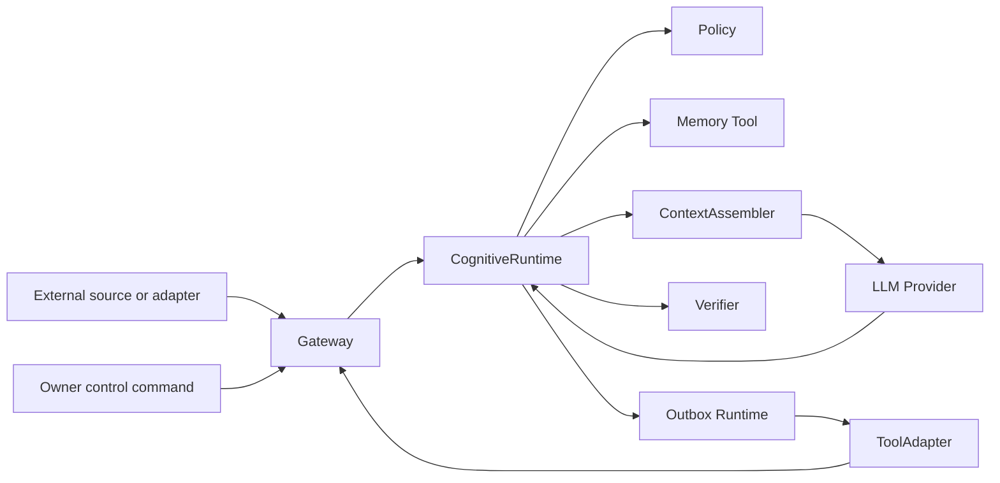

# 持续认知 Runtime 架构设计

> 本文是部署、组件、事件处理、控制面、事务、Provider、ToolAdapter、Outbox 与故障边界的唯一规范性来源。对象字段与状态语义以 [ai-memory-semantic-model-design.md](ai-memory-semantic-model-design.md) 为准。

## 1. 部署与边界

系统运行在单一本地进程、单一 CognitiveRuntime 与单一 SQLite 逻辑事务边界内。它不是多租户、分布式服务或外部主体的代理容器。

认知链为：

```text
Source -> SourceCapture -> Event / Artifact -> Derivation
-> Claim -> ApplicabilityAssessment -> CurrentView
-> ContextItem / ResponseProvenance
```

ExternalInput 是唯一认知处理入口。系统没有内部调度器、定时唤醒器或后台自行生成的任务；外部平台、工具、用户、Owner 或外部定时资源都必须通过 Gateway 提交输入。外部 worker、定时器或平台回调也可通过 Gateway 的受控维护入口驱动投递、协调、刷新或清理，但维护入口不触发认知处理或 Provider 推理。

Owner 的普通消息与其他 ExternalInput 走同一认知路径。Owner 的认证控制命令走独立控制面，不进入 LLM Provider。

## 2. 架构不变量

1. Memory Tool 是所有认知对象、RuntimeState、Tool、依赖索引、Tombstone、授权代次、Outbox、效果尝试与本地交付状态的唯一持久化所有者。
2. CognitiveRuntime 是唯一编译 Context、选择 Provider、验证 Proposal、推进处理循环和请求后果提交的组件。
3. Policy 是唯一的授权与控制裁决者；它不生成 Claim、不执行推理、不访问 SQLite，也不成为事实主存储。
4. Gateway 是 ExternalInput、OwnerControlCommand、MaintenanceInvocation、ToolAdapter 回执与外部结果的唯一入口。Provider、适配器、Verifier 与 Executor 不能直达存储。
5. LLM Provider 只接受 InferenceRequest、当前 ToolManifest 和 ToolResult，并返回 InferenceProposal。它没有数据库、授权、状态推进、直接工具执行或调度能力。
6. ToolAdapter 必须静态注册，且只能提交输入/回执或执行已批准的效果；高频来源必须按静态 IngressProfile 在接入侧完成采样、聚合、去重或阈值筛选，并携带归约元数据。它不能读取 Context、直接写入 Memory Tool、扩大能力或调用其他适配器。
7. Tombstone 在事务内优先生效，并立即阻断读取、索引、缓存、派生、CurrentView、Context、状态引用、ResponseProvenance 和未尝试 Outbox command。
8. 长事务内不调用 Provider、不调用外部目标、不执行昂贵索引、不重建投影，也不运行物理清理。

## 3. 组件与调用方向



### 3.1 Gateway Kernel

Gateway 认证 ExternalInput 的调用者、来源身份、协议完整性、关联键、顺序键与幂等键。它区分两类请求：

```text
ExternalInput
OwnerControlCommand
MaintenanceInvocation
```

ExternalInput 包含来源、输入摘要、输入载荷或 Artifact 引用、目的、关联键和幂等键。对经 IngressProfile 归约的输入，Gateway 还验证归约模式、窗口、事件计数与摘要 schema；它不得将有损摘要伪装成逐条原始观察。对于允许留存的对话来源，Gateway 还可提交有序 ConversationTurn 捕获候选，但当前 SessionWindow 不因此自动持久化。Gateway 不把 Owner 身份本身视为事实、纠错或执行命令。

OwnerControlCommand 必须是独立认证的结构化操作，包含目标、范围、预期授权代次、操作类型和幂等边界。它只可执行策略、能力、留存、Tombstone、来源限制、生命周期或紧急中断等控制面操作。

本地白盒管理界面或 CLI 必须通过认证 OwnerControlCommand 与 Memory Tool 执行记忆查看、搜索、纠错、范围限制、降权或删除；它不得直接修改 SQLite 核心表。Owner 对记忆的修订仍产生新的 Assessment、Correction、SourceRestriction 或 Tombstone，而非无痕改写历史对象。

MaintenanceInvocation 是经认证、幂等且范围受限的外部维护调用，只可请求 `outbox.dispatch`、`outbox.reconcile`、`projection.refresh`、`retention.cleanup` 或恢复校验。`retention.cleanup` 也负责清理超过 retentionBoundary 的 ConversationSession、ConversationTurn 与 ContextAnchor 内容和索引；它必须保留不可解析的 anchorRef 记录，不能改写引用该锚点的 Claim。它不创建 ExternalInput、不调用 CognitiveRuntime、ContextAssembler 或 Provider，也不自行扩大读取、留存或效果权限。

生命周期命令按 RuntimeLifecycle 状态机执行。Gateway 将它们交给 Policy 和 Memory Tool 处理，绝不调用 CognitiveRuntime、ContextAssembler 或 Provider；进行中的认知处理、状态提交和效果执行在各自提交边界比较当前生命周期与授权代次。

Gateway 不调用 Provider、不写入长期对象、不判断业务语义。

### 3.2 CognitiveRuntime Kernel

CognitiveRuntime 是一次 ExternalInput 的唯一协调者。其固定流程为：

```text
接收 Gateway 规范化输入
-> 请求 Policy 裁决捕获、读取、披露、状态与效果范围
-> 请求 Memory Tool 提交合格捕获或建立任务期输入
-> 对可验证的 ToolAdapter 回执、超时或健康检查更新对应 Tool.availability
-> 获取当前 RuntimeState、有界 CurrentView、当前 SessionWindow 与当前 Tool 控制记录
-> ContextAssembler 生成 ContextSnapshot 与当前 ToolManifest
-> 选择已注册 InferenceProvider 并发送 InferenceRequest
-> 验证 InferenceProposal 中的 ToolCall
-> 执行获准工具并产生绑定当前轮次的 ToolResult
-> 以新轮次重建 SessionWindow、ContextSnapshot 与 ToolManifest 后回传 Provider，直至轮数预算耗尽
-> 请求 Verifier、Policy 与 Memory Tool 接受、限制或拒绝后果
-> 返回输出、提交状态、创建 EffectIntent 或受限结束
```

每次处理具有固定的输入大小、候选数、派生输入数、推理轮数、Context token、效果数和处理预算。每次 Provider 调用都绑定唯一 `requestId`、`roundId`、ContextSnapshot 与 ToolManifest；ToolResult 后生成的新轮次不得复用旧 Proposal、ToolCall、快照或清单。Runtime 不自行重试失败推理、不制造后续任务，也不把 Provider 的建议当作命令。Tool 的可用性到期只在本次处理编译 ToolManifest 或处理相应回执时惰性重评估；它不创建内部唤醒任务。

### 3.3 Policy Kernel

Policy 从本地控制面读取当前授权、授权代次、目的、来源范围、留存、披露、预算、风险、Tool、Provider 身份与效果边界。它签发单次、目标绑定的 CapabilityGrant，并独立裁决：

```text
source.capture
observation.record
artifact.record
derivation.record
claim.record
assessment.record
runtime-state.transition
current-view.read
inference.invoke
tool.call
response-provenance.record
response.emit
effect.enqueue
effect.execute
tombstone.apply
source.restrict
correction.record
owner.control.apply
```

授权某项操作不自动授权相邻操作。`owner.control.apply` 只对 Gateway 已认证的 OwnerControlCommand 生效；Owner 的普通 ExternalInput 不获得该能力。

### 3.4 Memory Tool Kernel

Memory Tool 在目标侧复验 grant、当前授权代次、Tombstone、来源资格、输入资格、派生链、条件 schema、引用完整性、幂等边界和对象不变量，并独占所有长期持久化事务。它只在来源、目的、披露与 retentionBoundary 均允许时写入 ConversationSession、ConversationTurn 和 ContextAnchor；记忆对象保存引用而不复制整个会话。

读取时，Memory Tool 先规范化或拒绝 MemoryQueryPlan，并按 Runtime 身份、目的、来源、Tombstone、留存、时间、稳定引用、资格代次和授权代次缩小候选；之后才执行受限混合检索、确定性重排和预算内适用性补足，计算有界 CurrentView。请求 `memory.detail.get(context_window)` 时，它只能从当前卡片允许的 ContextAnchor 解析连续、有限的 ConversationTurn 窗口，并返回省略说明或不可用状态；锚点失效、已过 retentionBoundary、受限或 Tombstone 时不得展开。它只返回安全化投影、冲突、未知覆盖、截断说明和依赖指纹，不能向 ContextAssembler 泄漏未授权内容。

对 correction Event、SourceRestriction、Tombstone 或 OwnerControlCommand，Memory Tool 在短事务中持久化受控记录和相应资格/授权代次。它不在事务中重建 Context、调用 Provider、遍历无界依赖或逐项修改历史对象。读取与使用时始终按当前规则和代次判定资格。

### 3.5 ContextAssembler

ContextAssembler 是 Runtime 的确定性任务期组件。它只使用当前 SessionWindow、Memory Tool 返回的 CurrentView、当前 RuntimeState 摘要、已获准 ExternalInput 和安全化 ToolResult 创建 ContextSnapshot 与 ContextItem。默认 ContextItem 必须以紧凑 MemoryCard 交付摘要、相关性、适用性、不确定性、截断说明和详情可用性；带 ContextAnchor 的卡片也只声明 `context_window` 是否可用，不主动注入历史完整会话。需要细节时 Provider 只能通过当前 ToolManifest 中的 `memory.detail.get` 请求受限展开。它不能调用 Provider、直接读取 SQLite、重新水合 Tombstone 内容、选择 Provider 或扩大披露范围。

### 3.6 InferenceProvider

InferenceProvider 是静态注册的无状态边界。Runtime 随 InferenceRequest 提供当前 ToolManifest；Provider 可选择其中的 ToolCall，但所有调用均由 Runtime 在目标侧验证和执行：

```text
InferenceRequest -> InferenceProposal
```

Provider 注册项至少包含：

```text
providerId
modelId
modelDigest
protocolVersion
contextLimit
structuredOutputSupport
enabled
```

Runtime 在一次处理开始时固定 Provider、模型摘要和模板摘要。Provider 切换不影响长期记忆、RuntimeState、权限或 ToolAdapter 行为。所有 Provider 必须位于本地信任边界内；Context、输入和召回内容不得通过 Provider 路径出站。

### 3.7 Verifier

Verifier 只检查来源身份、捕获完整性、版本/路径/范围、Derivation 输入摘要、条件类型、状态转移依据、Tool 约束和可检查外部状态。它输出验证证据或失败原因，不能认证 Provider 语义、决定 grant 或执行效果。

### 3.8 ToolAdapter 与 Outbox Runtime

ToolAdapter 由静态 Adapter Registry 注册。每个适配器声明输入模式、观察模式、回执模式、可执行动作、目标身份规则、输入 schema、风险级别、幂等策略、结果验证器与可选 IngressProfile。每个可用工具绑定由单一 Tool 记录持久化其结构、生命周期与当前可用性；Runtime 只把 `lifecycle = active`、可用性允许且经当前策略获准的 Tool 描述符放入 ToolManifest。

ToolAdapter 的可验证回执、超时、重试边界或健康检查只能由 Runtime 更新对应 Tool 的 `availability` 字段。Provider 选择工具、ToolCall、ToolResult、Claim、纠错与普通 ExternalInput 均不能改变 `lifecycle`；`disabled`、`retired` 或恢复生命周期只能经认证 OwnerControlCommand、Policy 和 Memory Tool 处理。Provider 可选择描述符和参数，但适配器只接收通过验证的 EffectIntent。

Outbox Runtime 只处理已提交 EffectIntent。它按语义模型定义的状态机获取 lease、执行派发、写入尝试、关联回执并协调未知结果。它不能改变 Claim、RuntimeState 或授权；所有结果都通过 Gateway 作为 ExternalInput 回流。

## 4. 事务与状态提交

SQLite 中可以使用不同表保存认知对象、RuntimeState、Tool、控制面、Provider Registry、Adapter Registry、Outbox、尝试、回执与索引元数据；它们不代表独立服务。认知对象的当前物理投影使用版本化宽表与 `meta_json`：MemoryAddress 中稳定、常用的维度映射为注册生成列和 B-tree 索引，其余结构化标签保留在 `meta_json`；同一受控投影可维护 FTS5 全文索引与 sqlite-vec 向量索引。Memory Tool 以固定参数化查询形状合并这些索引的候选，并使用版本化、可追溯的确定性重排规则输出有限结果。

EmbeddingProfile 由 Runtime 静态注册，绑定模型摘要、向量维度与归一化规则。切换 Profile 时，外部维护先在事务外重建并验证对应 sqlite-vec 索引，再由受控配置原子切换活动 Profile；不同 Profile 的向量不得混合查询。重建、验证或切换失败时，先前活动 Profile 必须保持可读；每次查询固定读取一个活动 Profile 快照，不能观察到部分或混合索引。索引不可用、过期或版本不匹配时，Memory Tool 跳过向量候选并保留词法、时间和元数据检索。

物理索引只服务候选定位，不能保存独立的可用性结论。索引刷新、延迟或失败最多改变召回覆盖和排序，不能使已 Tombstone、受限、过期或无授权对象重新可见；每次读取均以当前主记录、资格和授权代次复验。宽表映射与索引维护不得绕过对象不变量、Tombstone、授权代次、来源引用或受控写入路径，也不要求图遍历或由 Provider 直接访问 SQLite。

短事务只允许：

```text
grant 目标侧验证、授权代次比较与消费
SourceCapture、Event、Artifact 和治理绑定的原子写入
Derivation、Claim、ApplicabilityAssessment 和治理绑定的原子写入
RuntimeStateTransition 与当前状态引用的原子推进
Tool 可用性字段与对应可验证回执的原子更新
Tombstone、范围限制、纠错或控制命令及其资格代次的原子写入
ResponseProvenance 与本地交付请求的原子写入
EffectIntent、Outbox command 与 effect_dispatch_requested 的原子写入
Outbox 状态、尝试、回执和协调结果的原子写入
```

Provider 调用、外部调用、Artifact 暂存、完整性计算、验证、索引、投影重建、物理清理和恢复校验都在事务外执行。提交失败后的暂存物只能隔离或回收，不能成为长期输入。

Runtime 接受状态转移或效果意图前，必须比较 ContextSnapshot 指纹、RuntimeState 预期版本、资格代次与授权代次。任一不匹配即丢弃 Proposal 后果并从当前合法输入重新处理。

## 5. 控制面与审计

CapabilityGrant 必须为：

```text
single-use, capability-bound, purpose-bound, scope-bound,
target-bound, expiry-bound, authority-revision-bound, transactionally consumed
```

`authorityRevision` 是控制面对撤销、目的、范围、风险、Provider 注册资格或效果边界的单调版本。Memory Tool、CognitiveRuntime、Outbox Runtime 与 Executor 必须在消费 grant、读取投影、提交状态、输出、入队或执行效果前比较当前版本；不匹配即拒绝。

每项持久化写入都绑定非秘密 GovernanceBinding、操作角色、输入摘要、幂等边界和时间。GovernanceBinding 至少能稳定定位：

```text
immutable policy content digest or controlled artifact reference
authority-contract identity
non-secret decision-fact digest
decision timestamp
```

审计记录支持重建和检查，但不扩大读取权限，也不是唯一授权事实。

## 6. 输入、输出与效果

### 6.1 任务期输入

不可记录、完整性不足或被拒绝的输入可以在任务期按当前处理边界提供给 Provider，但不得形成 SourceCapture、Event、Artifact、Claim、RuntimeStateTransition 或可重建 ResponseProvenance。

### 6.2 本地输出

`response.emit` 只提交通过复验的本地输出。CognitiveRuntime 在同一序列化边界复验依赖指纹、状态版本与授权代次，并写入最小 ResponseProvenance 和不可变本地交付请求。经授权的外部维护调用可在事务后驱动交付；它不得将本地提交表述为接收方已收到，也不承诺在没有外部触发时自行完成。

### 6.3 外部效果

每项 EffectIntent 必须引用具体 Tool 及其版本、最小依据、依赖指纹、授权代次、目标、规范化输入摘要、关联键、幂等键与完整性摘要。

Executor 在真实调用前重新取得 `effect.execute`，验证 EffectIntent、当前 Tool 的版本、生命周期、可用性、lease、fencing、当前资格与当前授权。纠错、范围限制、授权变化、Assessment 到期、Tombstone 或 Tool 不再可执行时，未尝试 command 不得派发；已经尝试的效果只可由回执或结果观察解释，不能被反向撤销。

## 7. 刷新、删除与恢复

Refresh runtime 是受控维护角色，不是唤醒器或任务调度器。它只在 ExternalInput 处理中的明确请求或外部 MaintenanceInvocation 下，按索引批次重算来源资格、验证结果、Assessment 和投影适用性。刷新不是资格生效的前提，也不承诺在没有外部触发时自行完成。需要 Provider 的日报、周报或阶段总结必须由外部触发为普通 ExternalInput，不得伪装成 MaintenanceInvocation。

Tombstone 在当前事务中立即生效。后续索引清理、缓存清理、派生重评估、物理清理、备份处理与恢复校验在事务外运行，并始终先检查 Tombstone。恢复前必须应用可验证 Tombstone 与必要留存状态；必要状态不完整、不可验证或不可读时恢复 fail-closed。

## 8. 故障与降级

| 故障 | 必须行为 |
| --- | --- |
| 控制面、授权或 Tombstone 裁决不可用 | fail-closed；不读、不写、不派发 |
| Source 认证或捕获完整性失败 | 拒绝持久化；可按处理边界形成任务期输入 |
| Provider 不可用或输出不合协议 | 当前处理受限结束；不生成事实、状态或效果 |
| Context 编译失败 | 受限输出或结束；不扩大读取范围 |
| 状态版本、依赖指纹或授权代次失效 | 丢弃未提交 Proposal 后果，从当前合法输入重新处理 |
| Verifier 失败或条件不可检查 | `unknown`、`restricted`、补充信息或受限结束；不得提升为支持 |
| EffectIntent 或 Adapter Registry 不匹配 | 不入队、不派发 |
| 外部结果未知 | 保持 `outcome_unknown`；不得自动重试 |
| Tombstone 生效 | 先阻断可见性与使用，再异步重评估和清理 |

## 9. 架构验收

1. Provider、ToolAdapter、Verifier、Executor 和外部调用方均不能绕过 Gateway、Policy 与 Memory Tool。
2. Owner 普通输入与其他 ExternalInput 走同一认知路径；只有认证 OwnerControlCommand 可进入控制面。
3. 每个持久化对象都有单次 grant、目标侧验证、授权代次与治理绑定。
4. CurrentView 和 ContextSnapshot 只能从当前合法、有界且经 Tombstone 过滤的投影生成。
5. Provider 可从当前 ToolManifest 选择工具，但不能单独持久化、推进 RuntimeState、直接调用适配器、扩大工具范围或认证来源。
6. ToolAdapter 不能读取 Context、持有记忆、修改状态或扩大能力。
7. Tombstone 后，受影响对象、索引、Context、状态引用、ResponseProvenance 与未尝试 command 立即不可用。
8. Outbox 不能把请求、派发、尝试或超时表述为外部结果；未知结果保持 `outcome_unknown`。
9. 纠错、范围限制、授权变化、Assessment 到期或 Tombstone 使依赖失效时，未提交输出、状态与效果后果不得提交。
10. 系统不自行唤醒；每次认知处理仅由 Gateway 收到的 ExternalInput 触发。认证控制命令只推进控制面；MaintenanceInvocation 只驱动受限维护，二者均不能触发认知处理。
