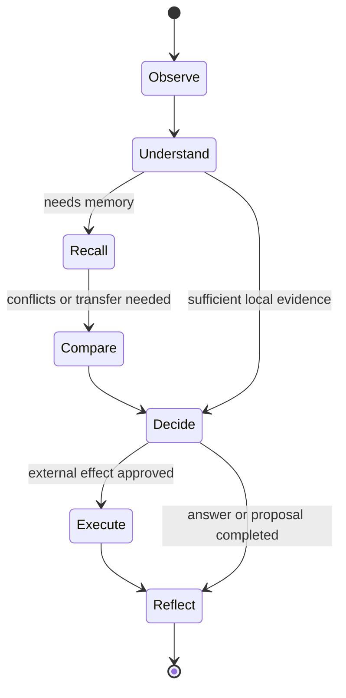

# LLM 与记忆系统集成设计

> 版本：v1.0 Draft  
> 日期：2026-10-28  
> 文档性质：集成协议与状态机设计  
> 上位架构：[ai-memory-architecture-kernel-std.md](ai-memory-architecture-kernel-std.md)  
> 语义模型：[ai-memory-semantic-model-design.md](ai-memory-semantic-model-design.md)  
> 主规范：[ai-memory-system-design-draft.md](ai-memory-system-design-draft.md)

## 0. 认知响应、学习提议与状态转换

LLM 在当前任务中理解情境、按需使用已有经验、比较差异与反证，并输出格式化认知响应。该响应既可以表达回答或工具意图，也可以表达对当前经历的记忆价值评估：它是否带来新观察、新结果、预测落差、支持或反证、适用边界、重复稳定信号，或对既有经验的纠错、失效和遗忘理由。

```text
LLM structured response
-> state-machine input
-> protocol, reference, source, result, lifecycle, authorization, purpose, budget and risk checks
-> no-op / recall / candidate / evidence or Assessment update / revision
    / wait for outcome / retire / governed deletion request / controlled effect / abstain / require_human
```

LLM 的记忆价值评估是 `ReflectionProposal`，不是持久化命令。它在认知语义上描述一次可能的 `CognitiveDelta`：当前经历可能纳入、限制、支持、挑战、修订或退役哪些认识。`CognitiveDelta` 是对该提议含义的定义，不是与 `ReflectionProposal` 并列的新协议或长期对象。系统不裁决 LLM 的所有开放式思考是否正确；系统裁决该提议能否以可追溯、可修订、当前允许的方式进入长期认知状态。只有 Validator 与 Guard 均允许时，Orchestrator 才能将提议编译为面向 Memory Tool 的 `CognitiveCommitPlan`。

`MemoryEvidencePack` 是任务期、有限且可重建的工作记忆投影。它不保存长期身份、经验或人格，也不因进入 LLM Context 而成为事实、指令或权限。

## 1. 目的与边界

本文定义 LLM 如何在长期认知系统的边界内理解任务、请求可复用经验或历史活动、比较证据、提出行动、复盘结果并提交候选经验。

本文不重新定义系统级授权、删除、风险、审计和 Kernel 职责；这些以架构文档为唯一来源。数据对象、关系、时间、来源和生命周期以语义模型文档为准。本文也不冻结数据库字段、JSON Schema、SDK 接口或模型供应商格式。

### 1.1 集成目标

1. 新语义任务可使用相同协作协议，不依赖固定业务场景。
2. LLM 可替换，模型供应商格式变化不改变记忆系统语义。
3. 记忆以证据化、可审查、预算受控的形式进入上下文。
4. LLM 可以提出下一步认知意图，但不拥有工具执行、事实写入或外部效果的最终权力。
5. 结果可关联来源、协议版本、模型版本、提示词版本和决策轨迹。
6. 空记忆或冷启动请求保持正常可用，且可与记忆辅助请求比较效果。

### 1.2 非目标

1. 不保证 LLM 的类比、泛化或因果判断天然正确。
2. 不要求或保存模型不可观察的内部推理过程。
3. 不承诺跨模型、跨版本调用一定产生相同字面输出。
4. 不允许 LLM 直接操作底层索引、存储、ACL 或执行器。

## 2. 集成不变量

1. **提案与执行分离**：LLM 提案，Orchestrator 推进状态机，Guard 决定权限和外部效果。
2. **事实与解释分离**：LLM 不能把摘要、推测或模式提案写成 `Event`。
3. **召回内容不可信**：记忆、附件提取结果和外部工具输出只能作为待评估数据，不能修改系统指令或触发工具。
4. **授权在读取时生效**：缓存、索引、回放和上下文注入均按当前策略重新裁决。
5. **领域无关、关系受控**：不使用固定场景枚举；以目标、对象、约束、角色、依赖、行动、结果和失效条件组织比较。
6. **外部效果受闸门控制**：只有 Guard 批准后，才可调用有外部影响的执行器。
7. **不确定性可见**：不足、截断、冲突、索引滞后和待回收结果必须进入协议，而非由模型猜测。
8. **模型一致不等于独立证据**：同一输入、相同来源根或相同受控工具结果上的多个模型输出，最多形成多个 `SemanticAnnotation` 或 `ReflectionProposal` 候选；它们不得自动增加来源独立性、形成观察 Event、升级 Pattern 或强化因果结论。

## 3. 职责与控制面

| 组件 | 职责 | 不拥有的权力 |
|---|---|---|
| LLM | 情境理解、工具意图、记忆比较、回答与候选提案 | 执行工具、写入事实、放行外部效果 |
| Orchestrator | 推进确定性认知状态机，调用获准能力，整合结果，并在内部协调冲突感知的证据视图；发起受限调度请求，消费已持久化的结果 Event，并只在既有锚点与服务治理匹配时请求推进 DecisionUnit | 覆盖 Guard 的权限和效果裁决，接入原始外部回执，直接派发外部效果，或生产观察事实 |
| Memory Tool | 返回合格候选与可引用证据；校验并物化获准的 `CognitiveCommitPlan`、DecisionTrace 与结果观察已启用时创建的 `DecisionUnit` 结果锚点；验证来源绑定的观察记录，并原子持久化 Event、调度请求与 Outbox | 最终行动决策、实际外部效果派发，或直接构建面向 LLM 的 Context |
| Validator | 校验协议阶段、引用、完整性和版本兼容 | 判断业务结论真伪 |
| Guard | 独立裁决效果执行、决策依据留存、结果观察资格、输入采集、调度、Unit 生命周期迁移、预算、风险和写入 | 替 LLM 生成任务语义 |
| LLM Adapter | 协议转换、模型路由、提示词、调用记录及受控 `llm_proposal_recorded`、`output_generated` 的来源绑定记录；在跨部署信任边界调用模型时，验证由 Orchestrator 唯一版本化投影编译步骤构造的模型调用或数据外发 grant，并校验最终序列化载荷不超过获批最小投影；保留模型、适配器与协议版本以支持多模型候选并存 | 改变内部逻辑协议、构造或扩大获批投影、将模型一致性视为独立证据或改变治理语义 |

M1 中上述组件均可在同一进程内运行；图中的调用箭头表示协议、治理和事实边界，不代表内部网络调用。执行器、交付适配器、reconciliation adapter 与 Lifecycle Worker 使用受控 runtime role，而非独立服务身份；只有它们与进程外目标、回执通道或人工系统的交互构成外部不确定性。

## 4. 认知状态机



状态机的状态转换由 Orchestrator 执行；LLM 只能在当前状态提出受限的下一步意图。LLM 可以在任务中形成记忆价值判断，但只在 `Reflect` 或系统允许的检查点提交 `ReflectionProposal`；提议本身不改变长期对象。`DecisionUnit` 的结果观察是跨请求的异步关联生命周期，不等同于此单次认知状态机中的 `Execute`；后续受控结果 Event 进入新的观察与反思入口。

| 状态 | LLM 可以提出 | 系统必须保证 |
|---|---|---|
| Understand | SituationFrame、查询线索、不确定性 | 不将情境解释当作事实 |
| Recall | `memory.recall`、`memory.inspect`、`activity.recall` 或 `activity.inspect` 意图 | 当前授权、目的、删除、失效与预算优先过滤；经历召回返回合格候选，活动回忆返回有限记录与缺口说明，均不直接构成结论 |
| Compare | 适用性、差异、反证查询、附条件综合、保留冲突或请求区分观察 | 返回冲突感知的证据视图，包含代表性支持与反证、条件差异和覆盖缺口，而不只返回相似结果 |
| Decide | 回答、行动提案或保守放弃 | 外部效果另行治理 |
| Execute | 等待或解释受控执行结果 | 记录执行关联，不将结果自动视为成功 |
| Reflect | 候选经历、模式、证据补充、纠错、失效、遗忘或无长期更新提案 | 只保存带来源和不确定性的候选对象，并等待必要结果 |

可在 `Understand` 后直接进入 `Decide`；系统不强制每个请求检索记忆。默认低成本召回应是可配置优化，而不是绕过状态机的隐式路径。

## 5. 逻辑协议对象

以下对象是跨模型、跨 Agent 的语义契约。实现可使用 JSON、函数调用、MCP、消息队列或本地类型承载，但不得改变含义。

### 5.1 CognitiveContext

系统传给 LLM 的当前工作上下文，包含：

1. 当前可观察输入及其事件引用。
2. 主体、当前授权作用域、采集或复用目的、风险模式和预算。
3. 当前状态、可用能力清单和禁止能力。
4. 已知执行结果、待回收结果和有效的系统约束。

项目、仓库或领域可以作为环境描述出现，但不是必填身份或访问主键。

### 5.2 CognitiveEnvelope

LLM 对当前认知阶段的结构化响应，包含：

1. 当前状态和期望的下一步认知意图。
2. `SituationFrame` 候选：目标、对象、约束、环境、预期结果、不确定性与机制线索。
3. 对事件、记忆、证据或 Assessment 的引用。
4. 需要的记忆能力、比较对象或人工确认。
5. 可观察理由：证据、反证、条件差异和未确定项的简要说明。

它不承载内部思维链，也不能直接包含可执行的低层存储或网络操作。

### 5.3 MemoryEvidencePack

Orchestrator 基于 Memory Tool 返回的合格候选和内部证据协调结果，向 LLM 提供受控数据包，包含：

1. `CurrentMemoryView` 的受限投影：按当前任务可比较的候选组，而不是平铺的 Top-K 列表。
2. 每组的候选经历、模式或语义解释，以及代表性来源事件、支持证据、反证和 Assessment 引用。
3. 适用前提、不适用条件、时效、当前可用性，以及直接冲突、条件互补、时间替代或不可比较状态。
4. Guard 允许披露的检索覆盖范围、选择原因、预算截断、超时、索引滞后和其他认知盲区说明；授权排除、删除状态和精确受限范围仅保留为内部诊断，除非 Guard 明确允许披露。
5. 内容信任说明和将其视为数据的注入边界。

该包不应直接拼接不受控原始历史；LLM 可以请求 `inspect` 下钻，但每次下钻都重新经过授权和预算裁决。

#### 5.3.1 ActivityRecallView

`ActivityRecallView` 是 Orchestrator 对 Memory Tool 返回的合格 Event、DecisionTrace 依据及受控对象或输出引用所作的查询期组织；其数据语义以语义模型文档为准。它服务于“过去发生了什么、当时如何处理、交付或结果如何、记录到的依据是什么”等问题，不是 `MemoryEvidencePack`、`CurrentMemoryView`、完整 Audit 导出或新的长期对象。

LLM 提出历史活动意图时必须给出主体、原始时间表达或明确时间范围、查询目的、活动线索或指定引用、所需范围和预算；可提出参与者角色范围与时区或日历偏好，但不得猜测缺失角色或时间边界。Validator 先检查最小查询条件；Orchestrator 随后按预定义规则、且不读取历史数据地将相对时间和未指定的角色呈现策略归一化为确定查询条件，并记录采用的时区或日历依据。它不得根据候选结果扩大主体、角色或时间范围，或重解释已归一化范围；范围不足时只能按已声明默认策略处理、请求澄清或拒绝过宽查询。Validator 再校验规范化查询，Guard 才对确定的主体、角色范围、时间范围、目的、预算和可披露范围签发 grant。该归一化只界定查询，不推断历史事实。系统返回的视图必须包含获准的查询范围及其时间依据、可确认活动及其时间顺序、已记录角色与活动断言、可披露的触发/目标/约束、证据/反证和治理裁决引用、交付或外部结果的可访问引用及已知状态、来源引用、覆盖范围与安全化缺口说明。它不得将语义相似性表述为历史归属，不得将提议、尝试、当前生成内容或不可访问引用表述为实际执行、历史实际输出或已确认结果；仅有派发记录时不得表述为已确认交付。

### 5.4 ExecutionDecision

仅在建议产生外部影响时使用。它是 LLM 的认知层行动提案，不是 Guard 授权或执行事实：

1. `propose`：提出受限行动及其支持证据、反证、适用性、风险和必要检查。
2. `abstain`：不形成行动主张，或明确建议保守不行动。

Guard 对 `propose` 独立输出 `effectAuthorization = deny | allow | allow_with_checks | require_human`。`deny` 表示当前治理禁止执行；`allow_with_checks` 表示 Guard 同时签发绑定意图、checker、版本、时效和执行点的不可变 CheckObligation，且只有指定检查证明满足当前阶段时才能继续；`require_human` 只表示不得自动进入外部效果调度，且只能创建效果授权审核。认知冲突、开放语义重评估或 Pattern 晋升争议不使用此裁决，而经独立的 `cognitive_review` 路径处理。有效的审核批准只是下一次 Guard 当前时点重新裁决的输入，不是执行授权或 command。它们不等于 `abstain`，也不等于执行器观察到的尝试、失败或成功。普通回答、回忆、类比、候选记忆和复盘不应被强制包装为 `ExecutionDecision`。

每个可调度效果都必须先形成不可变 EffectIntentSnapshot，统一绑定动作、目标、目的、作用域、输入或工件摘要、关联、幂等边界、规范化版本和完整性摘要。每种动作必须有唯一注册的 canonicalization owner；该 owner 只可在意图形成处按该动作已注册的版本化确定性规则计算快照，并绑定自身稳定标识与规则版本。Orchestrator 只调用该 owner 并传递结果；Guard 只验证并裁决同一稳定引用或摘要，不能构造、补全或重新解释原始动作意图。效果授权审核、CheckObligation、command 与执行 attempt 只能传递并验证同一快照引用或摘要，不能从原始输入重新计算。任一绑定或规范化版本变化均形成新意图，必须重新裁决，不能复用旧审核、检查、command 或证明。目标声明为强幂等时，声明还必须绑定目标身份、该快照摘要、幂等域与键、保证有效窗口、重复调用的无新增效果语义及可验证的原结果或目标状态查询；本地或最佳努力去重、未绑定输入摘要或保证窗口已到期均不得用于未知结果恢复。

### 5.5 ReflectionProposal

长期学习协作严格分为三个层次，名称相似但所有权和持久化资格不同：

| 层次 | 对象 | 产生者 | 作用 | 是否长期语义对象 |
|---|---|---|---|---|
| 认知提议 | `ReflectionProposal`（其语义为 `CognitiveDelta`） | LLM | 表达经历可能如何改变认识 | 否 |
| 受限提交 | `CognitiveCommitPlan` | Orchestrator | 将获准提议编译为追加式物化计划 | 否 |
| 执行结果 | `CognitiveCommitResult` | Memory Tool | 说明实际物化内容、提交时裁决与派生状态 | 否 |

在结果已观察、部分观察或超时后，LLM 可以提交候选经历、模式、证据补充、纠错、失效、遗忘或无长期更新提案。它表达 LLM 对当前经历记忆价值的判断，而不是直接要求写入。

提案必须表达变化类型、来源 Event、当前 `SituationFrame`、目标对象与基础版本（如适用）、关联 `DecisionUnit`（如适用）、条件或反例边界、不确定性和可观察理由。涉及 Assessment 时，提案还必须说明判断维度、适用范围、有效时间与依据引用；它不能把本次查询的 `current usability` 写成全局结论。变化类型仅为 `admit`、`qualify`、`corroborate`、`challenge`、`revise`、`retire` 或 `no_change`：分别表示纳入候选认识、增加条件边界、增加独立支持、追加反证或竞争解释、形成新的不可变经历表达、请求认知退役，或明确不产生长期变化。`retire` 不删除内容，也不替代 Tombstone。它应说明当前信息如何补充、限制、反驳、重复确认或改变既有经验；没有可追溯观察来源的内容不能成为长期候选。

Guard 对同一输出或行动独立输出 `effectAuthorization = deny | allow | allow_with_checks | require_human`、`decisionBasisCapture = none | minimum` 与 `outcomeObservationEligibility = disabled | enabled`。`effectAuthorization` 只决定外部效果能否进入受控调度；`decisionBasisCapture` 只决定是否持久化最小 DecisionTrace；`outcomeObservationEligibility` 只决定是否允许建立 DecisionUnit。合法组合固定为：`none + disabled` 不创建 Trace 或 Unit；`minimum + disabled` 只保存独立最小 Trace，称为 `basis_only`；`minimum + enabled` 保存 Trace 与 Unit；`none + enabled` 非法。三项均是请求期策略输出，LLM 不得设置或扩大其内容范围。只有结果来源和关联通道受控、观察窗口有意义、结果对后续经验有价值时，Validator 才可确认结果观察资格。Guard 授权后，Orchestrator 必须在启用结果观察的输出或效果对外可观察前，经 Memory Tool 持久化对应的 Trace、单元、关联键、观察窗口、`traceId` 与幂等或请求关联引用，以及规定允许来源、关联域与唯一关联键、一个 Event 可消费的 Unit 基数、允许的 fan-out、歧义时只保留 Event 而不归并、部分观察、迟到处理和 `confirmed` 充分条件的不可变 OutcomeObservationContract。

外部效果还必须获得独立的执行授权和稳定的效果关联与幂等引用。`allow_with_checks` 的 `pre_enqueue` CheckAttestation 必须在 `effect.enqueue` 前由注册 checker 或可信来源产生，并由 Guard 和 Memory Tool 重新验证绑定、完整性、时效、当前策略与 Tombstone；`pre_dispatch` obligation 及其允许 checker、输入绑定、时效和 attempt 验证规则则绑定进 command，但 command 不永久绑定会过期的 Attestation。执行器必须在每次实际调用前，以当前 dispatch lease 或 fencing 代次取得并验证与该次 attempt 绑定的新鲜 `pre_dispatch` Attestation 和当前 runtime-role 授权；旧 attempt 的证明不得复用。checker 只能产生或验证无外部副作用的证明；会创建、冻结、预留、提交或改变外部资源的操作是独立外部效果，必须走自身的 `ExecutionDecision`、Guard 和 command 路径。只有 `effectAuthorization = allow`，或 `allow_with_checks` 的当前 `pre_enqueue` 检查已满足时，Orchestrator 才可提交 `effect.enqueue`；政策要求结果观察时，DecisionTrace、DecisionUnit 与结果锚点还必须先成功持久化。`deny`、`require_human`、检查未满足或必要锚点失败均不得创建 command，必须保守不调度、降级或转入对应的人工路径；其中 `require_human` 的效果授权审核只能由审核人以 `approve_for_re_adjudication` 或 `reject` 结论解析，未及时解析则由系统标记为 `expired`，批准后必须由 Guard 重新裁决。Memory Tool 原子持久化的 `effect_dispatch_requested` Event 及受限 Outbox command 只表示调度请求；它们不证明外部效果已经发生。command 绑定请求 Event、动作/目标/目的约束、稳定关联、幂等域与键、到期或重试策略、所需 `pre_dispatch` obligation 及其验证规则和非秘密治理引用，其运行状态属于可靠投递边界而不是长期认知对象。受控执行器消费 command 时必须以受控 runtime role 请求 Guard 的当前授权，取得并验证当前 attempt 的 `pre_dispatch` 证明，且不能扩大原 command 的意图：获准后复用同一关联与幂等键执行；证明失败或授权拒绝且尚未调用外部目标时，只以受限 command ack 将其置为 `terminally_rejected`、`cancelled`、`awaiting_human_review`，或在重新检查被明确允许时置为 `retryable_failure`，不写入尝试或执行 Event。只有实际尝试、派发、失败、补偿或回执发生时，才由对应来源写入观察 Event。已调用但目标是否执行未知时必须进入 `outcome_unknown`，而不是 `retryable_failure`；后者只适用于未调用目标或已证明目标未接收、未执行的失败。注册 reconciliation consumer 只在取得当前 reconciliation lease 和 runtime role 授权后，查询 command 已声明的目标状态能力，或在已验证强幂等且当前策略允许时将 command 受控恢复为新的 `pending`；它不得直接派发、改变 command 意图或写入认知语义。低风险效果可在 `none + disabled` 或 `minimum + disabled` 下进入调度，且不得创建或更新 DecisionUnit；高风险策略可要求 `minimum + enabled`，锚点持久化或调度请求不合格时，Orchestrator 应按当前策略保守不调度、降级或转入对应的人工路径。`outcome_pending`、部分结果和窗口内未观察到结果的状态只能支撑低强度候选，不得自动晋升为高质量 Pattern 或因果结论。每个合格结果 Event 无论即时、迟到、重复或重放，均先经回执入口持久化，再由内部派生工作项通知 Orchestrator 按同一 DecisionUnit 状态归并规则处理；没有关联到既有 DecisionUnit 或未启用结果观察的 Event 只能作为新的观察，不能猜测性地更新既有经历。对仍可合法保留的 Unit，Lifecycle Worker 仅报告到期或不可观察条件；Orchestrator 经 Guard 裁决后请求 Memory Tool 以版本比较写入 `expired_without_outcome` 或 `observationClosure = unavailable`。后者不表示结果未发生，且不得绕过 Tombstone 或恢复已删除 Unit 的身份与关联键。

### 5.6 CognitiveCommitPlan 与 CognitiveCommitResult

`CognitiveCommitPlan` 是 Orchestrator 在 Validator 校验和 Guard 授权后，向 Memory Tool 发出的内部受限提交计划。它不是 LLM 输出、长期语义对象或新的公共 Agent 协议。计划必须关联 `traceId`、幂等键、`ReflectionProposal` 引用、来源 Event 引用、当前目的与授权决策引用，以及目标对象和基础版本（如适用）。`CapabilityGrant` 仅在请求期传递，不进入语义存储。

计划按已批准的认知变化编译为追加式物化操作，而不是开放 CRUD：`admit` 仅在提议已能作为完整、可回链、可条件化并可在未来比较的经历单元表达时，才可创建新的 `Memory` 稳定身份及其初始 `MemoryRevision`；否则只创建候选 `SemanticAnnotation`。`qualify`、`corroborate` 与 `challenge` 优先追加 `EvidenceRelation`、带范围与依据的 `Assessment` 或竞争解释；`revise` 只在经历的可复用表达、适用边界或候选教训发生实质变化时创建带基础版本的 `MemoryRevision`；`retire` 只提交认知退役或失效的生命周期变化。低强度 Pattern 候选仅可基于至少两个可比较的 `MemoryRevision` 及其共同机制、来源根独立性、适用前提和反例边界创建，且不能自动晋升为高影响或跨作用域规则。删除或撤回不属于 `CognitiveCommitPlan`：它走独立的 Guard 和 Tombstone 治理路径。

Memory Tool 必须按来源、版本、删除、当前授权、目的、生命周期和语义不变量验证计划，并返回 `CognitiveCommitResult`。结果必须分开表达：

1. `adjudication`：`accepted`、`deferred_for_observation`、`rejected` 或 `requires_human`。
2. `materialized`：已创建或追加对象的稳定引用；只有 `accepted` 才能包含这些引用。
3. `constraints`：本次提交、物化范围或异步派生的结构化限制。
4. `durable_references`：影响未来召回、复用、动作放行或生命周期的 Assessment、EvidenceRelation、生命周期状态、范围或对象引用。
5. `derivations`：`not_required`、`queued`、`completed` 或 `failed_nonblocking`。
6. `reason`：来源、策略、版本、生命周期、冲突、预算或结果不完整的可审计原因；它不得作为机器治理的唯一依据。

`deferred_for_observation` 表示本次提议尚不物化新的长期语义对象，因此 `materialized` 必须为空；如需等待后续结果，只能依托已经记录的待结果 `DecisionUnit`，而不能由结果本身创建无来源的回流锚点。`requires_human` 必须在同一 Memory Tool 控制事务中创建绑定该不可变提议快照、候选 delta、目标或基础版本和所需证据的 `cognitive_review`，并在结果中返回 `reviewItemRef`；任一持久化失败则不得返回或持久化 `requires_human`。此时 `materialized` 必须为空；它不能被解释为效果授权审核或直接提交许可。审核人只能提出重新认知裁决、拒绝或要求缩小提议，Orchestrator 必须以当前授权、Tombstone、基础版本和来源重新校验，并重新编译 `CognitiveCommitPlan`。影响未来使用的限制必须由 `durable_references` 指向的持久化治理语义承载；只影响本次提交或异步派生的限制只记录在 `constraints`。`CognitiveCommitResult` 关联 DecisionTrace。`derivations = queued` 仅表示异步派生已排队；`materialized`、限制、派生状态与 Pattern 或结论强度必须独立解释，不能相互推断。未来是否可用始终由 `CurrentMemoryView` 按当前授权、目的、Tombstone、Assessment、情境和预算重新裁决。

## 6. 记忆能力协商

LLM 接收当前允许的能力清单，并仅能在其中提出意图。M1 的通用能力如下：

| 能力 | LLM 意图 | 系统效果 |
|---|---|---|
| `memory.recall` | 按 SituationFrame 召回经历或模式 | 授权后的候选集合 |
| `memory.inspect` | 下钻来源、反证、版本或受控原始引用 | 受预算限制的证据视图 |
| `memory.compare` | 比较机制、前提和失效条件 | 适用性与差异说明 |
| `activity.recall` | 按主体、角色范围、时间、活动线索和目的回忆有限历史活动 | 当前允许披露的 `ActivityRecallView`，含来源、时间依据与安全化缺口说明 |
| `activity.inspect` | 下钻指定活动链、交付引用或记录依据 | 受预算限制的活动明细或受控引用，不导出完整 Audit |
| `memory.propose` | 提交 `ReflectionProposal` | 经校验、授权和长期不变量验证后创建 `CognitiveCommitPlan`，不写事实 |
| `memory.correct` | 提交对语义解释、经历、证据关系或 Assessment 的纠错、失效、冲突或认知审核所需的受限提议 | 经统一认知提交链追加证据、Assessment、竞争解释或必要的 `MemoryRevision`；不得创建 `ObservationCorrection` 或 `ObservationInvalidation` Event |
| `memory.retire` | 提交当前不应默认复用的认知建议 | 经统一认知提交链追加退役或失效状态，不删除内容 |
| `memory.forget` | 提出删除或撤回请求 | 进入独立的 Guard 和 Tombstone 治理流程，不作为 `ReflectionProposal` 或 `retire` 执行 |

能力清单必须声明版本、输入规模限制、是否具有外部效果、所需授权和预算类别。`activity.recall` 与 `activity.inspect` 还必须声明允许的主体与参与者角色范围、最大时间范围、相对时间归一化规则、最小查询条件、可披露范围及缺口说明的披露策略；LLM 不得假设未声明能力存在，或提出无主体、无时间或无目的的全量历史查询。

`memory.correct` 只能改变经认知提交允许的语义或评价层对象。对既有观察 Event 的身份、内容、关联、重复判定、时间或来源资格提出纠正或失效，必须由可验证外部证据来源经 Gateway、Guard 与 Memory Tool 的 `ObservationCorrection` 或 `ObservationInvalidation` 路径处理；LLM 可以指出疑点或请求核验，但不能把该请求、提议或推断提交为观察事实纠正。

### 6.1 能力提议与调用授权分离

能力清单是对 LLM 可提议意图的声明，不是对某次调用的授权。LLM 不接收、构造、修改或复用 `CapabilityGrant`；它只能提出已经声明的能力意图与所需对象引用。

Orchestrator 将通过 Validator 的提议交给 Guard。只有 Guard 的当前时点裁决会产生绑定主体、作用域、目的、目标约束、预算、`traceId` 和时效的 `CapabilityGrant`；然后 Orchestrator 才能调用目标工具。目标工具必须再次验证该凭证。凭证的治理语义和跨 Kernel 传递约束以 [ai-memory-architecture-kernel-std.md](ai-memory-architecture-kernel-std.md) 为准。

## 7. 端到端协作流程

```mermaid
sequenceDiagram
    participant U as User or Agent
    participant G as Gateway
    participant P as Policy Guard
    participant O as Orchestrator
    participant L as LLM Adapter
    participant V as Validator
    participant M as Memory Tool
    participant E as Evidence Coordination
    participant C as Registered Checker
    participant H as Human Review Queue
    participant X as Executor or Delivery Runtime
    participant R as Reconciliation Runtime
    participant A as Audit

    U->>G: request
    G->>P: identity, scope, processing and capture pre-check
    P-->>G: handling grant or denial, optional capture grant
    alt capture is required
        G->>M: capture-grant persist gateway_input Event and Outbox
        M-->>G: durable inputEventRef
        G->>O: normalized input and inputEventRef
    else capture is allowed best effort
        G->>M: capture-grant persist gateway_input Event and Outbox
        M-->>G: inputEventRef or classified capture-failed marker
        G->>O: normalized input and recordable status
    else handling allowed without capture
        G->>O: normalized input and non-recordable marker
    end
    opt model endpoint crosses deployment trust boundary
        O->>P: authorize model invocation and minimum egress projection
        P-->>O: model-call CapabilityGrant or denial
    end
    O->>L: CognitiveContext(Understand)
    L-->>O: CognitiveEnvelope
    O->>V: validate phase, references, and capability intent
    opt historical activity intent authorized
        O->>O: normalize time range and role scope
        O->>V: validate normalized activity query
        V->>P: authorize normalized activity plan, budget, and disclosure
        P-->>O: GuardDecision and CapabilityGrant
        O->>M: grant-bound activity recall or inspect
        M-->>O: eligible Event, DecisionTrace basis, controlled references, and grant-permitted coverage
        O->>O: construct ActivityRecallView
        O->>L: CognitiveContext(with activity recall view)
    end
    opt experience recall or comparison intent authorized
        V->>P: authorize memory plan and budget
        P-->>O: GuardDecision and CapabilityGrant
        O->>M: grant-bound memory recall, inspect, or compare
        M-->>O: eligible candidates and evidence
        O->>E: SituationFrame, candidates, budget, risk
        E-->>O: CurrentMemoryView
        O->>L: CognitiveContext(with evidence pack)
    end
    L-->>O: answer, ReflectionProposal, or ExecutionDecision
    O->>V: validate output and provenance
    opt validated ReflectionProposal recording is authorized
        O->>M: restricted internal persist llm_proposal_recorded(proposalId, callOrTurnRef)
        Note over M: one record per declared idempotency boundary; proposal occurrence only
    end
    V->>P: independently authorize effect, basis capture, and observation eligibility
    P-->>O: GuardDecision, independent decisions, and scoped grants
    opt decisionBasisCapture is minimum and observation eligibility disabled
        O->>M: grant-bound persist DecisionTrace
        M-->>O: stable DecisionTrace reference
    end
    alt external effect proposed and Guard returns allow_with_checks
        O->>C: invoke registered checker for each pre_enqueue obligation
        C-->>O: bound CheckAttestation or failure
        O->>P: revalidate current policy and pre_enqueue attestations
        P-->>O: current enqueue grant or denial
    else external effect proposed and Guard returns require_human
        O->>M: idempotently create effect_authorization_review(snapshot, decision, scope)
        Note over M: atomically persist ReviewItem and GovernanceBinding; return matching open item
        M-->>O: stable ReviewItem reference
        H->>G: signed review decision with item version
        G->>P: authorize review-item resolution
        P-->>G: scoped resolution grant or denial
        G->>M: grant-bound resolve or invalidate ReviewItem
        M-->>O: restricted review resolution
        opt approve_for_re_adjudication is valid
            O->>P: re-adjudicate current intent and review input
            P-->>O: fresh GuardDecision and scoped grants
            opt fresh decision returns allow_with_checks
                O->>C: invoke registered checker for each pre_enqueue obligation
                C-->>O: bound CheckAttestation or failure
                O->>P: revalidate current policy and pre_enqueue attestations
                P-->>O: current enqueue grant or denial
            end
        end
    end
    alt external effect proposed and scheduling is permitted
        opt observation eligibility enabled
            O->>M: grant-bound persist DecisionTrace, DecisionUnit, and result anchor
            M-->>O: stable DecisionUnit reference
        end
        O->>M: grant-bound effect.enqueue request
        M-->>X: Outbox: restricted effect dispatch command
        X->>P: runtime-role authorize current dispatch
        P-->>X: dispatch grant or denial
        alt current dispatch authorized
            X->>C: obtain attempt-bound pre_dispatch attestation
            C-->>X: current-attempt attestation or failure
            alt pre_dispatch checks are valid
                X->>G: actual attempt, dispatch, failure, compensation, or receipt
            G->>P: authorize observation Event recording
            P-->>G: observation-event-only CapabilityGrant or denial
            alt observation grant and persistence succeed
                G->>M: grant-bound persist Event and result-projection work item
                M-->>O: internal derivation: persisted result Event
                O->>P: authorize matching existing DecisionUnit association, if eligible
                P-->>O: scoped grant or denial
                O->>M: grant-bound associate and update matching DecisionUnit
            else observation denied or persistence fails
                Note over G,M: no Event; retain restricted governance or runtime diagnostic only
            end
            alt dispatch responsibility can be conclusively ended
                X->>M: dispatch-lease command ack: completed
            else target nonreceipt or nonexecution is demonstrated
                X->>M: dispatch-lease command ack: retryable_failure
            else call was issued but target outcome is unknown
                X->>M: dispatch-lease command ack: outcome_unknown
            end
            else pre_dispatch checks fail or expire before target call
                X->>M: dispatch-lease command ack: terminally_rejected, cancelled, awaiting_human_review, or allowed retryable_failure
            end
        else denied before actual call
            X->>M: dispatch-lease command ack: terminally_rejected, cancelled, or awaiting_human_review
        end
    else external effect proposed but scheduling is not permitted
        Note over O,P: deny, rejected or expired effect review, unmet checks, or required-anchor failure: no command
    end
    opt observation eligibility enabled for controlled answer or suggestion
        O->>M: grant-bound persist DecisionTrace, DecisionUnit, and result anchor
        M-->>O: stable DecisionUnit reference
    end
    opt source-bound generated output is recorded
        L-->>O: controlled generation record
        O->>M: persist output_generated Event with artifactRef, version, and digest
    end
    opt output delivery scheduling is permitted
        O->>M: delivery.enqueue with generatedEventRef, artifactRef, digest, and approved transform
        M-->>X: Outbox: restricted delivery command
        X->>P: runtime-role authorize current delivery
        P-->>X: delivery grant or denial
        alt current delivery authorized
            X->>G: actual dispatch, failure, or delivery confirmation with command and artifact binding
            G->>P: authorize output observation Event recording
            P-->>G: observation-event-only CapabilityGrant or denial
            alt observation grant and persistence succeed
                G->>M: persist output Event and result-projection work item
                M-->>O: internal derivation: persisted result Event
                O->>P: authorize matching existing DecisionUnit association, if eligible
                P-->>O: scoped grant or denial
                O->>M: grant-bound associate and update matching DecisionUnit
            else observation denied or persistence fails
                Note over G,M: no Event; retain restricted governance or runtime diagnostic only
            end
            alt target outcome or dispatch responsibility is known
                X->>M: dispatch-lease command ack: completed
            else channel nonreceipt or nonexecution is demonstrated
                X->>M: dispatch-lease command ack: retryable_failure
            else channel call was issued but outcome is unknown
                X->>M: dispatch-lease command ack: outcome_unknown
            end
        else denied before channel call
            X->>M: dispatch-lease command ack: terminally_rejected, cancelled, or awaiting_human_review
        end
    end
    opt ReflectionProposal at allowed checkpoint
        V->>P: authorize cognitive commit
        P-->>O: allow, defer, reject, or human
        O->>M: grant-bound CognitiveCommitPlan
        M-->>O: CognitiveCommitResult (requires_human includes reviewItemRef)
        opt result requires_human
            H->>G: signed cognitive review resolution with item version
            G->>P: authorize review-item resolution
            P-->>G: scoped resolution grant or denial
            G->>M: grant-bound resolve or invalidate ReviewItem
            M-->>O: restricted cognitive resolution
            O->>V: revalidate selected candidate deltas
            V->>P: reauthorize cognitive commit
            P-->>O: fresh grant or denial
            O->>M: recompiled CognitiveCommitPlan when current constraints hold
        end
    end
    opt lifecycle worker detects expiry or observation unavailability
        Note over O: worker sends ObservationLifecycleSignal only
        O->>P: authorize matching Unit transition or closure
        P-->>O: scoped grant or denial
        O->>M: compare-and-set Unit expiry or observation closure
    end
    opt registered reconciliation adapter settles outcome_unknown
        M-->>R: restricted reconciliation work and current reconciliation lease
        R->>P: runtime-role authorize declared status query or recovery
        P-->>R: reconciliation grant or denial
        alt confirmed complete by verified query or trusted receipt
            R->>M: reconciliation-lease command ack: completed
        else nonexecution is demonstrated, or verified strong idempotency and current policy permit retry
            R->>M: reconciliation-lease command ack: new pending
        else no safe automatic settlement
            R->>M: reconciliation-lease command ack: awaiting_human_review or cancelled
        end
    end
    opt controlled executor or channel later emits a receipt
        X->>G: controlled receipt with correlation and idempotency keys
        G->>G: validate source, signature, protocol, correlation, and idempotency
        G->>P: authorize receipt or delivery-confirmation Event recording
        P-->>G: observation-event-only CapabilityGrant or denial
        alt observation grant and persistence succeed
            G->>M: grant-bound persist Event and result-projection work item
            M-->>O: internal derivation: persisted result Event
            O->>P: authorize matching existing DecisionUnit association, if eligible
            P-->>O: scoped grant or denial
            O->>M: grant-bound associate and update matching DecisionUnit
        else observation denied or persistence fails
            Note over G,M: no Event and no DecisionUnit association; retain restricted diagnostic only
        end
    end
    O->>A: governance linkage, state transitions, and availability record
    O-->>G: final response
```

在线链路分别确认效果执行、决策依据留存与结果观察资格。`basis_only` 是 `minimum + disabled` 的派生结果，不进入待结果流程；只有 `minimum + enabled` 且来源、关联通道、观察窗口与学习价值均满足时，才建立 DecisionUnit 结果锚点。输入处理授权与长期采集授权独立：`capture_required` 的输入必须先获得 `gateway_input` 持久化 ACK，`capture_allowed` 可携带成功引用，或携带 `retryable_capture_failure`、`capture_denied_or_revoked`、`capture_validation_rejected` 之一继续处理；只有可重试采集失败在输入仍合法可得、来源与幂等边界不变且重新获采集授权后才可延迟采集，其他失败不得回填为原始历史事实。未获采集授权但获处理授权的输入只携带 non-recordable marker 且不得构成可回忆活动链。所有 `llm_proposal_recorded`、`output_generated`、DecisionTrace、ArtifactRef 或认知提交写入均须在各自写入前由 Memory Tool 逐一验证其全部来源具有当前采集、目的、留存和派生留存资格，或具有 Guard 针对明确控制目的签发的不可逆最小化派生许可；处理、读取、模型调用或其他派生写入许可均不能替代该验证。外部效果须获得独立执行授权：只有 `allow`，或 `allow_with_checks` 的全部 `pre_enqueue` 检查已满足，且政策要求的结果锚点已成功持久化时，Orchestrator 才发起 `effect.enqueue`，由 Memory Tool 持久化调度请求和 `external_dispatch` Outbox command；其余情形不创建 command，而是按策略降级、拒绝或创建 `effect_authorization_review`。执行器在实际派发前以受控 runtime role 重新授权、验证绑定的 `pre_dispatch` 检查并按目标的已声明幂等能力执行。执行器向 Gateway 回流的观察 Event 与其向 Memory Tool 回流的 dispatch-lease command acknowledgement 是独立路径：前者只有在 Guard 授权且 Memory Tool 成功持久化后才形成 Event，并以仅发布结果 Event 的内部派生工作项通知 Orchestrator；后者只收敛 command 运行态。Orchestrator 对即时、迟到、重复或重放的已持久化结果 Event 都按同一规则，在既有锚点、关联、关闭、Tombstone 和当前授权匹配时请求关联并推进 DecisionUnit。`completed` 只表示 consumer 的自动派发责任结束，不表示事实已记录、外部业务成功、交付已确认或结果已观察。实际调用已发起但因超时、连接中断或回执丢失而无法确认目标是否执行时，ack 必须将 command 置为 `outcome_unknown`；只有持有 reconciliation lease 的注册适配器才可在当前授权下查询目标已声明的状态能力，或在强幂等已验证且策略明确允许时恢复新的 `pending`。强幂等不证明初次调用未发生，也不能将未知结果写为 `retryable_failure`。观察 Event 缺失、延迟、被拒绝或持久化失败同样不得触发已发生调用的自动重试，也不得把动作表述为未发生。当前授权或执行前检查拒绝且尚未实际调用时只更新 command 运行终态；不能继续自动处理时必须进入 `awaiting_human_review` 并由 `command_settlement_review` 结算，不得伪造执行失败或观察事实。授权和调度请求本身不是执行事实。

`output_generated` 仅经受控生成适配器到 Orchestrator 的受限内部路径写入，且绑定不可变工件版本与摘要；工件须先完成摘要与完整性验证，只有 `committed` 且未被逻辑阻断的工件引用才能随 Event 原子持久化。`output_dispatched`、外部回执及交付确认经 Gateway 的 observation-event-only 路径，在 Gateway 完成传输、身份、签名、协议、关联与幂等检查并由 Guard 授权后写入。交付 command 与后续 Event 必须回链生成 Event、源工件、获准转换和实际派发或确认工件摘要，当前重新生成内容不得替代历史工件；暂存或孤儿工件只能隔离或回收，不能成为历史输出。Memory Tool 进行目标侧语义与生命周期验证，并原子持久化 Event 与 Outbox。Orchestrator 不接收原始回执或制造观察事实，只消费已持久化 Event；它仅在既有锚点、关联约束与服务治理匹配时请求关联和推进 DecisionUnit，结果记录与当前用户是否可读取该记录是独立裁决。Lifecycle Worker 仅报告到期或不可观察条件；其状态迁移由 Orchestrator、Guard 与 Memory Tool 按已定义的状态归并规则和版本比较完成。`observationClosure = unavailable` 只能表示仍合法保留的 Unit 无法继续观察，不表示没有结果；Tombstone 优先于一切关联和迁移。Audit 只接收治理、关联与状态记录，不保存 DecisionTrace 或回执 Event 的语义主体。语义派生、索引更新、摘要、候选模式生成和异步结果回收不阻塞该链路；它们通过 Outbox 异步执行，具有幂等、死信、补偿和删除约束。只有满足当前授权、目的、生命周期与版本条件的对象才能在后续任务中参与召回。

## 8. 上下文构建与预算

上下文由 Orchestrator 构建，LLM 不可直接要求“全部历史”。每个经验包或活动回忆视图都要满足：

1. 先完成当前授权、采集或复用目的、删除、失效与版本裁决，再进行相关性排序和证据协调。
2. 为当前状态保留必要的事实引用、证据、反证和约束，不以原文堆叠代替摘要；历史活动视图还必须保留可确认记录与未确认或排除范围的区别。
3. 标记 Guard 允许披露的覆盖范围、预算截断、超时和索引滞后，避免把“未返回”误解为“不存在”；权限排除、删除状态和受限范围的内部诊断不得被直接作为对外存在性提示。
4. 对敏感内容采用最小必要披露、脱敏或仅返回受控引用。
5. 同时受单请求、主体、作用域和 Agent 的 token、工具调用和成本配额限制。

## 9. 写回、结果与模式治理

1. 受控适配器和执行器写入观察事件；LLM 只能提交 `ReflectionProposal`，Orchestrator 只能在校验和授权后发起 `CognitiveCommitPlan`。
2. 效果执行、决策依据留存与结果观察资格独立裁决，且只有 `minimum + enabled` 可建立 `DecisionUnit`；锚点必须先于该输出或动作对外可观察而持久化。未启用结果观察的获准外部动作可经受限 Outbox command 幂等调度，但只形成由事实源写入的 Event 链。结果可异步、部分可见或缺失，必须以受控关联键唯一定位既有待结果单元，并显式表达结果状态。重复回执只形成一次 OutcomeObservation；窗口到期只表示窗口内未观察到结果，不阻断带合法关联键的迟到结果回流。Lifecycle Worker 只报告到期或不可观察条件，仍合法保留但无法继续观察的单元经受控状态迁移标记 `observationClosure = unavailable`，不等同于结果未发生。无法定位时只能作为新的观察 Event。
3. Observation、关联、机制假设与因果主张分级保存；不能由时序相关自动推导因果。
4. Pattern 至少经历候选、受支持、争议、替代或退役状态；M1 只创建低强度候选及其证据、条件或退役语义，不自动晋升为受支持状态，也不承担规模化治理。晋升需要独立来源、前提、反例边界、Assessment 支持及 Ops 或 `cognitive_review`。
5. 相同根源的重复事件不得被当作独立证据；模式去重和冲突处理由 Ops 与 `cognitive_review` 治理。
6. 多个模型基于相同输入、来源根或工具结果形成的一致候选不得被计为独立证据；它们保留各自模型、适配器、协议与提示词版本，可作为进一步核验或 `cognitive_review` 线索，但不得直接提升结论强度。

## 10. 模型适配、版本与回放

LLM Adapter 将内部协议映射为特定模型的 function call、structured output、MCP 或本地 JSON 模式。每次调用必须关联：

```text
protocol version
capability manifest version
model and adapter version
prompt template version
source references
authorization decision
budget decision
```

除版本标识外，每次需审计重建的调用还必须记录协议、能力清单、提示模板、适配器配置、动作规范化规则和生成参数的不可变内容摘要，以及声明实际启用版本集合、发布或部署身份引用、启用时间和受控内容引用的不可变配置 manifest 摘要。跨部署信任边界调用还必须记录唯一投影 canonicalization owner、规则标识与版本、内容分类、获批投影摘要及 Adapter 对最终序列化载荷的一致性校验结果；投影正文不是必然留存对象。策略发布或部署注册方必须使启用策略包可由不可覆盖的受控 ArtifactRef 或等价归档引用定位，审计读取需区分内容可读、当前不可披露和已按合法留存策略清理。仅当当前留存允许时，完整可读版本才通过受控 ArtifactRef 或等价归档引用定位。摘要或引用不得包含可重放授权秘密，也不要求复制未经允许长期保存的动态输入。系统必须支持审计重建：重建当时的输入、来源、授权、工具结果、模板和模型版本。精确字面输出复现仅在模型、随机性和所有依赖可冻结时才适用。

协议演进遵循兼容性规则：新增可选能力不破坏旧调用；删除或语义改变能力必须版本升级；旧记录按其生成时的协议解释，但读取和执行仍按当前授权与删除策略裁决。

## 11. 失败、降级与人工接管

1. 协议缺少关键内容时，Validator 可请求一次受限重试；持续失败则转受限回答或 `abstain`。认知冲突、开放语义重评估或 Pattern 晋升争议只能作为受限认知提交中的人工裁决条件，由 Memory Tool 在同一控制事务中唯一创建 `cognitive_review`；只有已提出的外部效果需要人工授权时才由 Guard 输出 `require_human` 并创建 `effect_authorization_review`。
2. 检索超时、索引滞后、受控引用不可读或非关键工具失败可降级，但 `MemoryEvidencePack` 与 `ActivityRecallView` 必须标记 Guard 允许披露的覆盖状态和不完整性；不完整查询不得表述为不存在、未发生或完整否定结果。
3. 授权、删除状态、来源完整性或作用域继承不确定时，必须 fail-closed。
4. 高风险冲突或候选模式争议按当前策略拒绝、降级或以受限认知提交请求 Memory Tool 创建 `cognitive_review`；执行前检查未满足时，未创建 command 的效果可创建 `effect_authorization_review`，已创建 command 则取消、进入 `awaiting_human_review` 并创建 `command_settlement_review`，或在尚未调用目标且重新检查被明确允许时进入可重试运行路径。
5. 人工审核者仅能在其授权范围内领取并查看最小化、脱敏的审阅包，其结论提交必须绑定当前 ReviewItem 版本。基础 Lifecycle Worker 以受控 runtime role 只维护可确定的 ReviewItem 到期或失效终态，并由 Memory Tool 以 item 版本 CAS 持久化；它不判断审核结论、不创建 Event 或直接改变 subject。`cognitive_review` 只能经重新校验和新的 `CognitiveCommitPlan` 影响 Assessment 或其他长期对象；`effect_authorization_review` 的批准只作为 Guard 重新裁决输入，不能直接创建 command 或回写 Assessment；`command_settlement_review` 只能提出恢复或取消，且仅在已持久化受控观察证明未接收或未执行，或已验证强幂等、当前 Guard 与策略均允许时，才可恢复新的 `pending`，否则保持等待或取消，不覆盖历史。审核程序性结论不是 Event；人工提交外部证据只有经 Gateway、Guard 与 Memory Tool 的受控观察路径验证后才可形成独立 Event。

## 12. M1 验收场景

M1 至少验证以下场景：

1. 新语义任务在没有新场景枚举的情况下形成 SituationFrame 并使用相同工具能力。
2. LLM 请求的未授权能力、过期引用或已删除内容被拒绝。
3. 被召回内容包含恶意指令时，不会改变系统指令、能力清单或工具权限。
4. 记忆包存在截断、超时、Guard 允许披露的覆盖不完整状态或反证时，LLM 可保守回答而非声称历史不存在；内部权限排除、删除状态和精确受限范围不得作为对外存在性提示。
5. 外部动作缺少证据、反证或必要检查时，不能直接 `allow`。
6. 结果待定的行动只能形成候选经验，不能自动晋升 Pattern。
7. 授权策略变化后，缓存、索引和重放均不可继续暴露旧范围数据。
8. 同一协议可由至少两种 LLM Adapter 承载，而不改变内部记忆语义。
9. Outbox 重放、死信恢复和备份恢复均尊重 Tombstone 与当前授权裁决。
10. LLM 即使提出已声明能力，也不能构造、复用或伪造 `CapabilityGrant`；无效或过期凭证必须被目标工具拒绝并进入审计轨迹。
11. 一次经历在来源、情境、边界和结果满足要求时可形成候选经验；后续结果可支持、限制、修订、失效或遗忘它，并影响未来任务中的条件化使用。
12. 条件不同的表面相反经历必须以条件差异保留；同条件且可追溯的直接冲突必须将代表性反证、争议状态和覆盖缺口注入证据包，不得按相似度、近期性或模型偏好静默选择。
13. 后续结果只能关联并更新对应 `DecisionUnit` 使用或排除的经历、证据关系或 Assessment，不能以一次成功或失败模糊更新全部相似候选。
14. 删除或撤回请求不会被认知 `retire` 吸收；Tombstone 生效后，受影响对象先退出当前视图，再仅按明确记录的来源依赖角色重评估其剩余合法证据。
15. 同一对象在不同条件或判断维度下的 Assessment 可以并存；MemoryEvidencePack 只展示当前 SituationFrame 下的视图级可用性，不将其伪装为全局结论。
16. `deferred_for_observation` 不返回新的长期对象引用；后续结果只有通过已有待结果 DecisionUnit 才能触发新的认知提交。
17. 对“昨天做了哪些工作”等主体和时间范围历史查询，系统只返回当前允许披露、已采集且可关联的有限活动链；提议、尝试、实际执行、交付和已知结果不得混淆，且记录缺口不得表述为未发生。
18. 历史交付引用不可访问、被删除或未保存时，系统不得以当前生成内容替代历史实际输出；必须说明内容不可访问或无法确认。
19. 历史活动回忆不会自动创建 Memory、Pattern 或 DecisionUnit；从候选经历下钻历史活动只能核验过去记录，当前是否沿用仍须经 `memory.compare` 和当前 `CurrentMemoryView` 判断。
20. 历史查询按获准主体、参与者角色范围和归一化时间范围执行；未指定角色时，系统必须按策略澄清或按已记录角色分组呈现，不得将请求者、受影响者或提议者表述为执行者。
21. 历史输出仅在受控通道确认回执存在时表述为已确认交付；仅有生成或派发 Event 时必须保持相应事实强度。
22. 对外历史视图只包含 Guard 允许披露的缺口说明；它不得通过授权排除、删除状态或精确受限范围透露不可访问记录的存在。
23. 采集政策要求保留决策依据但不存在受控结果观察资格时，系统只持久化 `basis_only` 的 DecisionTrace，不创建 DecisionUnit、结果关联键、观察窗口或 `outcome_pending` 状态。
24. 外部回执必须先经 Gateway 的受控入口校验来源、协议、关联键与幂等键，并在 Guard 授权和 Memory Tool 目标侧验证后作为 Event 与仅发布该结果 Event 的内部派生工作项原子持久化；即时、迟到、重复或重放的合格 Event 均经同一 Orchestrator、Guard 与 Memory Tool 关联路径归并既有 DecisionUnit。伪造、过期、重复或不满足关联约束的回执不得推进 DecisionUnit。
25. 获得独立执行授权但无结果观察资格的低风险外部效果可以执行；它具备稳定的效果关联与幂等引用，实际尝试、派发、失败或回执只在相应事实源观察到时写入 Event，不创建或更新 DecisionUnit。
26. 对要求结果观察的高风险效果，系统必须在执行前持久化合格锚点；锚点不合格时拒绝、降级或在外部效果仍未调度时创建 `effect_authorization_review`，而不是以缺少结果为由虚构执行事实。
27. `output_generated`、`output_dispatched` 与 `delivery_confirmed` 分别经受控生成、Gateway Deliver 和确认通道的来源绑定路径记录与回忆；任一较弱事实不得升级为较强交付结论。
28. 回执是否记录或关联由受控 runtime role、来源和治理规则裁决，不以当前请求用户是否有读取该记录的权限为前提；历史读取仍另行按当前授权裁决。
29. 对仍合法保留的 Unit，`observationClosure = unavailable` 只表示不能继续观察，不表示结果不存在；Tombstone 后不得以关闭记录保留或恢复 Unit、Trace 身份或关联键。
30. `none + enabled` 的决策组合必须被拒绝；`basis_only` 只表示 `minimum + disabled`，不得与 Unit 创建或结果观察混用。
31. 外部效果和输出交付只有在 `allow`，或 `allow_with_checks` 的当前 `pre_enqueue` 检查已满足，以及政策要求的结果锚点均已成功持久化后，才可形成受控调度请求与 Outbox command；拒绝、未完成或拒绝的效果审核、检查或锚点失败不得入队。之后才由受控 runtime role 的执行或通道适配器在当前授权和所需 `pre_dispatch` 检查下幂等派发；调度请求、实际尝试、派发、失败、补偿和确认不得互相替代。
32. `capture_required` 的输入必须由 Gateway 在进入认知处理前持久化受控 `gateway_input` Event 并取得 ACK；`capture_allowed` 只能携带成功引用，或 `retryable_capture_failure`、`capture_denied_or_revoked`、`capture_validation_rejected` 之一继续处理；任何失败标记都不得在 Event 实际持久化前形成历史活动链，且只有前者可在重新授权和输入仍合法可得时延迟重试。未获长期采集授权但获处理授权的请求必须带 non-recordable marker，且不得在历史回忆中被表述为完整活动链起点。
33. 凡将回答、输出、执行、派发、交付或结果作为 ReflectionProposal 来源的请求，都必须引用已持久化 Event；未持久化事实不得进入长期认知来源链。
34. 到期或不可观察条件只能由 Lifecycle Worker 发现并上报；Unit 状态迁移或关闭必须经 Orchestrator、Guard、Memory Tool 的版本比较与 Tombstone 检查完成。
35. `ExecutionDecision` 只表达 `propose` 或 `abstain`；Guard 的 `deny`、`allow`、`allow_with_checks` 与 `require_human` 是独立治理裁决，Outbox 运行终态和事实源 Event 不得借用其中任一语义。
36. 延迟执行或交付在当前授权下被拒绝且尚未调用外部目标时，执行器或交付适配器只能写入受限 command acknowledgement；必须可验证 command 的原始动作、目标、目的、幂等边界和当前终态，且不得伪造尝试、失败、派发或确认事实。
37. 输出交付 command 与派发、确认 Event 必须回链 `output_generated` Event、源工件、获准转换和实际工件摘要；通道渲染、脱敏、截断或本地化必须可审计，当前重新生成内容不得替代历史工件。
38. 对同一 DecisionUnit 并发到达的到期信号、关闭信号和结果 Event，系统必须按 Tombstone 优先、关闭前持久化 Event 可归并、关闭后新 Event 不关联的规则处理；普通重复和重放不得改变已确认的状态语义，但经当前授权且按纠正优先规则生效的 ObservationCorrection 或 ObservationInvalidation 可使证据资格投影变化，并经受控重算降级或重建当前结果。
39. `external_dispatch` command 的 acknowledgement 必须绑定注册 dispatch 或 reconciliation consumer 的 runtime role、当前对应 lease 或代次、状态版本或 fencing 引用、幂等边界和目标运行态；旧 lease、重放 acknowledgement、非法迁移或终态逆转必须被 Memory Tool 拒绝，且不得写入 Event。
40. command 的 `completed` 只表示 consumer 已结束自动派发责任；即使观察 Event 被策略拒绝、异步延迟或不可记录，已发生调用也不得因此自动重试或在历史视图中被虚构为未发生。历史回忆只能使用已持久化且当前允许披露的 Event。
41. `pending -> leased`、持有 dispatch 或 reconciliation lease 后的运行态迁移、lease 超时 fencing、重试预算耗尽进入 `dead_letter`、command 结算审核后恢复或取消以及死信受控恢复，必须遵守语义模型定义的 command 状态规则；内部派生工作项不得借用 `external_dispatch` 的 runtime role、lease 或 acknowledgement 语义。
42. `capture_allowed` 的失败标记必须区分可重试采集失败、采集授权拒绝或撤销、采集校验拒绝；只有前者可在重新授权且原始输入仍合法可得时延迟重试，任何失败标记都不得在 Event 实际持久化前形成历史活动链。
43. 外部调用已发起但因超时、连接中断或回执丢失而无法确认目标是否执行时，`external_dispatch` command 必须进入 `outcome_unknown`；只有持有 reconciliation lease、当前 runtime role 授权且不扩大原 command 意图的注册适配器，才可通过目标已声明的状态查询、可信回执、经受控观察路径验证的人工提交外部证据，或仍在保证窗口内、绑定目标与快照摘要、幂等域与键、重复无新增效果语义及可验证原结果或状态查询的强幂等能力恢复收敛。强幂等不证明首次调用未发生；只有已证明目标未接收或未执行的失败才可进入 `retryable_failure`。
44. 对执行、交付或迟到回执的观察记录，Guard 拒绝或 Memory Tool 持久化失败时不得写入 Event 或推进 DecisionUnit；系统只能保留受限治理或运行诊断，且不得把未记录解释为外部动作未发生。诊断只可用于告警、限次再摄取、人工定位或死信分析，不能作为自动结算证据；已能确定结束自动派发责任的 command 可为 `completed` 并附带该诊断，目标是否接收或执行无法安全判断时必须保持 `outcome_unknown`。诊断不能重新派发、将未知收敛为完成或改变既有 `completed`；只有原始证据仍合法可得且重新经 Gateway、Guard 与 Memory Tool 持久化为 Event，才可参与自动结算。
45. `require_human` 的效果授权审核只能绑定未调度的不可变意图快照；Memory Tool 必须按快照稳定引用、GuardDecision、审核范围和创建幂等边界，在同一控制事务中与 GovernanceBinding 原子创建该 item，相同有效请求返回同一 `reviewItemRef`。审核人只能提交 `approve_for_re_adjudication` 或 `reject`，未及时解析则由系统迁移为 `expired`。批准结论必须经过当前 Guard 重新裁决，不能直接授权、入队或视为检查证明。
46. `allow_with_checks` 的不可变 CheckObligation 必须绑定意图约束、输入摘要、checker 或可信来源、版本、时效及执行点；CheckAttestation 是短生命周期治理前置条件，不得成为 Event、Assessment、长期认知对象或外部世界事实。
47. `pre_enqueue` 检查必须在 `effect.enqueue` 前由 Guard 和 Memory Tool 复验；每次 `pre_dispatch` Attestation 必须绑定当前 command 与 dispatch lease 或 fencing 代次，并在实际调用目标前由执行器随当前 runtime-role 授权验证。旧 attempt 的证明、失效证明或会产生外部效果的伪检查不得用于放行；证明失败或失效只能按政策阻断、取消、使 command 进入 `awaiting_human_review` 并创建 `command_settlement_review`，或在重新检查被明确允许时进入未调用目标的 `retryable_failure` 路径，且不得伪造观察 Event。
48. ReviewItem 只能处于 `open`、`claimed`、`resolved`、`expired` 或 `invalidated`；基础 Lifecycle Worker 只能在到期、Tombstone、subject 终态或已确定的绑定失配时，以当前 item 版本请求 Memory Tool CAS 维护 `expired` 或 `invalidated`，审核程序性结论不得成为 Event。
49. EffectIntentSnapshot 的动作、目标、目的、作用域、输入或工件摘要、关联、幂等边界或规范化版本发生变化时，旧 ReviewItem、CheckObligation、CheckAttestation 或 command 必须失效；每种动作只能由其唯一注册的 canonicalization owner 在意图形成处按版本化确定性规则计算快照并绑定 owner 标识与规则版本，Orchestrator 只调用和传递结果，Guard 只验证并裁决其稳定引用或摘要，系统不得以摘要不同的近似意图复用审核、检查或派发资格。
50. `CognitiveCommitResult.requires_human` 必须只在同一控制事务中创建 `cognitive_review` 并返回其 `reviewItemRef`；其批准只能触发当前条件下的重新校验与新 `CognitiveCommitPlan`，不能直接物化长期对象或借用效果授权路径。
51. `command_settlement_review` 的恢复意见不能单独使 command 进入 `pending`；只有已持久化的受控观察证明未接收或未执行，或已验证强幂等、当前 Guard 和策略均允许时，才可恢复新的 `pending`。
52. 每个 DecisionUnit 必须有不可变 OutcomeObservationContract，`confirmed` 只在消费的合格 Event 满足其完成性条件时成立；它不表示领域成功或因果关系成立。
53. 对既有观察的可验证纠正或失效必须经 Gateway、Guard 与 Memory Tool 追加 ObservationCorrection 或 ObservationInvalidation Event；原 Event 不得被原地修改，且该追加关系不得替代 Tombstone。Memory Tool 必须在同一事务更新受影响 Event 的资格投影和水位线，并发布内部重算工作；Orchestrator 按 Unit 版本与水位线选择重算，Guard 授权后由 Memory Tool CAS 落库。多个仍有效而不可确定合并的纠正必须保守地使重叠范围不合格；Invalidation 对其覆盖范围终止性优先，后续需要恢复可用断言时必须记录新的受控观察 Event。
54. ActivityRecallView 对 GuardDecision、GovernanceBinding 或其他治理控制记录只能显示当前允许披露的结论或稳定引用；它们不是观察 Event，也不得表述为外部动作、交付或业务结果已经发生。
55. 每次需审计重建的模型调用或认知提交必须保存协议、能力清单、提示模板、适配器配置、动作规范化规则和生成参数的不可变内容摘要，并绑定声明实际启用版本集合、发布或部署身份引用、启用时间和受控内容引用的不可变配置 manifest 摘要；完整可读版本仅在当前留存允许时经受控 ArtifactRef 或等价归档引用访问，且不得复制可重放授权秘密或未经允许保留的动态输入。
56. `non-recordable`、`capture_denied_or_revoked` 或 `capture_validation_rejected` 的输入可以参与当前处理，但不得作为 DecisionTrace、ArtifactRef、生成输出、认知候选、长期记忆或 Audit 的来源，或以原文、可逆摘要、可重新识别语义及其他可重建派生内容间接保留；只有 Guard 明确允许的不可逆最小控制记录可以留存，且不得回填为历史活动或认知来源。
57. 每个 OutcomeObservationContract 必须声明关联域、唯一关联键、一个 Event 可消费的 Unit 基数、允许的 fan-out 和歧义处置；未明确允许 fan-out 时，一个 Event 不得更新多个 Unit，不能确定唯一匹配时只保留 Event 而不归并。ObservationCorrection 或 ObservationInvalidation 使必要来源失效时，相关对象必须立即退出原有复用资格，CurrentMemoryView 只能按剩余合法独立来源排除或保守降级，后续 Lifecycle Worker 或认知提交才可追加持久化影响。
58. 仅在模型端点跨出部署信任边界时，LLM 调用必须先取得当前模型调用或数据外发 grant；Orchestrator 内部唯一受控的 Context 投影编译步骤按静态注册、版本化确定性规则构造最小投影，是该投影的 canonicalization owner。grant 必须绑定 Adapter runtime role、允许提供方、模型或区域、提供方留存能力、投影规则标识与版本、内容分类、投影摘要、目的、预算和时效；Adapter 必须验证最终序列化载荷与获批投影一致，模板、路由或实现不得扩大外发内容。处理、采集或读取授权不自动构成外发授权；拒绝或调用失败只能降级，不能创建外部业务效果 command。本地模型只能调用组合根静态注册的 Provider，且不得借本地调用名义进程外外发内容。`llm_proposal_recorded` 仅对应通过 Validator 校验且获得留存授权的 `ReflectionProposal`，必须绑定稳定 `proposalId`、模型调用或认知轮次、协议与提议摘要、允许引用及逐一验证的派生留存边界；相同幂等域内只能记录一次，工具意图、阶段性 CognitiveEnvelope 或普通回答不得自动形成该 Event。它只证明提议记录发生，不证明提议正确、被接受、执行或形成独立证据。
59. 模型调用或受控认知提交的审计配置 manifest，及其 GovernanceBinding，必须包含 Guard 实际使用的不可变策略包内容摘要或受控归档引用和 Authority Provider 决策契约版本；策略发布或部署注册方负责用不可覆盖的受控 ArtifactRef 或等价归档引用定位启用策略包，Memory Tool 只原子持久化其稳定身份与留存状态。审计必须区分内容可读、当前不可披露和已按合法留存策略清理；后两者不得表述为可完整重放。仅使用策略名称或可变版本号不满足审计重建。`memory.correct` 只能走认知提交链处理语义或评价层对象，不能创建或替代 ObservationCorrection、ObservationInvalidation 或其他观察 Event。

### 12.1 M1 效果观测

M1 不预先冻结质量阈值，但必须从调用轨迹与结果状态持续记录：记忆被使用、排除或纠正的情况；反证是否改变决策；结果确认、失败、待定和超时的分布；以及请求成本、延迟和工具调用量。

这些观测用于与无记忆或受限记忆路径比较，并为 M2 的召回质量、误迁移和保守率校准提供依据，不可直接作为自动放行或模式晋升的唯一条件。

## 13. 与架构文档的关系

| 本文主题 | 架构文档所有权 |
|---|---|
| 事实、语义、记忆、证据、评估和生命周期 | [ai-memory-semantic-model-design.md](ai-memory-semantic-model-design.md) |
| Kernel、std Slot 和治理职责 | 第 3 至 5 节 |
| 授权、删除、来源信任和长期运行约束 | 第 12、16 节 |
| M1 交付边界 | 第 14 节 |
| LLM 状态机、协议对象、上下文和适配器 | 本文 |

若本文与架构文档发生冲突，系统级边界、授权、删除和长期运行约束以架构文档为准；数据对象、关系和生命周期以语义模型设计文档为准；集成行为和协议细节以本文为准。