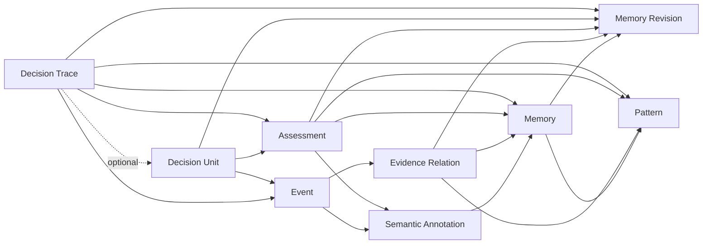

# 通用认知数据语义模型设计

> 版本：v1.0 Draft  
> 日期：2026-10-28  
> 文档性质：逻辑数据语义与生命周期设计  
> 上位架构：[ai-memory-architecture-kernel-std.md](ai-memory-architecture-kernel-std.md)  
> 相关集成：[ai-memory-llm-integration-design.md](ai-memory-llm-integration-design.md)

## 1. 目的与边界

本文定义长期认知系统的逻辑数据对象、对象关系、来源与信任、时间与版本、采集目的、共享与并发、生命周期、删除和派生视图语义。

本文不定义数据库表、字段类型、索引引擎、向量模型、评分公式或物理消息格式。授权、风险、审计和 Kernel 职责由架构文档定义；LLM 状态机和协议对象由集成设计文档定义。

### 1.1 设计目标

1. 用稳定的跨领域原语表达任何已接入通道中的经历，而不是以项目、领域或预设场景分类作为数据主键。
2. 区分观察、语义解释、经验、模式、证据、评估和决策使用轨迹。
3. 支持来源追溯、反证、时效、纠错、撤销、共享、并发修订和受控遗忘。
4. 为跨情境、跨领域的机制比较提供最小关系语法，而不构造封闭业务本体。
5. 使长期采集与记忆复用受明确目的、策略依据、留存边界与撤销状态约束。

### 1.2 核心不变量

```text
观察记录 != 外部世界真相
语义解释 != 观察记录
可复用记忆 != 已验证事实
模式 != 自动适用规则
时间相关 != 因果关系
历史可审计 != 历史内容永久可读
Context != 长期记忆、人格或授权载体
```

M1 在其运行与留存期内只保留足以解释可复用经历如何形成、修订、限制或退役的最小演进关系。它不要求保存每次中间语义理解、建立全对象修订体系，或承诺向 M2/M3 迁移数据与数据模型。

## 2. 领域无关的最小语义语法

系统不定义“代码故障”“工厂协作”等固定场景类型。所有开放语义均可用 `SituationFrame` 描述，并以以下关系原语支持比较：

```text
goal
object
constraint
role
dependency
action
outcome
failure_condition
```

这些原语是表达关系的最小语法，不是业务枚举，也不限制 LLM 使用新的术语或类比线索。

`SituationFrame` 至少表达当前目标、主体与对象、条件与约束、环境、预期结果、不确定性、候选机制和类比线索。它用于检索、比较和适用性判断，不作为访问主键或不可变事实。

新任务、领域或生活场景不得定义专属长期记忆对象、专属学习状态机，或绕过 Event、EvidenceRelation、Assessment、DecisionTrace 和生命周期的更新路径。新通道、工具和领域术语只能以可观察输入、开放 SituationFrame 或受控外部能力接入同一认知内核。

## 3. 逻辑对象

### 3.1 Event：观察事件

`Event` 是追加式观察记录，描述系统实际收到、执行或观察到的输入、工具调用、工具结果、外部反馈、交付和状态变化。它是历史活动回忆的事实底座，不是可复用经验、当前判断或完整聊天记录。

每个事件必须关联：

1. 来源身份、来源类型、采集方式、来源根标识和信任等级。
2. 授权作用域、主体、调用或因果链路。
3. 采集目的、策略依据、留存边界与撤销状态。
4. 有效时间与系统记录时间。
5. 原始内容或受控对象引用，以及其完整性信息。

每个 Event 还必须具有可跨重放验证、并在未来跨进程部署时可独立验证的逻辑身份：系统分配的 `eventId`、来源可提供时的 `producerEventId`、`idempotencyDomain + idempotencyKey`、`sourceRootId`、`traceId` 或 `causalRef`、`occurredAt` 与 `recordedAt`、以及 `schemaVersion` 和 `payloadDigest`。`eventId` 标识本系统记录；`producerEventId` 标识来源发生；幂等键只在其声明的去重域内有效；`sourceRootId` 用于独立证据判断。来源可提供 `producerSequence` 时，系统只在该可信生产者范围内使用它校验顺序；跨来源不要求全局总序，只能依据因果关联与双时间表达先后。系统晚收到 Event 不得自动推断为事实晚发生。

Event 不将用户陈述、工具输出或执行回执自动提升为外部世界真相，也不因事件先后关系自动声明因果。

#### 3.1.1 可回忆活动的最小记录契约

只有已接入、具备明确采集目的、策略依据与留存边界的活动才可产生用于历史回忆的 Event。进入该范围的 Event 必须额外表达：它在活动链中可证明的观察断言、相关参与者角色、`traceId` 或请求关联及可用的因果关联；涉及交付或外部结果时，还必须包含受控内容、回执或对象引用及其完整性信息。活动断言是对单个观察的限定，而不是跨领域的全局工作流状态机；同一活动可由多个不可变 Event 分别证明请求、提议、裁决、尝试、派发、外部结果、交付、取消或失败等不同事实。

对用户可见输出，至少区分“已生成”“已向外部通道派发”和“通道已确认交付”三种可观察事实。只有受控通道提供可验证回执时才可记录或表述“已确认交付”；没有该回执时，系统最多表述已生成或已派发，不得推断用户已收到、阅读或理解。它们是可并存的 Event 断言，而非需要所有活动遵循的全局状态机。

`output_generated` 必须绑定不可变的受控输出工件引用、其版本与内容摘要。任何 `delivery.enqueue` command 都必须引用该生成 Event 和工件；若通道需要脱敏、渲染、截断、本地化或格式转换，command 还必须引用获准转换的策略或版本，并绑定派发工件及其摘要。`output_dispatched` 和 `delivery_confirmed` 必须回链 command、生成 Event、源工件与实际派发或确认工件的摘要。因而生成内容与派发内容不要求字节相同，但其差异必须可解释、受批准且可审计；当前重新生成的内容不得替代历史工件。

`ArtifactRef` 是受控原始内容或派发内容的不可变逻辑引用，不是新的认知 Store 或可复用经验。它至少表达逻辑身份、版本、内容摘要、受控介质位置、`staged | committed | orphaned | logically_blocked` 状态、生成 Event 或获准转换引用及留存或 Tombstone 约束。只有已完成摘要和完整性验证、处于 `committed` 且当前未被逻辑阻断的工件，才能由可披露 Event 引用。工件可先在私有暂存位置物化；只有其可验证引用与对应 Event 或 command 在控制事务中成功持久化后才成为历史可用内容。事务失败或进程中断留下的 `orphaned` 工件只可隔离或受控回收，不能被查询或派发链表述为历史输出；Tombstone 先使引用 `logically_blocked`，物理清理可异步完成。

参与者按观察需要明确引用 `requester`、`affected_subject`、`proposer`、`executor`、`confirmer` 或 `deliverer` 等角色；未记录某个角色时，系统不得从当前主体、来源身份或语义相似性推断其身份。活动断言、角色、关联和交付引用是逻辑语义，不冻结字段名、事件类型枚举或物理存储格式。

各类可回忆事实必须由下列可信生产者在发生时写入，不能由 LLM 在查询时补造：

| 可证明的事实 | 可信生产者 | 产生时机 |
|---|---|---|
| 请求已收到、请求者、目标线索 | Gateway、Receive 或受控输入适配器 | 接收已允许采集的输入时 |
| LLM 曾提出认知变化提议 | LLM Adapter 的已校验 `ReflectionProposal` 记录；由 Orchestrator 受限内部调用记录 | `ReflectionProposal` 已通过 Validator 协议校验且 Guard 允许记录时 |
| 治理裁决的可披露结论或稳定引用 | Guard 的可审计裁决摘要或稳定引用 | GuardDecision 完成时 |
| 工具或执行已尝试、已派发 | 受控执行适配器、External Executor 或受控交付适配器 | 实际调用、派发或补偿发生时 |
| 外部结果、完成、失败、取消或部分结果 | 受控执行器回执、受控工具结果，或经受控观察入口验证的人工提交外部证据 | 收到可验证观察时 |
| 输出已生成 | LLM Adapter 的受控输出生成记录或受控输出生成适配器 | 已形成可交付输出时 |
| 输出已向外部通道派发 | Deliver 阶段或受控交付适配器 | 提交给外部通道时 |
| 输出已确认交付及其实际内容 | 提供可验证确认回执的受控通道适配器 | 收到确认回执时 |

若某类生产者未接入、采集不被允许、引用未保存或来源不可验证，系统只能将对应事实标记为未记录、不可访问或无法确认；不得用提议、当前生成内容、审计元数据或相邻 Event 替代实际执行、交付或外部结果。`llm_proposal_recorded` 只能在 `ReflectionProposal` 通过 Validator、Guard 已为该记录签发留存授权且 Memory Tool 验证 Adapter、协议、稳定 `proposalId`、所属模型调用或认知轮次、提议摘要、允许引用、目的和每个来源的派生留存边界后，经 Orchestrator 的受限内部调用持久化；工具意图、阶段性 `CognitiveEnvelope` 或普通回答不能自动形成该 Event。相同 `proposalId` 与调用或轮次关联在其声明幂等域内只能记录一次；后续提交、Trace 或审核项可引用该记录，但不能以引用反向补造未记录的提议。它只证明提议记录发生，不能被解释为提议正确、被接受、被执行、外部效果发生或独立证据。任何持久化派生物都必须逐一验证全部来源的当前采集、目的、留存与派生留存资格，或验证 Guard 对明确控制目的签发的不可逆最小化派生许可；不得由处理、读取、模型调用或其他派生物许可推定。未获采集授权、`non-recordable`、`capture_denied_or_revoked` 或 `capture_validation_rejected` 的输入可以按处理授权参与当前任务，但不是任何可持久对象的来源：DecisionTrace、ArtifactRef、生成输出、SemanticAnnotation、ReflectionProposal、Memory、Assessment、`llm_proposal_recorded` 和 Audit 均不得保存其原文、可逆摘要、可重新识别语义或足以重建该输入的派生内容。只有 Guard 为独立的控制、留存目的明确签发许可且内容已按该许可不可逆最小化后，才可保留不含该输入语义的受限控制记录；该记录不得回填为历史活动、认知来源或可复用经验。GuardDecision、GovernanceBinding 和 CapabilityGrant 是控制面依据，不是 Event 或外部世界事实；DecisionTrace 与 ActivityRecallView 只能在当前披露政策允许时引用其可披露结论或稳定引用，不能将其表述为外部动作已经发生。普通回答或交付可在满足采集约束时产生 Event 与受控输出引用，但不因此创建 DecisionUnit 或进入结果观察流程。

外部效果的授权记录不自动成为 Event，也不得表述为效果已经发生。LLM 或 Orchestrator 的行动提议只能为 `propose` 或 `abstain`；`abstain` 表示未形成行动主张。Guard 独立输出 `effectAuthorization = deny | allow | allow_with_checks | require_human`；`deny` 表示当前治理禁止执行，不能与 `abstain` 或实际执行失败混用。每个获准外部效果必须先形成不可变 `EffectIntentSnapshot`，规范化绑定动作、目标、目的、授权作用域、输入或工件摘要、`effectCorrelationKey`、幂等域与键、创建时间、协议或策略版本、规范化版本及完整性摘要。每种动作必须有唯一注册的 canonicalization owner；该 owner 按动作已注册的、版本化确定性规范化规则在意图形成处计算快照，并在快照中绑定自身稳定标识与规则版本。Orchestrator 只调用该 owner 并传递结果；Guard 只验证并裁决该稳定引用或摘要，不构造、补全或重新解释原始动作意图。后续审核、检查、command 与执行 attempt 只能传递并验证同一稳定引用或摘要，不得从原始输入各自重建。它是 command、CheckObligation、效果授权审核和重新裁决共同引用的运行期意图契约，不是新的长期认知对象、可重放凭证或独立 Store。GuardDecision 与 CapabilityGrant 绑定该快照的稳定引用或摘要及受限的 `traceId`；同一 command、检查、审核或执行 attempt 不得以语义近似但摘要不同的意图替代它。

`allow_with_checks` 必须由 Guard 以一个或多个不可变 `CheckObligation` 明确其检查类别、受控 checker runtime role 或可信来源、绑定的动作/目标/目的/作用域与输入摘要、策略和 checker 版本、所需结果、时效及执行点。执行点只能为 `pre_enqueue` 或 `pre_dispatch`：前者的全部有效 `CheckAttestation` 必须在请求 `effect.enqueue` 前存在；后者将 obligation 及其验证规则绑定进 command，执行器在每次实际调用外部目标前必须重新取得当前授权并验证与该次 dispatch lease 或 fencing 代次绑定的新鲜证明。`CheckAttestation` 只能由注册 checker 或可验证来源产生，并绑定 obligation、结果、输入摘要、产生时间、到期时间、完整性证明与受限原因码；`pre_dispatch` Attestation 还必须绑定 command 身份及当前 dispatch lease 或 fencing 代次。它是短生命周期治理记录，不是 Event、Memory、Assessment、可重放授权凭证或独立长期 Store；检查通过不表示效果已授权、已调度或已发生。Guard 在签发 `effect.enqueue` grant 时重新裁决当前策略和全部 `pre_enqueue` 证明；Memory Tool 在写入 command 时再次验证其绑定、时效、Tombstone 与 grant。执行器只能使用与当前 attempt 绑定且未过期的 `pre_dispatch` Attestation；旧 attempt 的证明不得复用。执行器或 checker 在重新检查时不得调用会创建、冻结、预留、提交或以其他方式改变外部资源的能力；这类操作是独立外部效果，必须走自身的 `ExecutionDecision`、Guard 和 command 路径。证明失败或失效时，执行器只能按当前政策阻断、取消或使 command 进入 `awaiting_human_review`；`command_settlement_review` 只能提出恢复或取消，且仅在已持久化的受控观察证明目标未接收或未执行，或已验证强幂等、当前 Guard 与策略均允许重新派发时，Memory Tool 才可迁移为新的 `pending`，否则保持等待或迁移为 `cancelled`。仅在尚未调用目标且重新检查被明确允许时，才可经 `retryable_failure` 回到新的 `pending`。不得伪造执行 Event。

只有 `ExecutionDecision = propose` 已通过 Validator，且 Guard 已裁决 `effectAuthorization = allow`，或 `allow_with_checks` 的当前 `pre_enqueue` 检查已经成功满足时，Orchestrator 才可请求 `effect.enqueue`。`deny`、`require_human`、未满足当前阶段检查或政策要求的结果锚点持久化失败均不得创建 `external_dispatch` command；它们必须按当前策略结束为不调度、受限降级或对未调度效果创建 `effect_authorization_review`，不能以“稍后补齐”方式绕过调度前置条件。受控系统可将已通过目标侧校验的派发请求写为 `effect_dispatch_requested` Event，并在同一事务写入受限 Outbox command；它只证明系统已持久化调度请求，不证明外部调用已发生。`external_dispatch` command 是可靠投递的运行记录，不是长期语义对象或新的 Effect Store；索引、摘要、删除传播、结果 Event 投影等 `internal_derivation` Outbox 工作项不得借用外部派发的 runtime role 重授权、lease 或 acknowledgement 语义。

`external_dispatch` command 的不可变部分至少绑定 command 身份、请求 Event、EffectIntentSnapshot 引用或摘要、允许的 dispatch consumer 类型、允许的 reconciliation consumer 类型、目标的幂等与状态查询能力声明、`traceId`、效果关联、幂等域与键、动作和目标约束引用、原始目的引用、到期或重试策略、所有 `pre_dispatch` CheckObligation 及其允许 checker、输入绑定、时效和 attempt 验证规则、以及非秘密治理引用；它不得永久绑定可能过期的 `CheckAttestation`。目标声明的强幂等能力必须同时绑定目标身份、EffectIntentSnapshot 摘要、幂等域与键、保证有效窗口、重复调用的无新增效果语义，以及可验证的原结果或目标状态查询能力；仅有本地去重、最佳努力去重、未绑定输入摘要或保证窗口已到期的声明都不是强幂等。运行状态仅可为 `pending`、`leased`、`retryable_failure`、`outcome_unknown`、`terminally_rejected`、`cancelled`、`awaiting_human_review`、`completed` 或 `dead_letter`。`pending -> leased` 只能由注册 dispatch consumer 取得当前 dispatch lease 后发生。持有有效 dispatch lease 的 consumer 只能将 command 迁移为 `completed`、`retryable_failure`、`outcome_unknown`、`terminally_rejected`、`cancelled` 或 `awaiting_human_review`。`retryable_failure` 只适用于尚未实际调用目标，或能够证明外部目标尚未接收或尚未执行调用的失败；它仅在重试预算、命令到期、Tombstone、当前授权和所需重新检查均允许时回到新的 `pending`，否则进入 `dead_letter`。实际调用已发起但因超时、连接中断或回执丢失而无法确认目标是否执行时，dispatch consumer 必须迁移为 `outcome_unknown`，不得自动回到 `pending`。

`outcome_unknown` 只能由注册 reconciliation consumer 持有当前 reconciliation lease、以受控 runtime role 取得当前 Guard 授权后收敛。该 consumer 只能查询 command 已声明支持的目标状态能力，或在原动作、目标、目的、作用域、关联键和幂等边界内准备一次仍在保证窗口内的已验证强幂等重试；它不得直接派发、修改 command 意图或创建新的效果。受控目标状态查询或可信回执证明 consumer 的自动派发责任已经结束时，可迁移为 `completed`；`command_settlement_review` 只能提供或验证这类证据，不能仅凭程序性结论使 command 进入 `completed`。确认不再继续自动处理时可迁移为 `awaiting_human_review` 或 `cancelled`；只有受控查询或可信回执已持久化为 Event 且证明目标未接收或未执行，或者目标已声明、当前可验证且仍在保证窗口内的强幂等能力、当前策略明确允许重新派发并重新取得当前授权时，才可迁移为新的 `pending`。后一种迁移必须使所有旧 dispatch 或 reconciliation lease 失效，之后只能由新的 dispatch lease 实际派发。强幂等不是 `retryable_failure` 的证明条件，`outcome_unknown` 也不表示外部动作未发生、失败或成功。`command_settlement_review` 的程序性结论只能提出 `resume_if_evidence_satisfies_policy` 或 `cancel`；Memory Tool 只有在前述 Event 或强幂等条件及当前 Guard 裁决同时满足时，才可将 `awaiting_human_review` 迁移为 `pending`，否则只能保持等待或迁移为 `cancelled`。`completed`、`terminally_rejected`、`cancelled` 与 `dead_letter` 是自动派发终态，不能由普通 consumer 逆转。任何 lease 超时后的重新领取必须使旧 lease 失效，旧 consumer 的 acknowledgement 都必须被拒绝。死信恢复必须经过受控运维操作重新排队或创建新 command，不能隐式重放。

consumer 只能经受限 command acknowledgement 报告其运行态；acknowledgement 至少绑定 command 身份、consumer runtime role、当前 dispatch 或 reconciliation lease 标识或代次、command 状态版本或 fencing 引用、幂等域与键、目标运行态、受限原因码和双时间，并可附带已持久化观察 Event 的稳定引用或摘要。Memory Tool 必须验证 consumer 类型与 runtime role、其角色允许的 lease/fencing、状态版本、幂等边界、合法迁移，以及命令到期、Tombstone 和当前运行策略；acknowledgement 只改变该 command 的运行态，不创建 Event、语义对象或 DecisionUnit。`completed` 只表示该 consumer 已结束本 command 的自动派发责任，不表示外部业务成功、交付确认、结果已观察或观察事实已被记录；当 consumer 已确认不再承担自动派发但对应观察授权被拒绝或 Event 持久化失败时，仍可进入 `completed`，同时仅保留受限观察记录诊断。若目标是否已接收或执行无法安全判断，则必须进入 `outcome_unknown`，不得以 `completed` 替代。观察 Event 的缺失、延迟、被 Guard 拒绝或持久化失败不得驱动已发生调用的自动重试。观察记录只有在 Guard 签发对应事实类别 grant 且 Memory Tool 持久化成功时才形成 Event；拒绝或持久化失败只可留下受限治理或运行诊断，不能作为历史事实、自动结算证据或外部动作未发生的证明。该诊断最多绑定失败类别、来源身份、关联键、载荷或回执摘要、发生时间和可重新获取或验证的受控引用，并只用于告警、限次再摄取、人工定位或死信分析；只有原始证据仍合法可得且重新经 Gateway、Guard 与 Memory Tool 成功持久化为 Event，才可参与自动结算。除仍在保证窗口内的已验证强幂等恢复外，诊断本身不得使 command 进入新的 `pending`；它不改变已确定的 `completed`，也不能将未知结果收敛为完成。每个合格结果 Event 在持久化时必须原子写入仅用于发布该 Event 的 `internal_derivation` Outbox 工作项；Orchestrator 消费该工作项后，只有在既有 DecisionUnit、结果关联约束、观察资格、Tombstone、关闭状态和当前 Guard 授权均匹配时，才可请求 Memory Tool 以 compare-and-set 归并该 Unit。即时、迟到、重复或重放的结果 Event 使用同一归并路径；没有匹配 Unit 或未启用结果观察的 Event 仍可作为独立观察事实存在，但不得更新 Unit。执行器或 reconciliation consumer 只能在原始动作、目标、目的、预算和授权作用域内重新申请当前 runtime role 授权，不能借重新授权扩大命令意图。若当前授权拒绝且尚未发生实际调用，command 必须进入 `terminally_rejected`、`cancelled` 或策略要求的 `awaiting_human_review`，不得写入“已尝试”或“已执行” Event；只有受控执行、交付或补偿适配器实际尝试、派发、失败、补偿或收到回执时，才可请求按对应来源写入独立的观察 Event。重试、取消和重放必须重查 Tombstone、命令到期与当前授权；已发生实际调用后，后续取消、授权变化或 Tombstone 只能阻断后续派发、重试或观察，不能将历史改写为未执行。

#### 3.1.2 Command Runtime：受限外部派发运行记录

`CommandRuntime` 是 `external_dispatch` command 的操作性运行记录，承载不可变 command 意图及其 `lease`、`fencing`、状态版本、重试与到期策略、acknowledgement、reconciliation 资格和最小诊断留存。它不属于 Event Store 的观察事实，不属于长期认知对象，也不作为 `ActivityRecallView` 或 `CurrentMemoryView` 的直接来源。Outbox Runtime 是其唯一运行态所有者；dispatch 或 reconciliation consumer 只可在当前 runtime role、lease 和状态版本约束内提出 acknowledgement。

进入 `outcome_unknown` 时，Runtime 必须为该 command 保持至多一条有效 reconciliation 路径，并记录下一次可尝试时间、尝试计数和查询预算。该路径每次都重查当前授权、到期、Tombstone 和目标声明的状态查询或强幂等能力；它只能收敛到既有的 `completed`、新的 `pending`、`awaiting_human_review` 或 `cancelled`，不得创建新的效果、修改原意图或将运行诊断升级为观察 Event。

### 3.2 SemanticAnnotation：语义解释

`SemanticAnnotation` 是 LLM 或受控规则基于一组 Event 提出的不可变解释候选。它必须引用来源事件，并能被后续证据支持、质疑、替代或失效。M1 中解释变化以新的候选对象及其关系表达，不要求为每个解释建立稳定身份与 Revision 容器。

它包含 `SituationFrame`、实体与关系线索、候选机制、解释不确定性和适用边界。为支持跨情境比较，它还包含开放的 `ClaimDescriptor`：候选机制或结论、行动与结果关系、适用与失效条件、不确定性，以及 `SituationFrame` 中可比较的关系锚点。`ClaimDescriptor` 不是全局唯一事实或固定领域本体；多个冲突解释可以并存，不以静默覆盖方式收敛。

### 3.3 Memory：可复用经历

`Memory` 是可供未来任务调用的经历稳定身份；`MemoryRevision` 是该经历在某一时点的不可变表达。一个修订保留同一经历中共同成立的情境、行动、可观察结果、候选教训、适用前提和不适用条件，并可包含多个可回链到该整体经历的 `ClaimDescriptor`。

修订、纠错、补充边界与并发分歧不得覆盖旧修订；它们通过基础版本、EvidenceRelation 和 Assessment 追加表达。记忆不是事实的替代视图；它必须保留到来源 Event、SemanticAnnotation 和 EvidenceRelation 的可追溯路径。可比较的子主张不得脱离其整体经历、适用条件和不确定性被解释为普遍规律。

### 3.4 Pattern：可迁移机制

`Pattern` 是在多个经历共同证据上形成的高抽象层级 Memory。它保存目标结构、关系机制、前提、反例边界和结果信号，而不是某个领域的固定答案。M1 中 Pattern 只可作为低强度、不可静默覆盖的 `candidate`，且必须引用至少两个可比较的 `MemoryRevision`、其来源根独立性、共同机制及当前适用前提和反例边界；单一经历只能形成 Memory、SemanticAnnotation 或候选机制解释。候选 Pattern 可追加支持、反证、条件边界、竞争解释或替代关系，但不得自动晋升为 `supported`。实质变化可以以新 Pattern 和 `supersedes` 等关系表达，不要求预先建立完整 `PatternRevision` 模型。

例如，“规划 -> 分工 -> 并行推进 -> 汇总 -> 质检 -> 反馈修正”可由一个领域中的经历提出，并在目标结构、依赖关系和适用条件相近的另一领域中被比较。迁移依据是机制与边界匹配，而不是来源领域标签。

### 3.5 EvidenceRelation：证据关系

`EvidenceRelation` 连接 Event、SemanticAnnotation、Memory、MemoryRevision、Pattern 与 Assessment，表达：

```text
supports
contradicts
contextualizes
derives
supersedes
```

关系必须说明关联对象、关系成立的情境范围、比较维度、有效时间范围、来源质量、来源根独立性和不确定性。针对具体经历表达的支持、反证、派生、替代、结果回流或删除依赖必须指向 `MemoryRevision`；`Memory` 级关系只用于不依赖具体修订的稳定关联，不得替代修订级关系。派生或来源关系还必须表达其依赖角色：对象的合法表达是否以该来源为必要基础、是否只是可替代的支持，或是否仅为比较背景。该角色用于 Tombstone 的有界传播，不产生新的长期对象或隐含依赖图。只有在目标、条件、时间与比较范围充分重叠时，`contradicts` 才表示直接反证；条件不同但能解释结论差异时应使用 `contextualizes`。相同根源的重复 Event 不得被计为独立证据。

### 3.6 Assessment：当前判断

`Assessment` 不重写目标内容，只追加对目标对象的、有依据且有范围的判断，例如：

```text
证据状态
时态状态
当前适用性
冲突或条件差异状态
认知提交裁决
```

每项 Assessment 必须关联目标对象或具体 `MemoryRevision`、判断维度、适用情境或条件范围、有效时间和可审计依据；不同维度或不同范围的判断可以并存，不能以单一“最终状态”互相覆盖。历史正确不等于当前有效，证据充分不等于当前适用。这两个判断必须独立保存。Tombstone、归档和过期机制拥有内容生命周期；当前读取授权由请求期 Guard 与目标侧验证重新裁决。Assessment 可以关联其生成时的授权决策作为审计上下文，但不能声明对象永久可读或不可读。查询期 `CurrentMemoryView` 依据当前 SituationFrame 合成 `current usability`；该视图结论不是新的全局 Assessment 或事实。

### 3.7 DecisionTrace：决策使用轨迹

`DecisionTrace` 是按当前采集政策获准留存的最小决策依据记录，可包含零个或多个 `DecisionUnit`。它可以保存当前允许披露的任务目标、约束、被使用或排除的 MemoryRevision、可见证据与反证、冲突状态、适用条件、回答或行动提案、治理裁决引用和受限审计摘要，以解释当时记录到的决策依据；这些引用不等于模型内部思维或未记录的动机。Trace 的每一项输入、摘要、工件或语义引用都必须独立满足当前采集、派生留存与最小披露许可；处理但不可记录的输入不得通过 Trace、引用关系或可逆摘要间接保留。决策依据是否采集由当前目的、风险、复盘或人工审核需要、采集政策和留存边界共同决定，而不是由任何回答自动触发：普通回答、开放式建议或纯回忆可只有受控 Event，且没有可披露的 DecisionTrace；此时历史视图只能说明依据未记录、不可访问或无法确认。

Guard 对同一输出或行动分别裁决 `effectAuthorization = deny | allow | allow_with_checks | require_human`、`decisionBasisCapture = none | minimum` 和 `outcomeObservationEligibility = disabled | enabled`。三者都是请求期策略输出，不是新的长期对象，LLM 不得设置或扩大其内容范围：`effectAuthorization` 只决定效果是否可执行；`decisionBasisCapture` 只决定是否持久化最小 DecisionTrace；`outcomeObservationEligibility` 只决定是否允许建立 DecisionUnit 并将后续结果定向回流。合法组合固定如下：`none + disabled` 不创建 Trace 或 Unit；`minimum + disabled` 只持久化独立最小 DecisionTrace，称为 `basis_only`；`minimum + enabled` 持久化包含 DecisionUnit 的最小 DecisionTrace；`none + enabled` 非法，Guard 不得签发。`basis_only` 因而是组合的派生描述，不是与 `minimum` 并列的 Guard 原始枚举值；它不创建 DecisionUnit，不记录结果关联键、观察窗口或 `outcome_pending`，也不进入结果状态机。只有结果来源和关联通道受控、观察窗口有意义、结果对后续经验有价值，且 Guard 将 `outcomeObservationEligibility` 设为 `enabled` 时，DecisionUnit 才连接当前任务与情境解释、相关经历与证据、回答或行动提案及预期结果；该单元的结果关联键、观察窗口、`traceId` 与幂等或请求关联引用必须在输出或效果对外可观察前持久化。外部效果始终还须获得独立的 `effectAuthorization`；低风险效果可在 `none + disabled` 或 `minimum + disabled` 下执行并由实际观察 Event 记录，高风险策略可要求 `minimum + enabled` 才允许执行。普通回答、开放式建议或纯回忆不因此创建待结果流程。

后续结果以 `OutcomeObservation` 表达；它是基于具体 DecisionUnit、其已消费的受控 Event 引用及状态版本形成的可重建语义投影，而不是新的长期核心对象或脱离决策的成功、失败标签。创建 DecisionUnit 时必须同时持久化不可变 `OutcomeObservationContract`：允许的结果断言类别和来源类型、关联域及其唯一关联键、幂等边界、一个 Event 可消费的 Unit 基数与明确允许的 fan-out、歧义或冲突关联时只保留 Event 而不归并的规则、最小完整性条件、是否允许部分观察、观察窗口、迟到 Event 的处理方式以及可使状态进入 `confirmed` 的充分条件。同一关联域内，未被契约明确允许的一个 Event 不得更新多个 Unit；不能确定唯一匹配 Unit 时，Orchestrator 必须拒绝归并并保留该 Event 作为独立观察。它是 DecisionUnit 的组成契约，不是新的 Store、通用工作流或领域成功标准。DecisionUnit 持久化该契约引用或摘要、结果关联约束、观察窗口、结果状态、已消费 Event 引用、幂等边界、状态版本和迟到标记。其 `outcomeState` 只能为 `outcome_pending`、`partially_observed`、`confirmed` 或 `expired_without_outcome`，`observationClosure` 只能为 `none` 或 `unavailable`；二者正交，均不表达领域成功、失败或取消。`confirmed` 只表示已消费的合格 Event 满足该 Unit 创建时的完成性契约，不表示行动成功、经历正确、机制或因果关系成立。观察窗口到期且未收到合格结果时，系统记录 `expired_without_outcome`，表示窗口内未观测到结果；该记录不阻断之后带合法关联键的迟到 Event 形成带迟到标记的 OutcomeObservation，并将单元更新为 `partially_observed` 或 `confirmed`。

当仍可合法保留的 DecisionUnit 因策略、生命周期或来源变化而不再允许或无法继续采集、关联或解释后续结果时，Lifecycle Worker 只产生受限的 ObservationLifecycleSignal；Orchestrator 校验 Unit 当前版本、Tombstone、留存与治理条件后请求 Guard 授权，Memory Tool 以版本比较和幂等边界持久化 `observationClosure = unavailable` 及关闭时间、受限治理原因引用。相同链路用于观察窗口到期：Worker 只报告到期条件，Orchestrator 才可发起 `outcome_pending -> expired_without_outcome`。

状态归并由 Orchestrator 选择、Guard 授权、Memory Tool compare-and-set 落库，CAS 只保证原子性而不定义业务含义。每次受控状态变化必须在同一控制事务中持久化状态变更与其内嵌的非秘密 `GovernanceBinding`：GuardDecision 标识或摘要、决策类别与结果、策略版本、授权事实快照摘要、actor 或 runtime role、输入或意图摘要、幂等边界、评估时间、协议版本及受限原因码。`GovernanceBinding` 是状态记录的一部分，不是新的 Guard Store、长期语义对象或可重放凭证；完整遥测可异步投递到 Audit，但不得成为这些依据的唯一副本。Tombstone 永远优先：被删除的 Unit、Trace 或必要来源不得再接受关联、状态迁移、关闭记录、身份或关联键恢复。对未删除 Unit，满足 OutcomeObservationContract、关联约束且 `observationClosure = none` 的合格结果 Event 可按完整性规则将 `outcome_pending` 或 `expired_without_outcome` 迁移为 `partially_observed` 或 `confirmed`；重复 Event 只确认既有消费记录。到期只基于截止时已持久化且合格的 Event 判断，不能把未观测到结果写成结果不存在。`observationClosure = unavailable` 后不得关联新收到的结果 Event，但在关闭前已持久化、匹配且尚未归并的 Event 可按原完整性规则完成一次幂等归并。`confirmed` 后的重复 Event 不改变结论，新的合格补充 Event 仅在不改变其完成性语义时追加已消费引用。

ObservationCorrection 或 ObservationInvalidation 只在其目标 Event、声明用途或影响范围内改变当前证据资格。每条记录必须指向被影响 Event，并声明生效时间、受控原因、来源完整性信息和影响范围；Correction 若替代或限定既有 Correction，必须显式引用其 `supersedes` 关系。对同一目标和重叠范围，若存在多个仍有效且未被 supersede 的 Correction，或其范围与断言无法确定性合并，则该范围的原 Event 必须保守地视为不合格，直到出现可验证且无冲突的新观察 Event。Invalidation 对其覆盖范围具有终止性：后续 Correction 不得使原 Event 恢复资格；需要恢复可用断言时，必须经受控观察路径记录新的 Event。Tombstone、当前授权、留存失效和来源失效始终优先于任何 Correction。Memory Tool 在持久化资格变化时原子更新受影响 Event 的资格投影并发布仅用于结果重算的 `internal_derivation` 工作项；它不自行选择或推进 DecisionUnit 状态。

Orchestrator 消费该工作项后，按受影响 Event 引用、DecisionUnit 当前版本与资格投影水位线幂等选择重算，并向 Guard 请求对应 Unit 状态迁移授权；Memory Tool 仅在当前授权、Tombstone、版本、关联约束和水位线匹配时以 compare-and-set 持久化重建。重建只使用仍合法、仍合格且已消费的 Event 及不可变 OutcomeObservationContract，不创建第二结果状态机或新的长期对象。若剩余 Event 不再满足完成性条件，`confirmed` 必须迁移为 `partially_observed`；若没有满足最小部分观察条件的 Event，则按当前时间和观察窗口迁移为 `outcome_pending` 或 `expired_without_outcome`。历史 Event、已追加的状态变更和其 GovernanceBinding 均不得改写；新的投影或状态变化必须追加并绑定新的 GovernanceBinding。该重建只改变该 Unit 的当前结果投影：对以受影响 Event 为必要基础的 Assessment、EvidenceRelation、MemoryRevision 或 Pattern，Memory Tool 必须立即使其退出原有复用资格，`CurrentMemoryView` 只能按剩余合法独立来源排除或保守降级；Lifecycle Worker 再追加可确定的受限影响，后续认知提交才可重新评估其开放语义，不得被运行时直接改写。`outcome_pending + observationClosure = unavailable` 仅表示当前无法继续观察，不表示结果未发生；对外只能按当前披露策略说明无法确认后续结果。结果关联只确定其回流范围；结果只能经后续认知提交支持、限制或修订该单元关联的 Assessment、EvidenceRelation、适用边界或新修订，不能模糊影响仅语义相似的 Memory。`DecisionTrace` 支持审计重建、纠错和复盘，但不将一次决策自动升级为事实、记忆或 Pattern。

## 4. 对象关系与引用完整性



必须保持以下引用不变量：

1. 语义解释、记忆、模式和 Assessment 的来源引用可审计。
2. 缺少来源、授权或删除状态不确定的对象不可注入 LLM 上下文或用于外部效果。
3. 派生关系不可覆盖原始观察事件；冲突通过关系和 Assessment 追加表达。
4. 派生对象必须继承来源的删除、访问和保留约束。
5. 满足结果观察资格的 DecisionUnit 必须在输出或效果对外可观察前持久化，并可由受控结果 Event 的关联键唯一定位；同一受控回执重复到达只形成一次 OutcomeObservation。没有稳定锚点的结果不得回流到长期认知对象。执行效果的稳定关联字段不等于 DecisionUnit：未启用结果观察的效果只能形成可审计的 Event 链，不得创建或更新 DecisionUnit。

## 5. 来源、信任与结论强度

### 5.1 来源信任

来源信任用于判断证据在何种程度上可支撑后续判断，不用于将任何来源直接等同于真相。至少区分来源身份、来源类型、采集方式、完整性状态和信任等级。

观察 Event 的来源可以是用户输入、受控工具、外部系统回执、经受控观察路径验证的人工提交外部证据，或受控离线派生。人工审核的程序性结论本身不是观察来源。LLM 仅是 `SemanticAnnotation`、`ReflectionProposal` 或其他候选解释的提出者，不能成为观察 Event 的采集来源。LLM Adapter 可以作为受控协议记录的生产者，记录“LLM 曾提出某项解释或提议”这一观察事实；该记录只证明提议发生，不能作为外部世界事实、实际执行、交付或结果的独立证据根。不同来源可以相互支持或相互冲突。

### 5.2 结论强度

对行动与结果的关系分为：

1. `observed_association`：观察到行动与结果的时间或上下文关联。
2. `plausible_mechanism`：存在合理机制假设，但仍缺少独立验证。
3. `supported_mechanism`：具有独立来源、前提与反例边界支持。
4. `causal_claim`：经过专门验证的因果结论。

M1 只允许前两类作为候选经验或建议；后两类需要更严格的证据和治理标准。

## 6. 时间、版本与审计重建

### 6.1 双时间语义

1. 有效时间：事件或判断在所描述世界中发生或有效的时间。
2. 系统时间：系统接收、写入、修订、失效或删除该信息的时间。

在当前留存与授权允许范围内，二者都必须可用于审计重建。晚到事件、事后纠错和授权变化不得改写历史记录本身。

### 6.2 版本与并发

`Memory` 使用稳定身份与不可变 `MemoryRevision` 表达可复用经历的实质演进。新的支持、反证、条件限制、可信度或当前适用性变化优先通过 `EvidenceRelation` 与不可变 Assessment 追加表达；只有经历的可复用表达、适用边界或候选教训实质改变时才创建新修订。`SemanticAnnotation` 和 Pattern 不得静默覆盖，M1 可以通过新的候选对象及其关系表达变化。并发冲突通过修订、对象共存、EvidenceRelation 和 Assessment 表达。读取时的当前可用视图不等同于最新修订。

### 6.3 审计重建

在当前留存与授权允许范围内，系统必须能重建某次决策时可见的输入、来源、授权、工具结果、模板和模型版本。每次需审计重建的模型调用或受控认知提交还必须保存协议、能力清单、提示模板、适配器配置、动作规范化规则及生成参数的不可变内容摘要，并绑定一个不可变配置 manifest 摘要：该 manifest 至少声明实际启用的版本集合、发布或部署身份引用、生成或启用时间、每个受控内容引用、Guard 实际使用的不可变策略包内容摘要或受控归档引用，以及 Authority Provider 决策契约版本。跨部署信任边界的模型调用还必须保存唯一投影 canonicalization owner、规则标识与版本、内容分类、获批投影摘要及 Adapter 对实际序列化载荷一致性校验的结果；投影正文不是必然留存对象。每个 GovernanceBinding 必须关联同一策略内容摘要或稳定引用；仅记录策略名称或可变版本号不得满足审计重建。策略发布或部署注册方负责使启用策略包以不可覆盖的受控 `ArtifactRef` 或等价归档引用定位；Memory Tool 只持久化该身份及其留存状态。审计读取必须区分内容当前可读、当前无权披露和已按合法留存策略清理，后两者不能伪装为可完整重放。可保留内容受当前留存与最小披露约束的，必须通过受控 `ArtifactRef` 或等价归档引用定位其版本；同一 manifest 标识不得覆盖已有内容，当前取得的内容只有同时匹配其受控引用与摘要时才可用于重建。摘要或引用不得包含可重放授权秘密，也不要求为审计而复制未经允许长期保存的动态输入。此能力是审计重建，不承诺保存全部中间理解过程，也不承诺在模型或随机性无法冻结时复现相同字面输出。

## 7. 归属、共享与当前授权

每个可持久对象必须表达其适用的提出者、所属主体、授权快照、作用域、采集或复用目的、策略依据、留存边界和撤销状态；仅当对象表达对既有对象的修订、替代、挑战或派生更新时，才必须表达基础对象或基础版本。可作为 `CurrentMemoryView` 候选或经认知提交复用的 SemanticAnnotation、Memory、MemoryRevision、Pattern、EvidenceRelation 和 Assessment 还必须表达共享状态。Event、ArtifactRef、DecisionTrace、DecisionUnit、Tombstone、CommandRuntime、GovernanceBinding、CapabilityGrant、CheckObligation、CheckAttestation、ReviewItem、Audit 与其受控引用不进入认知共享升级；它们只按当前授权、目的、最小披露、留存和删除边界访问。共享状态至少区分：

```text
private
shared_by_policy
organization_curated
```

共享状态变化不是任意字段改写，而是受 Guard 裁决、Memory Tool 版本校验和当前目的约束的治理操作。`private -> shared_by_policy` 必须证明来源、派生关系和目标作用域在当前策略下可复用；`shared_by_policy -> organization_curated` 只能经当前授权的 `cognitive_review`、其 `approve_for_cognitive_re_adjudication` 结论与重新编译的 `CognitiveCommitPlan` 完成，并绑定审阅结论、目标作用域与共享升级依据。不得存在等价的未定义组织治理路径。共享升级不得扩大原始来源的可读范围、目的或留存边界；来源 Tombstone、目的撤销、共享策略收缩或必要基础失效时，Memory Tool 必须按依赖角色阻断、降级或失效受影响的共享对象。M1 可以保留 `organization_curated` 的语义状态，但在未配置相应审核角色、组织政策与运行流程前不得启用该提升转换。共享状态可随治理操作追加变更记录，但不创建独立共享 Store。

`CapabilityGrant` 是请求期控制面凭证，不是 Event、SemanticAnnotation、Memory、Pattern 或 Assessment，不能作为可持久语义对象保存、检索或复用。DecisionTrace 仅在适用的审计留存边界内关联其授权决策、凭证标识或可验证引用；不得将可重放的授权秘密写入语义存储。

`ReflectionProposal`、`CognitiveCommitPlan` 和 `CognitiveCommitResult` 同样不是长期语义对象：前者是任务期的认知变化提议，后两者分别是请求期内部提交计划与执行结果。若 ReflectionProposal 将回答、输出、执行、派发、交付或结果作为认知变化来源，必须引用已持久化的对应 Event；尚未持久化的事实不得作为来源，只能引用已有输入、工具结果、DecisionTrace 或证据。LLM 通过 `memory.correct` 只能提出对 SemanticAnnotation、MemoryRevision、EvidenceRelation 或 Assessment 的认知层纠正、失效或限制；它可以指出既有 Event 的疑点并请求核验，但不能创建、替代或直接导致 ObservationCorrection、ObservationInvalidation 或其他观察 Event。对既有 Event 的身份、内容、关联、重复判定、时间或来源资格的纠正或失效，必须由可验证外部证据来源经 Gateway、Guard 与 Memory Tool 的受控观察路径处理。DecisionTrace 可以保存其受限审计摘要、稳定对象引用和原因，但长期认知状态只能由 Event、SemanticAnnotation、MemoryRevision、Pattern、EvidenceRelation、Assessment 与生命周期记录表达。

写入时的授权快照服务于审计；读取、缓存命中、索引召回、重放和上下文注入始终根据当前授权、成员关系、共享策略、采集或复用目的、删除状态、失效状态和撤销状态重新裁决。

项目、仓库、领域和会话可以作为可选上下文或策略条件，但不能成为所有长期记忆的天然身份。

## 8. 生命周期、结果与模式治理

### 8.1 候选对象与结果状态

LLM 仅可提交 `ReflectionProposal`；它描述一次可能的认知变化，而不指定底层对象操作。Orchestrator 经 Validator 与 Guard 后编译 `CognitiveCommitPlan`；Memory Tool 校验语义不变量后才能创建语义、`Memory` 稳定身份及其初始或后续修订、模式或其他候选，并返回 `CognitiveCommitResult`。受控适配器、工具执行器和经 Gateway、Guard 与 Memory Tool 验证的人工外部证据入口才可写入 Event；ReviewItem 的程序性结论不得写入 Event。

需要后续观察的 DecisionUnit 具有以下结果状态：

```text
outcome_pending
partially_observed
confirmed
expired_without_outcome
```

`outcome_pending` 或 `expired_without_outcome` 只允许支撑低强度候选经历；未得到可观察结果的候选经历不得晋升为高质量 Pattern 或因果结论。`expired_without_outcome` 仅表示观察窗口内未获得结果，不关闭关联；可唯一定位既有 DecisionUnit 的迟到受控 Event 仍形成带迟到标记的 OutcomeObservation。无法关联既有单元的 Event 只是新的观察 Event，不得猜测性地更新既有经历。

`observationClosure = unavailable` 只适用于仍可合法保留的 DecisionUnit，表示当前不再允许或无法继续采集、关联或解释后续结果；它不改变已记录的结果状态，不等价于 `expired_without_outcome`，也不表示结果不存在。关闭原因只保留受控治理引用，对外披露必须避免暴露策略、删除或来源限制细节。

### 8.2 Pattern 生命周期

Pattern 至少经历：

```text
candidate
supported
contested
superseded
retired
```

晋升需要独立来源、适用前提、反例边界和 Assessment 支持。M1 只创建候选及其支持、反证、条件或退役语义，不自动推进 `candidate` 到 `supported`，也不承担规模化去重、冲突治理或跨作用域扩展。Ops 或 `cognitive_review` 负责晋升、去重、运营级冲突治理和高影响扩展。

## 9. 删除、保留与派生视图

`retire` 是对象仍可在合规范围保留、但当前不应默认复用的认知生命周期状态；Tombstone、目的撤销和留存到期则是独立的治理路径。后者驱动删除或受限访问传播到事件引用、语义对象、记忆、Pattern、索引、缓存、重放和备份恢复路径，不得由 `retire` 替代。

`Tombstone` 是一等治理记录，不是 Event、Memory、Assessment 或可召回对象。它至少表达目标引用或范围、生效时间、授权或留存依据引用、有界传播边界、逻辑阻断状态、物理清理状态及允许保留的最小完整性证明引用。Guard 基于 Authority Provider 的当前事实裁决其合法性；Memory Tool 在控制事务中使其逻辑阻断生效。逻辑阻断先于异步索引、摘要、工件、缓存、备份可恢复副本和物理内容清理；后者未完成不恢复读取、关联、重放或派发资格。

Tombstone 生效后，系统先阻断被删内容及其可恢复派生物的读取、索引、缓存、摘要与上下文注入。基础 Lifecycle Worker 只沿明确记录的来源依赖角色有界传播：先将直接依赖对象置于不得按原强度复用的待重评估状态，再基于剩余合法、独立且可访问的来源及预定义保守规则追加生命周期 Assessment，例如 `still_supported`、`constrained`、`evidence_insufficient`、`retired` 或 `deleted`。Worker 不生成新的机制解释、类比、适用边界或候选教训；若剩余来源是否足以支持原经验需要开放语义判断，则只保留待重评估影响并交由后续认知提交或 `cognitive_review`。只有能完全依据剩余来源重述的经历，才可创建新的 `MemoryRevision`；删除证明、影响结果或审计元数据不得恢复或推断被删内容。

已持久化的观察 Event 不可原地修改。若后续可验证信息表明其来源身份、签名、内容、关联、重复判定或时间断言不可信，受控入口必须追加 `ObservationCorrection` 或 `ObservationInvalidation` Event，并关联被影响 Event、原因、来源、双时间、完整性信息和影响范围。前者提供经验证的替代或限定断言；后者只否定原 Event 在指定用途或范围内继续作为证据的资格。它们不删除或改写原 Event，不自动等同于 Tombstone，也不自行成为外部世界事实；Tombstone 仍处理删除、留存和访问阻断。Memory Tool 必须在同一受控变更中使受影响 Event 不再满足当前证据、DecisionUnit 关联、EvidenceRelation 或视图使用条件，并发布受限内部派生工作项；该工作项只触发既有 DecisionUnit 的确定性 OutcomeObservation 重建，不是外部 command、认知提交或新的状态机。Lifecycle Worker 与后续认知提交按剩余合法来源追加受限 Assessment 或修订。

以下内容必须分层处理：

1. 可删除业务内容。
2. 受留存策略约束的审计元数据。
3. 不可恢复的完整性证明或哈希。

索引、向量和摘要都是派生视图，不得在删除或授权变化后重新暴露原始内容。异步派生和恢复任务必须检查当前 Tombstone 与授权状态。

`ReviewItem` 是受限人工处理运行记录，不是通用工作流、认知对象或事实来源。它仅可为 `cognitive_review`、`effect_authorization_review` 或 `command_settlement_review`，并绑定 subject、允许结论、所需证据引用、最小化审阅包、授权范围、到期或失效引用、审核人或审核角色引用、item 版本、审核记录和固定运行态 `open | claimed | resolved | expired | invalidated`。`claimed` 只表示获准审核人取得当前 item 的审阅资格，不改变 subject；`resolved` 只保存该类型允许的结论。授权变化、Tombstone、命令终态、效果意图快照变化、风险/预算/目的/作用域变化或 subject 不再可处理时必须使其失效并进入 `invalidated`；到期只可进入 `expired`。M1 的基础 Lifecycle Worker 必须以受控 runtime role 发现这些可确定条件，并请求 Memory Tool 在同一控制事务中按 item 版本 compare-and-set `expired` 或 `invalidated`；它不得判断审核结论、创建 Event、推进长期认知或直接改变 subject。ReviewItem 的读取、领取与结论提交均须以当前授权、item 版本和最小披露重新验证，重复或过期结论不得改变其状态。

`cognitive_review` 只能绑定不可变的认知提议快照、候选认知 delta 集合、目标对象或基础版本、所需证据引用和当前冲突范围，并只能通过既有 `CognitiveCommitPlan` 路径影响长期对象；认知冲突、开放语义重评估或 Pattern 晋升争议不使用 `effectAuthorization = require_human`。Guard 或 Orchestrator 只能在受限认知提交请求中声明当前政策要求人工裁决，不能直接创建 ReviewItem；Memory Tool 是唯一创建、去重和持久化 `cognitive_review` 的所有者。它在同一控制事务中以认知提议快照、候选 delta、目标或基础版本、冲突范围和创建幂等边界校验请求，返回 `CognitiveCommitResult.adjudication = requires_human` 与稳定 `reviewItemRef`；两者任一失败则整个结果不得持久化或返回。审核人只能从创建时声明的候选 delta 中提交 `approve_for_cognitive_re_adjudication`、`reject` 或 `request_narrowed_proposal`；它们均不是 Assessment、Event 或直接认知写入。有效批准只允许 Orchestrator 以当前授权、Tombstone、基础版本和来源重新校验已选候选，随后编译新的 `CognitiveCommitPlan`；不满足当前条件时必须拒绝、失效或要求新的受限提议。`effect_authorization_review` 只绑定一个未调度的不可变 EffectIntentSnapshot 及其 `require_human` GuardDecision。Orchestrator 请求创建时，Memory Tool 必须以 `EffectIntentSnapshot` 稳定引用、GuardDecision 标识或摘要、审核范围和创建幂等边界在同一控制事务中持久化该 ReviewItem 及其 GovernanceBinding；对相同且仍有效的绑定重复请求必须返回同一 `reviewItemRef`，任一持久化失败则不得暴露可审核状态。审核人只能给出 `approve_for_re_adjudication` 或 `reject`，未在到期前解析的 item 由系统迁移为 `expired`。批准结论只是 Guard 下一次当前时点重新裁决的受控输入，不是执行授权、检查证明、command、Event 或效果事实；只有重新裁决后满足当前政策，Orchestrator 才可按通常路径请求 `effect.enqueue`。`command_settlement_review` 只能提交 `resume_if_evidence_satisfies_policy` 或 `cancel`，并只能在受控查询或可信回执已按观察路径持久化，或已验证强幂等与当前策略允许时，将 `awaiting_human_review` 迁移为 `pending`；否则只能保持等待或迁移为 `cancelled`。可验证目标查询或可信回执仍须经受控观察与 reconciliation 路径处理，审核程序性结论不得使 command 进入 `completed`。审核者只有提交可验证的外部证据断言、且该断言经 Gateway、Guard 与 Memory Tool 的受控观察路径验证并持久化时，才可形成独立 Event；审核结论本身不能成为 Event 或效果事实。

## 10. 逻辑存储与派生视图

| 逻辑角色 | 承担内容 | 必须保持的语义 |
|---|---|---|
| Event Store | 追加式观察事件 | 来源、双时间、幂等与删除传播 |
| Semantic and Memory Store | 语义、经历、修订、模式、候选、Assessment，以及受控的 DecisionTrace 与可选 DecisionUnit | 稳定身份、追加式版本、来源、状态和共享语义；DecisionTrace 可独立保存最小决策依据，DecisionUnit 仅是具备受控结果观察资格的决策使用与结果关联记录，不是可召回 Memory，状态迁移由 Orchestrator 发起、Memory Tool 校验并持久化 |
| Evidence Graph | 对象之间的证据关系 | 支持、反证、派生与替代可追溯 |
| Index Layer | 全文、向量、元数据等派生召回视图 | 当前授权、目的、删除、失效、版本与时间过滤先于召回 |
| Object Storage | 不可变工件、大对象、受控原始引用和日志 | 工件完整性、受控引用、最小必要披露与留存或 Tombstone 约束 |
| Command Runtime | `external_dispatch` 的操作性 intent、lease、ack、重试、结果未知与 reconciliation 记录 | 不得成为 Event、长期认知对象或默认历史内容来源 |
| Governance Preconditions | 短生命周期的 CheckObligation、CheckAttestation 及其受限关联 | 不得成为 Event、长期认知对象、可重放授权凭证或独立长期 Store |
| Review Item | 三类固定人工审核运行记录 | 不得演化为通用工作流或绕过 Event、Guard、Tombstone 与 command 规则 |

M1 默认将上述 Event、语义、证据、Outbox Runtime 与索引元数据等逻辑角色映射到同一 SQLite 数据库的不同表；逻辑角色不等于独立数据库、进程或部署单元。大对象可保存在受控文件存储，SQLite 仅保存其受控引用、版本、摘要、完整性信息和生命周期约束。该物理映射不得改变本节定义的逻辑边界，也不得允许任何模块绕过 Memory Tool 的授权、Tombstone、版本或事务检查。

在 M1 运行与留存期内，物理存储迁移、恢复或压缩不得破坏仍被允许保留的来源、经历修订、证据、Assessment、删除边界和当前视图语义。M1 数据及其模型不承诺向 M2/M3 迁移或兼容；后续阶段可以按新的目标整体重建。

`CommandRuntime` 及 Governance Preconditions 的归档、恢复、最小诊断留存和 Tombstone 后处理必须遵守命令或证明到期、当前授权、删除边界和不可将运行记录升级为历史事实的规则；仅可在受限运维或治理查询中按独立授权读取。

DecisionTrace 与可选 DecisionUnit 复用上述受控持久化边界，并受其留存与授权约束；每个受控对象或运行态变更均在本地事务中绑定非秘密治理摘要或稳定引用、actor 或 runtime role、输入或意图摘要、幂等边界、策略或协议版本和受限原因码。Audit 保存状态历史、治理回执和可重建关联，但不单独拥有在线状态机或这些对象的语义主体，也不得成为前述治理绑定的唯一副本。它们不得作为 `CurrentMemoryView` 的可复用候选；其引用的独立长期对象仍须按当前授权与目的重新裁决。它们可以作为 `ActivityRecallView` 的受限依据，由受控查询返回可披露的裁决结论或稳定引用，而不是将全量 Audit 内容作为默认历史数据暴露。

### 10.1 Context 作为可重建工作记忆

`MemoryEvidencePack` 或其他 LLM Context 是基于当前任务、当前授权、目的、预算、生命周期状态和长期对象构建的短生命周期投影。它可以被丢弃和重建，不是 Event、SemanticAnnotation、Memory、Pattern、Assessment 或长期人格的替代存储。

任何需跨任务持续存在的经历、偏好、目标、承诺、关系状态或协作方式，都必须以可追溯、可修订、受当前授权和生命周期约束的长期对象表达；任务期仅将其受控投影到 Context。

### 10.2 CurrentMemoryView：冲突感知的当前记忆视图

`CurrentMemoryView` 是基于当前 `SituationFrame`、当前授权与目的、生命周期状态、时间、预算和已持久化长期对象构建的查询期逻辑投影，不是新的长期记忆对象或事实来源。它可以缓存，但授权、目的、Tombstone、修订、Assessment、时间、预算或当前情境变化后必须重新裁决或失效。一次提交的 `CognitiveCommitResult` 不能承诺对象在未来查询中仍可使用。

该视图至少表达：

```text
eligible candidates
claim groups
代表性支持与反证
适用条件与差异
直接冲突、条件互补、时间替代或不可比较状态
current usability
coverage and blind spots
```

`ClaimGroup` 与冲突集合仅组织当前任务中可比较的候选，不将它们持久化为唯一主张或全局结论。候选先经过当前授权、目的、删除、失效与版本裁决，之后才能按相关性和比较锚点进入该视图；相似度、近期性或单一评分不能单独决定当前可用性。

视图合成必须先执行硬阻断：当前授权或目的不满足、Tombstone、留存失效和待删除重评估的对象不得按原强度进入可复用候选。随后按 Assessment 的判断维度、适用范围、有效时间和依据组织支持、反证与条件差异；同条件直接冲突必须保留争议，条件互补必须分别呈现。相关性、近期性和预算只影响候选的排序、代表性选择与截断，不裁决对象是否为真或将视图结论写回长期状态。

### 10.3 ActivityRecallView：受治理的历史活动回忆视图

`ActivityRecallView` 是基于当前授权、查询目的、主体、参与者角色范围、归一化时间范围及其时区或日历依据、活动线索、预算、可观察 Event、DecisionTrace 及受控对象或输出引用构建的查询期逻辑投影。它不是 Event、Memory、Pattern、Assessment、DecisionTrace 或新的长期对象，不进入 `CurrentMemoryView` 的可复用候选，也不产生新的长期结论。相对时间表达必须在查询期归一化为确定范围；这只解释查询边界，不推断 Event 的发生时间、参与者角色或历史事实。

该视图按明确的请求关联、`traceId`、因果关联、时间和已记录活动断言组织有限活动链；语义相似性只能辅助检索或提示候选关联，不能单独证明多个请求属于同一工作项或同一历史活动。每个活动组至少表达：当前查询范围、可确认的活动断言与时间顺序、已记录参与者角色、已记录触发/目标/约束、证据/反证和治理裁决引用、交付或外部结果的受控引用及已知状态、来源引用、覆盖范围与不确定性。

Memory Tool 可以在受控内部诊断中区分 `no_matching_record`、`recording_out_of_scope`、`excluded_by_current_authorization`、`deleted_or_retention_expired`、`truncated_by_budget` 与 `source_unavailable_or_index_lag` 等缺口原因；这些原因均不表示对应活动未发生。`ActivityRecallView` 只呈现 Guard 已允许披露的覆盖状态和缺口说明：除非政策明确允许，不得以 `excluded_by_current_authorization`、删除状态或精确范围暗示受限记录存在。对外默认说明为“当前可访问范围内无法确认”或“当前结果覆盖不完整”。历史实际输出只有在受控交付引用当前允许访问时才能展示；仅有派发 Event 时只能说明已派发，只有确认回执才能说明已确认交付；引用不可访问、被删除或未保存时，视图只能说明内容不可访问或无法确认，不能以当前生成内容替代历史输出。对“为什么”的说明仅限视图中可披露的记录依据，不能补全未观察的因果、动机或内部推理。

## 11. M1 验收语义

M1 至少验证：

1. 新领域任务可通过 SituationFrame 使用同一数据语义，不新增场景类型。
2. 所有 Memory 与 Pattern 均可回溯到来源 Event、EvidenceRelation 和 Assessment。
3. LLM 提案不能写成 Event，且未观察结果不能自动升级 Pattern。
4. 来源冲突、版本冲突和反证可以并存并影响当前 Assessment。
5. 授权、删除、失效和共享策略变化后，索引、缓存、重放和注入均使用当前视图。
6. 备份恢复、异步派生和索引重建不复活 Tombstone 内容。
7. 审计可重建历史视图，但不会将历史可审计误解为历史内容永久可读。
8. 采集目的、复用目的、策略依据、留存到期或撤销变化后，后续写入与读取均遵循当前视图。
9. `CapabilityGrant` 仅存在于请求期控制面；语义存储、索引、召回和备份中均不保留可重放的授权秘密。
10. 同条件直接冲突、条件互补、时间替代与不可比较的候选均可进入 `CurrentMemoryView`，且不得因相似度、近期性或单一评分被静默压平。
11. 后续 `OutcomeObservation` 只能通过对应 `DecisionUnit` 回流到相关经历、证据关系或 Assessment，不得模糊影响全部相似 Memory。
12. Tombstone 生效后，被删内容及其派生物不会进入 `CurrentMemoryView`；直接依赖对象在重评估完成前不得按原强度复用，且重评估不得使用被删内容或可恢复摘要。
13. 同一对象在不同判断维度或适用范围内的 Assessment 可以并存；`CurrentMemoryView` 的当前可用性只在本次 SituationFrame 下生成，不得作为全局结论回写。
14. `deferred_for_observation` 不物化新的长期语义对象；后续结果仅可通过既有的待结果 DecisionUnit 关联并触发新的认知提交。
15. 对进入历史回忆范围的 Event，活动断言、参与者角色、关联、来源、双时间、采集目的、留存边界和相关受控引用均可追溯到规定的可信生产者；缺少生产者或引用时，查询只能表达未记录、不可访问或无法确认。
16. `ActivityRecallView` 只呈现当前允许披露的有限活动链，区分提议、尝试、实际执行、交付和已知结果；它不将当前生成内容、经验摘要、完整 Audit 或已删除内容表述为历史事实或历史实际输出。
17. 对候选 MemoryRevision 的活动下钻只能核验过去记录，不自动改变其 Assessment、形成 Pattern 或放行当前行动；当前可沿用性仍由 `CurrentMemoryView` 和后续比较在当前情境中裁决。
18. 历史查询必须按已授权的参与者角色范围和归一化时间范围过滤；未记录角色、未确认交付或未给定时区的相对时间不得被推断为执行、送达或确定时间边界。
19. 历史视图对外仅呈现 Guard 允许的缺口说明；受限、删除或不可访问记录的内部诊断不得成为存在性侧信道。
20. 采集政策要求保留最小决策依据但不存在受控结果观察资格时，系统只持久化 `basis_only` 的 DecisionTrace，不创建 DecisionUnit、结果关联键、观察窗口或 `outcome_pending` 状态。
21. 外部执行、派发、交付与确认事实只能由对应的受控适配器或可验证执行器回执写入 Event；Orchestrator 只请求、关联和消费已持久化 Event，不得将请求或推断写成已执行、已派发或已确认事实。
22. 效果执行授权、决策依据留存与结果观察资格可独立裁决；未启用结果观察的低风险效果可以形成实际执行或派发的 Event 链，但不得创建或更新 DecisionUnit。
23. OutcomeObservation 必须可由 DecisionUnit 的稳定状态与受控 Event 引用重建；观察关闭不得被表述为没有结果，且不得绕过 Tombstone、留存或当前披露边界。
24. Event 的系统记录身份、来源发生身份、幂等域与键、来源根、因果关联、双时间、协议版本和内容摘要必须可验证；同一可信生产者内可校验顺序，但跨来源不得伪造全局总序或将晚到自动解释为晚发生。
25. `propose`、`abstain`、Guard 的 `effectAuthorization`、Outbox command 运行状态和实际观察 Event 必须彼此独立；当前授权拒绝且尚未调用外部目标时，只能形成受限 command 运行终态，不得形成尝试、执行或失败 Event。
26. `output_generated`、`delivery.enqueue`、`output_dispatched` 和 `delivery_confirmed` 必须通过生成 Event、源工件、获准转换和实际工件摘要形成可验证链路；合法通道转换不得被误判为篡改，当前重新生成内容不得替代历史工件。
27. Tombstone 必须优先于所有 DecisionUnit 关联和状态迁移；关闭前已持久化且合法关联的 Event 可按幂等规则归并，关闭后新收到的 Event 不得再关联，窗口到期与迟到回执的归并不得依赖消费者到达顺序。
28. M1 的核心 Event、DecisionTrace、DecisionUnit、Tombstone、Outbox 与 command runtime 更新必须在 SQLite 短事务中完成；事务不得包含 LLM 调用、进程外调用、人工审核等待或重型派生计算。
29. 对 command lease、fencing 或状态版本的领取与 acknowledgement 必须使用条件更新或等价原子比较；旧 lease、旧版本、重复 acknowledgement 与非法迁移均不得改变运行态。
30. 可披露 Event 只能引用已完整、不可变、摘要可校验且当前未被 Tombstone 逻辑阻断的 ArtifactRef；暂存或孤儿工件不得被表述为历史输出，物理清理滞后不得恢复引用资格。
31. 每个 `outcome_unknown` command 同时至多有一条有效 reconciliation 路径，并受当前授权、退避、查询预算、到期和 Tombstone 约束；该路径不得创建新的效果或观察事实。
32. Tombstone 必须保存目标范围、生效依据、逻辑阻断与物理清理状态；逻辑阻断先于所有异步清理，且清理未完成不得成为恢复读取、关联、重放或派发的理由。
33. ReviewItem 只能属于 `cognitive_review`、`effect_authorization_review` 或 `command_settlement_review`，且运行态只能为 `open`、`claimed`、`resolved`、`expired` 或 `invalidated`；效果授权审核的批准只触发 Guard 重新裁决，后者不得直接将 command 迁移为 `completed`，前者不得绕过既有认知提交链。
34. `allow_with_checks` 的每个不可变 CheckObligation 必须绑定检查执行点、意图约束、输入摘要、checker 身份或可信来源、版本、时效和所需结果；CheckAttestation 只能作为受限治理前置条件，不能表述为授权、调度、执行或外部世界事实。
35. `pre_enqueue` 检查必须在 command 创建前经当前 Guard 与 Memory Tool 验证；`pre_dispatch` Attestation 必须绑定当前 command 与 dispatch lease 或 fencing 代次，并由执行器在实际调用目标前随当前 runtime-role 授权重新验证。旧 attempt 的证明、失效证明或会产生外部效果的伪检查不得被用于放行。
36. 人工审核的程序性结论不是 Event、Assessment 或效果事实；只有审核人提交的可验证外部证据断言经 Gateway、Guard 与 Memory Tool 的观察路径验证并持久化后，才可成为独立 Event。
37. `EffectIntentSnapshot` 必须在效果授权审核、CheckObligation、command 创建与实际派发之间保持同一稳定引用或完整性摘要；任何动作、目标、目的、作用域、输入摘要、关联或幂等边界变化都构成新意图，必须重新裁决，不能复用旧审核、检查或 command。
38. 每个 DecisionUnit 必须持久化不可变 OutcomeObservationContract；只有合格 Event 满足其来源、关联、完整性和完成性条件时，才可使结果状态进入 `confirmed`。
39. `command_settlement_review` 的恢复意见不能单独使 command 进入 `pending`；仅当已持久化的受控观察证明目标未接收或未执行，或已验证强幂等、当前授权和策略均允许重新派发时，Memory Tool 才可完成该迁移。
40. 已持久化 Event 的后续纠正或失效只能追加 ObservationCorrection 或 ObservationInvalidation，不得原地修改原 Event；它们与 Tombstone 分别处理证据资格和删除或访问阻断，并必须触发受影响 DecisionUnit 基于剩余合格 Event 的幂等 OutcomeObservation 重建。
41. 每个受控状态变化必须与内嵌的非秘密 GovernanceBinding 在同一控制事务中持久化；其至少包含 GuardDecision 标识或摘要、决策类别与结果、策略版本、授权事实快照摘要、actor 或 runtime role、输入或意图摘要、幂等边界、评估时间、协议版本及原因码。Audit 不得成为这些依据的唯一副本。
42. `CognitiveCommitResult.adjudication = requires_human` 只能与同一事务创建的 `cognitive_review` 及其 `reviewItemRef` 一起返回；`shared_by_policy -> organization_curated` 只能通过该既有审核类型和重新编译的 CognitiveCommitPlan，不能使用未定义的等价流程。

## 12. 文档关系

| 主题 | 所属文档 |
|---|---|
| 系统边界、Kernel、Guard、M1 范围 | [ai-memory-architecture-kernel-std.md](ai-memory-architecture-kernel-std.md) |
| LLM 状态机、协议对象、能力协商、Adapter | [ai-memory-llm-integration-design.md](ai-memory-llm-integration-design.md) |
| 逻辑对象、关系、时间、来源、生命周期、派生视图 | 本文 |

若本文与架构文档冲突，系统级授权、删除、治理和长期运行约束以架构文档为准；若本文与集成文档冲突，数据对象、关系和生命周期以本文为准。